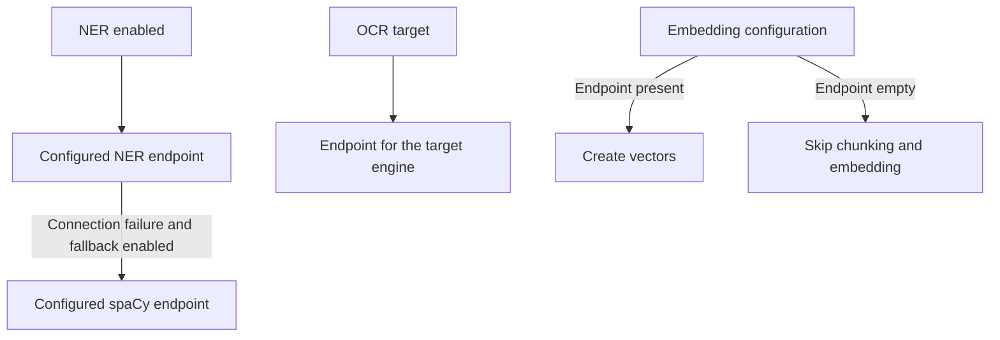

# AI services provide separate capabilities.

The optional GPU tier runs independently of the main services.
Pipeline callers and agents use its configured HTTP services.
The GPU tier does not call the main services.
[The service guide](../../ai_services/README.md) describes deployment and provider settings.

## Select providers by capability.

| Capability | Configuration and behavior |
|---|---|
| Named entities | GPU, spaCy, both providers, or disabled. GPU connection failure can use an enabled spaCy fallback. |
| Image OCR | Tesseract and EasyOCR have separate endpoints, language lists, and stored source identities. |
| PDF OCR | The PDF builder requests the selected engine and stores engine-specific source parts. |
| Embeddings | The configured GPU endpoint supplies vectors. An empty endpoint skips P5 chunking and embedding. No CPU embedding fallback exists. |
| Reranking | The configured reranker shares the embedding service base URL. No CPU reranker fallback exists. |
| Chat | The selected provider supplies chat models. A configured self-hosted model service is optional. |

Disabled model capabilities do not prevent full-text search over parsed and indexed text.
Disabling embeddings also removes the prerequisite for vector-based tool retrieval.
A configured but unavailable capability can fail its processing tasks.
An unavailable GPU tier does not automatically disable its configured tasks.

## Preserve OCR source identity.

[Deployment configuration](../../deploy.py) supplies one OCR endpoint per engine.
An EasyOCR request cannot fall back to Tesseract because their model, language, and source identities differ.
[Text source helpers](../../main_services/processing/tasks/text_sources.py) construct the stored identity.
The viewer uses the matching [source types](../../website/common/src/document_sources.rs).

## Apply fallback only to supported calls.

[The remote client](../../main_services/processing/tasks/remote.py) tries the ordered endpoints supplied by its caller.
A connection failure can select the next endpoint when fallback is enabled.
A read timeout or ordinary HTTP error does not select another provider.
HTTP 503 requests a later retry and does not open the circuit breaker.
Connect and read timeouts have separate settings.

[The NER client](../../main_services/processing/tasks/P4_extract_entities/extract_ner_from_text.py) supplies the configured GPU and spaCy endpoints.
The stored model identity records the provider that answered.
The CPU service must be enabled for this fallback to exist.
A disabled primary NER endpoint skips entity work before it contacts the fallback.

## Keep deployment access details in the private inventory.

Operators configure service access through the deployment configuration.
Keep deployment addresses and access details in `INFRASTRUCTURE_INVENTORY.md`, which is local and gitignored.

## Verify workload distribution before sizing services.

P5 reads text separately for each extractor variant.
Native text and OCR variants can therefore produce separate chunk and vector sets.
Measure workload, model, batch size, and concurrency before selecting service resources.
The architecture does not establish a universal throughput or hardware requirement.

Vectors remain durable in ClickHouse.
P6 copies them into disposable Manticore vector tables.
Rebuilding those tables reads stored vectors without repeating embedding.
