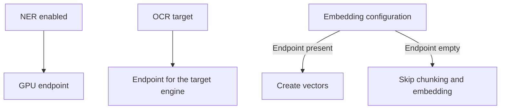

# AI services provide separate capabilities.

The optional GPU tier runs independently of the main services.
Pipeline callers and agents use its configured HTTP services.
The GPU tier does not call the main services.
[The service guide](../../ai_services/README.md) describes deployment and provider settings.

## Select providers by capability.

| Capability | Configuration and behavior |
|---|---|
| Named entities | GPU or disabled. NER has no CPU path. `[ai_services] ner_enabled` turns it off. |
| Image OCR | Tesseract and EasyOCR have separate endpoints, language lists, and stored source identities. |
| PDF OCR | The PDF builder requests the selected engine and stores engine-specific source parts. |
| Embeddings | The GPU endpoint supplies vectors from the model constant of the AI server. `[ai_services] embeddings_enabled` turns it off. An empty endpoint skips P5 chunking and embedding. No CPU embedding fallback exists. |
| Reranking | The reranker shares the embedding service base URL. No CPU reranker fallback exists. |
| Chat | The selected provider supplies chat models. A configured self-hosted model service is optional. |

Disabled model capabilities do not prevent full-text search over parsed and indexed text.
Disabling embeddings also removes the prerequisite for vector-based tool retrieval.
A configured but unavailable capability can fail its processing tasks.
An unavailable GPU tier does not automatically disable its configured tasks.

## Preserve OCR source identity.

[Deployment configuration](../../deploy.py) supplies one OCR endpoint per engine.
An EasyOCR request cannot fall back to Tesseract because their model, language, and source identities differ.
[Text source helpers](../../main_services/processing/tasks/text_sources.py) construct the stored identity.
The viewer uses the matching [source types](../../website/common/src/document_sources.rs).

## Send each call to one endpoint.

[The remote client](../../main_services/processing/tasks/remote.py) tries the ordered endpoints supplied by its caller.
Each caller supplies one endpoint, so no call selects a second provider.
A read timeout or ordinary HTTP error does not select another provider.
HTTP 503 requests a later retry and does not open the circuit breaker.
Connect and read timeouts have separate settings.

[The NER client](../../main_services/processing/tasks/P4_extract_entities/extract_ner_from_text.py) supplies the configured GPU endpoint.
An empty `NER_URL` skips entity work.
The AI server does not load the NER model on a host without CUDA.

## Keep deployment access details in the private inventory.

Operators configure service access through the deployment configuration.
Keep deployment addresses and access details in `INFRASTRUCTURE_INVENTORY.md`, which is local and gitignored.

## Verify workload distribution before sizing services.

P5 reads text separately for each extractor variant.
Native text and OCR variants can therefore produce separate chunk and vector sets.
Measure workload, model, batch size, and concurrency before selecting service resources.
The architecture does not establish a universal throughput or hardware requirement.

Vectors remain durable in ClickHouse.
P6 copies them into disposable Manticore vector tables.
Rebuilding those tables reads stored vectors without repeating embedding.
