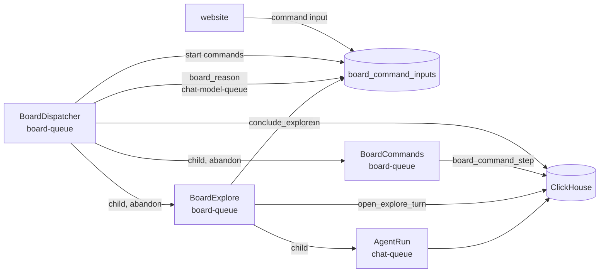
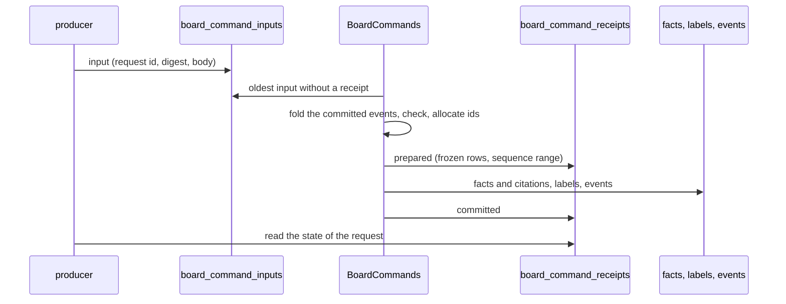
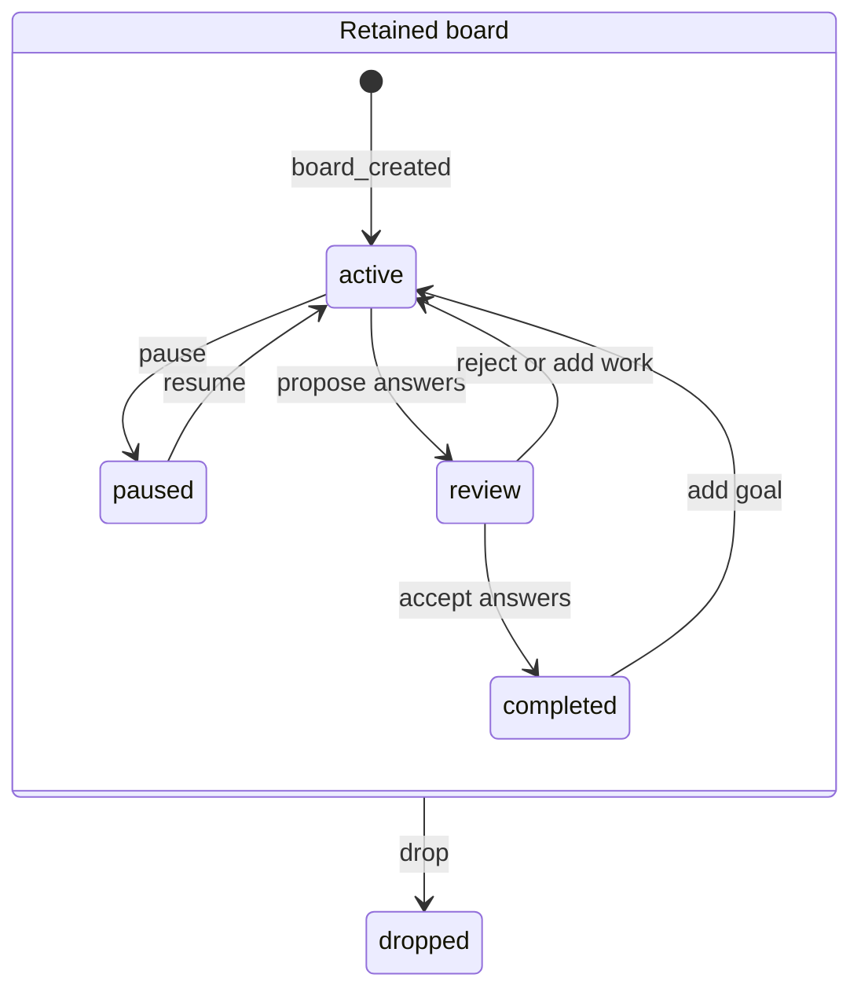
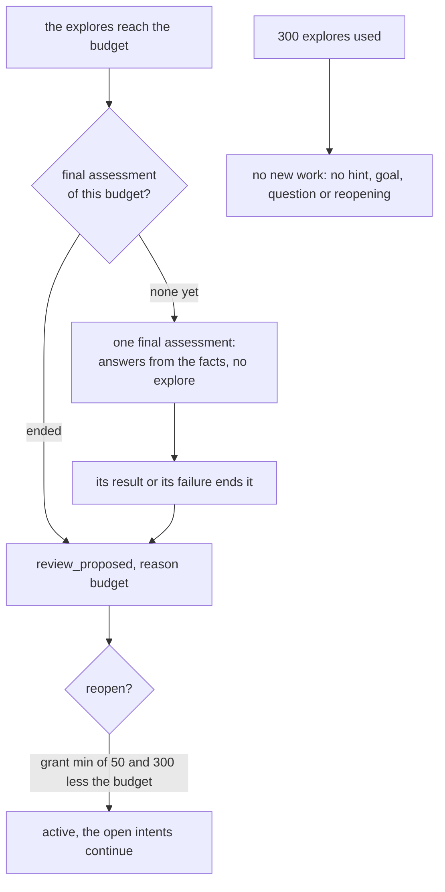

# Investigation boards

A board is a long-running investigation of one or more goals over one or more collections.
The worker splits the goals into intents. Each intent runs as one chat turn, which is an
explore, and the explore ends in one board fact with resolved citations. A person reads the
board under AI Chat, adds hints and goals, rejects facts, starts the explore of an open
question, and accepts or rejects the result.

The interface calls a board fact a **finding**. Stored slugs, tool names, and payload fields retain `fact`.

The page uses display terms for several stored concepts. The **assessment** is the
model call that reads the board and declares intents or proposes the goal answers: the code calls
it a reason (`board_reason`, the events `reason_started` and `reason_result`, the actor
`reason`). The **background context** is the fact of kind `origin`: the collections and the
context of the board. An **open question** is a question that an explore fact leaves for the
board, stored in the fact's `open_questions`.

A board uses the chat stack for its agent work. It adds one tool, `submit_board_fact`, which
only board turns have, and no agent or model route.

## Contents

- [Routes](#routes)
- [Storage](#storage)
- [Workflows](#workflows)
- [Commands](#commands)
- [Node identity](#node-identity)
- [The fold](#the-fold)
- [Budget](#budget)
- [Assessment](#assessment)
- [Explore](#explore)
- [Person actions](#person-actions)
- [The graph](#the-graph)
- [Limits and settings](#limits-and-settings)
- [Changing the board workflows](#changing-the-board-workflows)

## Routes

- `/ai_chat` shows the chat on the left and the board overview on the right: a card per board
  with its title, status, a thumbnail of its graph and the board summary (the first goal
  before the summary exists). The overview shows while the chat gate
  is open, because the explores are chat turns.
- `/ai_chat/boards/new` is the create form. "Create board" opens the new board after its
  command writer wrote its goals.
- `/ai_chat/boards/:board_id?selected=&zoom=&assessment=` is the explorer. `selected` is the
  slug of a node, and empty selects the board overview. The page resolves it by slug first and
  then by storage id, so a link with a storage id keeps working. A click on a node puts its
  slug in the address. `zoom` is the zoom of the graph in percent: 50, 75, 100 or 125. Empty or
  another value is 100. A zoom change replaces the address, and a node click keeps the zoom.
  `assessment` is the number of the assessment whose details popup is open, empty for none.
- A board explore chat links back to its board: "Investigation Board" in the row of the
  conversation search selects the chat's intent, and the answer card at the end of the chat
  selects its fact. Both open the board in the same tab. The card reads the fact of the
  intent from the board (`board_fact_for_intent`). While the board has not published the fact,
  the card selects the intent.

Every user can own boards. A board belongs to the user who created it, also for
administrators, and the server functions return "not found" for a board of another user.

## Storage

Migration `00043_investigation_boards.sql` adds six tables to the global database.
Migration `00044_board_settings.sql` adds the `internet_tools` column to `boards`.
Migration `00045_board_labels.sql` adds `board_labels`.
Migration `00046_board_assessments.sql` adds `board_assessments`.
Migration `00047_board_commands.sql` adds `board_command_inputs`, `board_command_receipts` and
the `request_id` column of `board_facts`.

| Table | Content | Writer |
|---|---|---|
| `boards` | The definition: owner, first goal, context, collections, internet tools. A drop sets `is_deleted`. A settings change writes a new version of the row. | the website |
| `board_command_inputs` | One row for each command: the request id, the digest of its body, the actor, the kind and the body. A row never changes. | the website for person actions, the board activities for worker commands |
| `board_command_receipts` | One row for each decided request: `prepared`, then `committed` or `rejected`, with the frozen rows of the command, the node ids that it allocated, its sequence range and its result. | `BoardCommands` only |
| `board_events` | Every action, with a JSON payload. This table is the record of the board. | `BoardCommands`, and `board_plan` for the derived `status_changed` rows |
| `board_state` | The status and counters that the last fold wrote. Its `summary_json` holds the answers, the budget grants, the review identity, the question bindings and the origin of each intent. | `board_plan` only |
| `board_intents` | The intents as the last fold derived them. | `board_plan` only |
| `board_facts` | The facts. A fact is written once and never changed. `request_id` names the command that wrote it, empty for a fact written before the commands. | `BoardCommands` |
| `board_fact_citations` | The documents of each fact, resolved from the explore's `cite_documents` rows. | `BoardCommands` |
| `board_labels` | The slug, title and summary of each intent, fact and correction, and one summary row of the board (empty `node_id`). | `BoardCommands` for a slug, `label_board` for a title and a summary |
| `board_assessments` | The whole prompt and the whole reply of each assessment, keyed by board and assessment number. An assessment that ran before the table existed has no row. | `board_reason` only |

The command tables have no age limit. A receipt keeps the identity of a request and the
node ids of its command after the Temporal history of the command is gone. A drop deletes
their rows with the other board rows.

The explore of an intent runs in the chat session `board-{board_id}-{intent_id}`. A board id
is hex, so the first hyphen after the board id ends it, and the hyphens of a slug intent id
stay in the intent id.

A board fact has one of six kinds.

| Kind | Meaning |
|---|---|
| `origin` | The background context: the collections and the context, written at creation. |
| `goal` | A goal, written at creation or later by a person. A board has at most 6 goals. |
| `sourced` | An explore finding with at least one citation whose quote the chat verified. |
| `inferred` | An explore finding without such a citation. A `sourced` claim without a verified quote is stored as `inferred`. |
| `not_found` | The explore searched and found nothing that answers the intent. |
| `correction` | The text of a person who rejected the review or an answer. |

## Workflows



`BoardDispatcher` has the fixed id `board-dispatcher`. The chat worker starts it at start-up
when it is not running. Every 5 seconds it runs `board_plan`. The pass submits a start
command for each assessment and explore that it decides, and names the boards with a command
that waits. The dispatcher starts the command writer of each such board, and starts an
assessment or an explore only after a later pass reports its start command committed. It
cancels the explores of paused and dropped boards. After 200 passes it waits for its
assessments in flight and continues as new, with the start commands that still wait as its
argument. The dispatcher waits for no person. A person action is a command input, and the
next pass reads it.

`BoardCommands` has the id `board-commands-{board_id}`, so a board has at most one command
writer. It runs `board_command_step` until the board has no command left, then completes.
Each step handles up to 20 commands. The writer makes no model call and takes no board model
slot.

`BoardExplore` runs one intent. It opens a chat turn, runs it as an `AgentRun` child, and
concludes it. When the turn ends without a `submit_board_fact` call, it sends one conclude
turn in the same session and concludes again. The end of the explore is an `explore_end`
command with the request id `explore_end:{intent}:{attempt}`, so a retry of the conclusion
returns the end that it submitted and never reads a later answer of the session.

### Labels

`board_plan` also names at most one board that needs labels: a node without a current label,
or a board summary whose source text changed (`labels.label_due`). A board with a command
that waits is not named. The dispatcher then starts `label_board` on `chat-model-queue`, one
at a time, outside the board model slots. One call of the summarisation model labels up to 8
nodes, from the full text of each node.

| Node | Slug | Title and summary |
|---|---|---|
| background context | `background`, fixed | none, the text shows |
| goal | `goal-01` to `goal-06`, fixed from the goal slot | none, the text shows |
| intent | `intent-<words>` | generated from the objective and the brief |
| fact | `fact-<words>` | generated from the kind and the text without `[Dn]` handles |
| correction | `correction-<words>` | generated from the text |
| the board | none | 10 to 15 words, from the origin, every goal, and the titles of the intents, the live facts and the corrections |

A node with a slug id has its id as its slug from its creation, and `label_board` adds its
title and summary. A legacy node gets its first slug through the `assign_labels` command of
its board, so the slug takes no name that another node of the board has. A slug does not
change after its first write. The model gives a title of 3 to 4 words and a summary of 15 to
20 words, and the code cuts a title at 5 words and a summary at 24 words. A changed source text
gives a new title and summary. A node that a reply leaves out counts a failed attempt. After 2
failed attempts the code writes a label from the first words of the node text, with `model =
'fallback'`. A board whose newest row records a failed attempt waits 60 seconds before its
next call. Each call writes an `llm_call_events` row of kind `board_label` or
`board_summary`. Until a node has a title, the website shows the first words of its text.

`board_plan` also reconciles. It reads the Temporal state of each running intent older than
60 seconds. When the `BoardExplore` closed without an end event, it submits an `explore_end`
command: concluded when the fact row of the intent exists, cancelled when the workflow never
started, and failed otherwise. So a worker restart does not leave an intent running for ever.

## Commands

Every change of the canonical state of a board is a command. The website writes the commands
of a person, and the board activities write the commands of the dispatcher, the assessments,
the explores and the labels.



- **One request, one command.** The same request id with the same body writes the same input
  row again. Two bodies under one request id are two inputs, and the writer accepts the first
  and refuses the other.
- **Checked against the committed state.** The writer folds the committed events before it
  prepares a command. A stale review decision, a used budget or a question that an intent
  already explores is refused with a reason that the page shows.
- **A prepared receipt comes first.** The writer applies a prepared receipt before it reads a
  new input. A retry after a failure writes the same rows with the same times and ids, so one
  request never allocates a second id.
- **Sequence.** Each event of a command carries `seq` and `request_id` in its payload. The
  fold reads the events written before the commands in their stored order, then the
  sequenced events by `seq`. The first receipt of a board records the last event before the
  commands.
- **Facts before their event.** The writer writes facts before the event that publishes them.
  A fact row with a request id counts only when an event carries the same request id, so no
  reader sees a fact whose publication stopped.
- **Pending starts.** A board with a command that waits gets no new decision in that pass.
  Its start commands that wait take board model slots and explores of its budget.
- **Producers.** A person request id has the prefix `web:`. A worker request id names its
  logical step, for example `reason_started:{n}`, `explore_started:{intent}:{attempt}` or
  `final_ended:final-{budget}`. A worker writes no input for a dropped board.

## Node identity

`server_settings` holds `board_node_identity_version`. An absent value reads as 1. The
deployment step `main.py activate-board-node-ids` sets 2 once the compatible services run,
and a second run changes nothing. The admin settings page does not show the key and refuses
it.

| Node | Version 1 | Version 2 | Creation key |
|---|---|---|---|
| background context | `origin` | `background` | the creation request |
| goal | `goal`, `goal-2` to `goal-6` | `goal-01` to `goal-06` | the goal request, with the first free slot |
| assessment intent | `i{reason}.{k}` | `intent-<words>` | the assessment and the position of the intent in the reply |
| question intent | `i0.{n}` | `intent-<words>` | the question request |
| explore fact | `f{reason}.{k}` | `fact-<words>` | the intent |
| correction | `c<hash>` | `correction-<words>` | the correction request |

A version 2 id is its final slug. The words come from the model's candidate (`slug` of an
intent in the assessment reply or of the `submit_board_fact` call), else from the node text,
else from a word of the node kind. The writer removes type words and stop words, keeps at
most 4 words and 40 characters, and adds `-2`, `-3` and so on when another node id, slug or
reserved name of the board has the id. Every existing node keeps its id, so a board can hold
both forms. A goal slot reads both forms, so the first legacy goal `goal` holds slot 1 and a
later goal is `goal-02`. The fold reads the explicit `intent_id` and `origin` of a new event,
and derives a legacy id only for a legacy event without them.

## The fold

[tasks/P_board/fold.py](../../main_services/processing/tasks/P_board/fold.py) derives the state of a board from its events and facts. It reads no
storage and no clock. The module docstring lists the rules. These rules have the most effect.



- A pause, a resume, a decision and a drop apply in event order. The worker proposes, and a
  person decides.
- An assessment can propose answers for some goals and declare intents for the others. A new
  proposal replaces the proposal of its goal and keeps the others. The board goes to review
  when every goal without an accepted answer has a proposal. A proposal has the identity
  `{reason_result event id}:{goal}`, and an answer decision names it, so a decision on a
  replaced answer does nothing. An accepted answer stays in every later state. The board is
  complete when every goal has an accepted answer. A rejected answer moves a board in review
  to active at once, and the other proposals wait for their decision.
- Entering review or completion sets the review identity to the id of the causal event. "Finish
  the board" (`review_accepted`) accepts every proposal and completes the board, and "Continue
  with a correction" (`review_rejected`) drops the proposals and continues. Both name the
  review identity, so a late request cannot decide a newer review. A stored legacy assessment
  of outcome `review` keeps its first effect: it replaces every proposal and moves an active
  board to review.
- A `goal_added` and a reopening move a board in review or complete back to active, and mark
  the checkpoint as having work. A paused board stays paused.
- A question that a person explores opens a new intent of origin `person_question` from its
  fact and changes no status. On a board in review or complete the planner starts only such
  intents, and no assessment follows. On an active board the new fact goes to the next
  assessment.
- `explore_started` uses one attempt and one explore of the budget. A cancellation returns
  both. An intent fails after 2 failed attempts.
- An assessment is due when the facts, hints, rejections or late goals changed since the last
  assessment with progress, or the open work ended. It runs only on an active board with no
  open intent, no assessment in flight and no final assessment in flight. Progress is a new
  intent, a proposal for a goal without one, or a changed fact list or kind of a proposal. 3
  assessments in a row without progress send the board to review. The fold counts each one
  by its cause: a valid reply without new work, a reply without a valid JSON object, or a
  failed model request (`model_failure`). The review reason is `stalled_no_direction`,
  `stalled_invalid` or `model_unavailable`, for the cause with the most assessments, and the
  review statement names each cause and its count. An older review has the reason `stalled`.
- Each status change is a derived `status_changed` row with the id
  `status_changed:{causal event id}:{ordinal}` and the time of its cause. `board_plan` writes
  the rows that the stored events lack, so a repeated pass writes nothing new and a pause and a
  resume between two passes both show.
- An explore that asked a question waits. The next hint opens its intent again.

## Budget

```text
max_explores = min(300, 30 + 25 * (goals - 1) + 4 * (hints + person questions + corrections) + 50 * reopenings)
```

The goals of the creation count from the start, and a later goal counts at its own event. A
correction is a rejected fact, a rejected answer or a rejected review. The budget of one board
never exceeds 300 explores. Each budget event keeps its actual grant in `summary_json.grants`:
the capped budget after the event less the capped budget before it, so a grant near the limit
is smaller than its step, and at the limit it is 0. The event line on the page shows the
grant.



When the explores of a board reach its budget and none runs, the dispatcher starts one final
assessment for that budget. It proposes answers from the facts and starts no explore. Its
result ends it, and a call that fails in every attempt ends it with a recorded failure, so no
second model call follows. When the budget is still used, the next pass proposes the budget
review. A hint or a goal that grows the budget during the call keeps the board active.

A board in review or complete with a goal without an accepted answer can reopen once for each
review identity. The reopening adds `min(50, 300 - budget)` explores. At a budget of 300 with
unused explores, the grant is 0 and the button says "Reopen with the remaining budget". A
reopening keeps the facts, the concluded intents and the accepted answers, and the open
intents continue. A board that used 300 explores starts no more work. Its page says so and
links to the create form, and the answer decisions stay available.

## Assessment

`board_reason` sends one model call on `chat-model-queue`, with the short-call model of
`hoover4.ini` (`LLM_MODEL`). The prompt holds the goals, the live facts without their citation
labels, the hints, the rejected facts, the intents, and at most 20 open questions of the live
explore facts that no intent explores, newest fact first, each with its key
`{fact id}#{1-based index}`. The activity writes the prompt and the whole reply to
`board_assessments` and submits the result as a `reason_result` command, while the board is
not dropped. The reply is one JSON object with `answers`, `intents`, both, or neither.
`contracts.parse_reason` checks it.

The prompt lists the fact ids in two lists: "Facts that can support an answer" (sourced and
not-found facts) and "Other facts" (inferred facts, the background context and corrections).
It also lists the checks that changed the last 3 replies, each with its assessment number.

The read timeout of the request is `board_reason_request_seconds` of `hoover4.ini` (600 s
when empty). An attempt that finds the `reason_result` command of its assessment sends no
request. A transport failure fails the attempt, and Temporal sends the request once more
after 1 s. When both attempts fail, `record_reason_failure` submits a `reason_result` with
the outcome `model_failure`. A refused request (4xx) gives `model_failure` at once. A final
assessment that fails in both attempts ends its operation through `record_final_failure`.

- An intent must name live facts in `from`. The prompt names the background context as the
  `from` of a direction that no fact leads to. An intent that repeats an earlier objective is
  dropped. At most 3 intents are kept, and each keeps its position in the reply, so a dropped
  intent changes no creation key. An intent can name open questions by key in `questions`.
  A key that the prompt did not list, or that an earlier intent of the reply or another live
  intent holds, is dropped with a note.
- An answer names its goal, the facts it rests on and a statement. An answer with a sourced
  fact is `supported`. An answer whose facts are all not-found facts is `not_established`:
  its statement is the fixed text "The cited records do not establish an answer to this
  goal.", and the model's text stays in the assessment details. An answer that names no
  sourced or not-found fact, an accepted goal or an unknown goal is dropped with a note. An
  answer that names one keeps it. Its other ids (an inferred fact, the background, a
  correction or an id that is no fact) are dropped with a note.
- The outcome is `review` when the answers cover every open goal and the reply has no intent,
  `partial` for other answers, `intents` for intents only, `noop` for neither, and `invalid`
  for a reply without a JSON object.
- A final assessment proposes answers only. Its intents are dropped with a note.

Every change that a check makes is in the `problems` list of the `reason_result` event. The
"Show details" button of an assessment row in the events table opens a popup with the date,
the model, the outcome, the latency, the tokens, these checks, the prompt and the response.
For an assessment that ran before `board_assessments` existed, the popup shows the first 6000
characters of the reply, which the event holds, and says that the prompt was not stored.

## Explore

`open_explore_turn` writes the rows that `send_message` writes for a person: the session with
the board's internet setting and its options locked, the user message, and the stream row.
The turn then runs as an ordinary `AgentRun` of kind `board`, with the model step limit of
the fold. Its model is the agent model of `hoover4.ini`, as for a chat turn. A board turn does
not write follow-up suggestions or a session title.

A board turn has the tool pack `board`, which no chat turn has. Its tool `submit_board_fact`
takes the fact with inline `[Dn]` handles, its kind, at most 3 open questions and an optional
slug candidate, and ends the turn. The workflow writes the fact as the answer of the turn, with the citation metadata of a
chat answer. The chat page shows the answer and, under it, what the turn gave to the board.
`conclude_explore` reads the call and resolves each handle: a `[Dn]` handle from the
`doc_refs` of the session's `cite_documents` results, and a `[Wn]` handle from the verified
citations of its `cite_pages` results. A web citation row has the page address as its path
and the first verified term as its quote, and it counts as a verified citation of a sourced
fact. It submits the fact with its session and answer
position as an `explore_end` command, and the writer gives the fact its id. A turn that asks
the person a question becomes an `explore_question` event.

Citation labels are local to one chat session. The worker removes them from a fact before the
fact enters another prompt, and the citation rows keep the document identity. The fact pane
reads the explore session and gives each stored citation the reason line, the search snippet
and the search route of the session citation with the same handle, dataset and file. The
quote, its verification and the document target stay the stored ones. A `[Wn]` citation shows
the session's web page card of the same handle and address. A click on a web page card opens the explore chat in a new tab with that page selected.

The chat history leaves board sessions out unless the person ticks "Show board chats", and
`send_message` refuses a board session. The explorer links to the session page, where a person
reads the full turn.

## Person actions

Each action is one command (`board_command`), and its button stays disabled until the command
writer decides it. A refused command shows its reason above the board.

| Action | Command and effect |
|---|---|
| Create | `create_board`. The website writes the definition, and the command writes the background fact, a goal fact per goal, `board_created` with the goal ids, and one `hint_added` for each first hint. Every readable collection is selected at first, and the internet tools are on. The collections cannot change later. The board id comes from the user and the request id, so a creation sent again names the same board. |
| Settings | `set_internet_tools`. The website writes a new version of the `boards` row, and the command writes `settings_changed`. Explores that run keep the setting they started with. |
| Add hint | `add_hint` writes `hint_added`. The next assessment reads it. It also opens intents that asked a question. |
| Add goal | `add_goal` writes the goal fact in the first free slot and `goal_added`, at any status but dropped, up to 6 goals. The next assessment reads the goal. A board in review or complete becomes active. |
| Explore this question | `explore_question` with the fact and the index of an open question. It opens an intent that binds the question key, and the board keeps its status. A question of a rejected fact, or one that an intent explores, is refused. |
| Ask a follow-up | `explore_question` with the fact and the person's own question, on an explore fact or the background context. It opens an intent of origin `person_question`, and the board keeps its status. The pane lists the person's questions with their intents. |
| Reject fact | `reject_fact` writes `fact_rejected` with the reason. Later prompts leave the fact out and list it as rejected. On a correction the box and the button say "Why the correction is wrong" and "Reject correction". |
| Pause and resume | `set_paused` writes `pause_requested` or `resume_requested`. A pause cancels running explores and does not use their attempts. |
| Accept answer | `answer_decision` with the proposal identity writes `goal_answer_accepted`. When every goal has an accepted answer, the board is complete. |
| Reject answer | `answer_decision` writes a correction fact and `goal_answer_rejected`, whose `from` names the facts of the answer. The board continues at once. |
| Finish the board | `review_decision` with the review identity writes `review_accepted`. Every proposed answer is accepted, and the board is complete. |
| Continue with a correction | `review_decision` writes a correction fact and `review_rejected`, whose `from` names the facts of the proposed answers. The board is active again. |
| Reopen | `extend_budget` with the review identity writes `budget_extended` with its prior status and its actual grant. See [Budget](#budget). |
| Drop | The website sets `is_deleted` on the `boards` row, cancels the command writer and the running explores, deletes the board's chat sessions as the chat history deletes a chat, and deletes the rows of the other nine board tables. |

A page loaded before the commands calls the earlier server functions. They refuse with a
reload message.

## The graph

The explorer and the overview thumbnail draw one graph ([components/board_graph.rs](../../website/frontend/src/components/board_graph.rs)). x is
depth: the background context is the first column, the goals are the last column, and every
other node is one column after the deepest node it comes from. Open questions have no node.
The fact pane lists them. The edges follow the encoding of Cairn, which
records a completion as an edge from the facts to the goal and a reopened goal as an edge from
those facts to the person's correction.

| Edge | From | To |
|---|---|---|
| Flow | a fact that an intent names, or an intent | the intent, or the fact of the intent |
| Answers | a fact of the accepted answer of a goal | that goal, in every status. Dashed for a proposed answer that waits for the person. |
| Corrects | a fact of a rejected answer or review | the correction of it |

The layout is computed in one pass before it shows, so no node moves on screen. In each column
a node asks for a y: its earlier y, else the mean y of its placed neighbours. The column sorts
by that y and moves its nodes apart to one row each, so nodes never overlap. A placed node
moves only when a new node needs its room.

A node is 300 by 150 pixels at 100 % zoom, and its fonts are the app's text roles: the title
in bold at the body size, the summary at the detail size in at most 4 lines, and a meta row
in gray monospace with the type of the node on the left and its statuses on the right
(`board_graph::corners`). No card shows its slug, and no status repeats the type.

| Node | Left | Right |
|---|---|---|
| background context | `background` | none |
| goal | its slug, `goal-01` | `answered` or `answer proposed` |
| fact | `fact` | `sourced`, `inferred` or `not found`, and `rejected` |
| correction | `correction` | `rejected` when rejected |
| intent | `intent` | its state |

The background context is white with a black border. The goals are blue with white text. The
background context and the goals show their text with no title. A rejected fact and a
cancelled intent are dimmed, with an opaque white card under them. The detail pane of a node
shows the same type and statuses under its title, and "Open the explore chat" at the right
of the title for an intent or fact with a chat. The graph does not scale to its pane. The pane scrolls, a press and a drag of more than 4 pixels
pans it up to the edges of the graph, and a control in its lower-right corner zooms out to
50 % and in to 125 %. After a zoom change the pane keeps the same graph point in its middle.
While a node is selected, "Show the board overview" is over the top-right corner of the pane.
When the selected node is not wholly in the pane, at the first load of the page or after a
link in a detail pane selects it, the pane scrolls it to its middle. A click on a node does
not scroll.

Every edge is one straight line from the middle of the right side of its source to the middle
of the left side of its target, and every edge is drawn under the nodes.

The board overview on the right shows the limit notice when the board used 300 explores, the
review panel while the board waits for review, the reopen panel of a complete board with an
open goal, the goals with their answers and the form to add a goal, the hint form, the events
as a table (date, actor, event, links, newest first, the newest 200 with a control that shows
all) and the statistics: explores, model steps, assessments, intents
and facts by state, collections, internet tools and the creation date. A person's name shows
in bold and a system actor in italic, and the actor `reason` shows as `assessment`. The text
that a person wrote in an event shows in italic after the fixed text. The links column shows
"Show details" for an assessment, "Open" (a new tab) for an event of an intent or a fact with
an explore chat, and else the slug of the node that the event names, as a link that selects
it. A goal shows its accepted answer, or its proposed answer with "Accept answer" and "Reject
answer", in the overview and in its detail pane. A `not_established` answer says that its
facts are searches that found nothing. A budget review shows the reopen button first, then
"Finish the board", then the correction. The fact pane lists each open question of the fact as
a card with the question in a larger font and, in its bottom-right corner, "Explore this
question", or "Explored in" and the slug of the intent that explores it. The intent that binds
the question key and did not fail comes first. The fact pane and the background pane also
show the follow-up form and the person's own questions.

The brief of an explore allows one tool call per 4 model steps of its budget: 15 calls at the
base budget and 30 at the cap.

## Limits and settings

| Limit | Value | Where |
|---|---|---|
| Board model work of all boards together | `server_settings` key `board_max_parallel_explores`, default 1 | `/admin/settings` |
| Explores of one board | See [Budget](#budget). At most 300. | [tasks/P_board/model.py](../../main_services/processing/tasks/P_board/model.py) |
| Model steps of one explore | 60, growing with corrections, late goals and hints to at most 120 | [tasks/P_board/model.py](../../main_services/processing/tasks/P_board/model.py) |
| Goals of one board | 1 to 6 | `common::board_types::MAX_GOALS` |
| Attempts of one intent | 2 | [tasks/P_board/model.py](../../main_services/processing/tasks/P_board/model.py) |
| Intents kept from one assessment | 3 | [tasks/P_board/model.py](../../main_services/processing/tasks/P_board/model.py) |
| Open questions in one assessment prompt | 20 | [tasks/P_board/prompts.py](../../main_services/processing/tasks/P_board/prompts.py) (`PROMPT_QUESTIONS`) |
| Output tokens of one assessment, reasoning included | 16,000 | [tasks/P_board/model.py](../../main_services/processing/tasks/P_board/model.py) (`REASON_MAX_TOKENS`) |
| Read timeout of one assessment request | 600 s | `hoover4.ini` key `board_reason_request_seconds` |
| Attempts of one assessment request | 2, 1 s apart | [tasks/P_board/workflows.py](../../main_services/processing/tasks/P_board/workflows.py) (`EXTERNAL_RETRY`) |
| Commands of one step of the command writer | 20 | [tasks/P_board/command_workflows.py](../../main_services/processing/tasks/P_board/command_workflows.py) |

Each running explore, each assessment in flight and each start command that waits uses one
slot of the global cap. A free slot goes first to the board with the least work in flight,
and then to the board that has received the fewest explores and assessments, so a new board
does not wait for every explore of an older board. The explore turns also use the chat
queues, so a board turn competes with the chats of people.

## Changing the board workflows

A change to [tasks/P_board/workflows.py](../../main_services/processing/tasks/P_board/workflows.py) that schedules a different command for an existing
history event needs the drain of
[`tasks/Readme.md`](../../main_services/processing/tasks/Readme.md). Terminate
`board-dispatcher`, cancel every `board-explore-*` workflow, deploy, and let the worker start
the dispatcher again. The next pass reconciles the cancelled intents, and they run again.

A new step that an old history decodes as empty needs no drain. `PlanOutput.labels` and the
command fields of `PlanOutput` are such steps: a `board_plan` result in an old history decodes
with no labels, no command boards and tasks without a request id, which start at once as
before, so a replay schedules no new command. The evidence for such a change is a `temporalio.worker.Replayer` run of the new
workflow code over the fetched `board-dispatcher` history, before the worker restarts.
