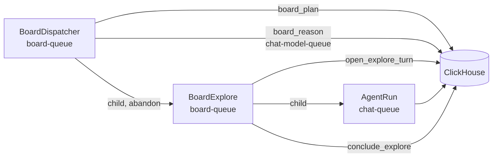

# Investigation boards

A board is a long-running investigation of one goal over one or more collections. The worker
splits the goal into intents. Each intent runs as one chat turn, which is an explore, and the
explore ends in one board fact with resolved citations. A person reads the board in the
administration section, adds hints, rejects facts, and accepts or rejects the result.

A board uses the chat stack for its agent work. It adds no agent, no tool and no model route.

## Contents

- [Routes](#routes)
- [Storage](#storage)
- [Workflows](#workflows)
- [The fold](#the-fold)
- [Reason](#reason)
- [Explore](#explore)
- [Person actions](#person-actions)
- [Limits and settings](#limits-and-settings)
- [Changing the board workflows](#changing-the-board-workflows)

## Routes

- `/admin/boards` lists the boards of the signed-in administrator and holds the create form.
- `/admin/boards/:board_id?selected=` is the explorer. `selected` is a fact id or an intent
  id, and empty selects the board overview.

Only administrators reach these pages. A board belongs to the administrator who created it,
and the server functions return "not found" for a board of another administrator.

## Storage

Migration `00043_investigation_boards.sql` adds six tables to the global database.

| Table | Content | Writer |
|---|---|---|
| `boards` | The definition: owner, goal, context, collections, model, budgets. A drop sets `is_deleted`. | the website |
| `board_events` | Every action, with a JSON payload. This table is the record of the board. | the website and the worker |
| `board_state` | The status and counters that the last fold wrote. | `board_plan` only |
| `board_intents` | The intents as the last fold derived them. | `board_plan` only |
| `board_facts` | The facts. A fact is written once and never changed. | the website and `conclude_explore` |
| `board_fact_citations` | The documents of each fact, resolved from the explore's `cite_documents` rows. | `conclude_explore` |

Ids are deterministic, so a retried activity writes the same row again. An intent is
`i{reason}.{k}` and its fact is `f{reason}.{k}`. An event id is `{type}:{subject}:{attempt}`
for worker events. The explore of an intent runs in the chat session
`board-{board_id}-{intent_id}`.

A board fact has one of six kinds.

| Kind | Meaning |
|---|---|
| `origin` | The collections and the context, written at creation. |
| `goal` | The goal, written at creation. |
| `sourced` | An explore finding with at least one citation whose quote the chat verified. |
| `inferred` | An explore finding without such a citation. A `sourced` claim without a verified quote is stored as `inferred`. |
| `not_found` | The explore searched and found nothing that answers the intent. |
| `correction` | The text of a person who rejected the review. |

## Workflows

`BoardDispatcher` has the fixed id `board-dispatcher`. The chat worker starts it at start-up
when it is not running. Every 5 seconds it runs `board_plan`, starts the reasons and explores
that the plan returns, and cancels the explores of paused and dropped boards. After 200
passes it waits for its reasons in flight and continues as new. The dispatcher waits for no
person. A person action is a row in ClickHouse, and the next pass reads it.

`BoardExplore` runs one intent. It opens a chat turn, runs it as an `AgentRun` child, and
concludes it. When the answer holds no valid JSON block, it sends one conclude turn in the
same session and concludes again.

`board_plan` also reconciles. It reads the Temporal state of each running intent older than
60 seconds. When the `BoardExplore` closed without an end event, it writes
`explore_concluded` if the fact exists, `explore_cancelled` if the workflow never started, and
`explore_failed` otherwise. So a worker restart does not leave an intent running for ever.

## The fold

`tasks/P_board/fold.py` derives the state of a board from its events and facts. It reads no
storage and no clock. The module docstring lists the rules. These rules have the most effect:

- A pause, a resume, a review decision and a drop apply in event order. Only
  `review_accepted` completes a board. The worker can propose review, and a person decides.
- `explore_started` uses one attempt and one explore of the budget. A cancellation returns
  both. An intent fails after 2 failed attempts.
- A reason is due when the facts, hints or rejections changed since the last valid reason.
  It runs only on an active board with no open intent and no reason in flight.
- The board goes to review in three cases. The budget is used, a reason proposes review from
  sourced facts, or 3 reason replies in a row are invalid.
- An explore that asked a question waits. The next hint opens its intent again.

## Reason

`board_reason` sends one model call on `chat-model-queue`, with the summarisation model
(`llm_summarization_model`). The prompt holds the goal, the live facts without their citation labels,
the hints, the rejected facts and the intents. The reply must be one JSON object with
`intents`, `review` or neither. `contracts.parse_reason` checks it.

- An intent must name live facts in `from`. An intent that repeats an earlier objective is
  dropped. At most 3 intents are kept.
- `review` must name sourced facts only. Otherwise the reply counts as empty.
- A reply without a JSON object is invalid.

Every change that a check makes is in the `problems` list of the `reason_result` event.

## Explore

`open_explore_turn` writes the rows that `send_message` writes for a person: the session with
internet tools off and its options locked, the user message, and the stream row. The turn then
runs as an ordinary `AgentRun`, with the board's step budget as its model step limit. Its
model is the board's model, else the model of the internal search chat profile
(`llm_model_internal_search`), which is the model of a person's chat without internet tools. A board
turn does not write follow-up suggestions or a session title.

The brief asks for the answer with inline `[Dn]` labels and a final fenced JSON block with
`fact`, `kind`, `citations` and `open_questions`. `conclude_explore` parses the block and
resolves each label from the `doc_refs` of the session's `cite_documents` results. An answer
that asks the person a question becomes an `explore_question` event.

Citation labels are local to one chat session. The worker removes them from a fact before the
fact enters another prompt, and the citation rows keep the document identity.

The chat history leaves board sessions out, and `send_message` refuses a board session. The
explorer links to the session page, where a person reads the full turn.

## Person actions

| Action | Effect |
|---|---|
| Create | Writes the definition, the `origin` and `goal` facts, `board_created`, and one `hint_added` for each first hint. |
| Add hint | Writes `hint_added`. The next reason reads it. It also opens intents that asked a question. |
| Reject fact | Writes `fact_rejected`. Later prompts leave the fact out and list it as rejected. |
| Pause and resume | Write `pause_requested` and `resume_requested`. A pause cancels running explores and does not use their attempts. |
| Accept review | Writes `review_accepted`. The board is complete. |
| Reject review | Writes a `correction` fact and `review_rejected`. The board is active again. When the explore budget is used, the next pass sends it back to review. |
| Drop | Writes `drop_requested`, sets `is_deleted` on the `boards` row, cancels the running explores, deletes the board's chat sessions as the chat history deletes a chat (a tombstone on the session row), and deletes the rows of the other five board tables. |

## Limits and settings

| Limit | Value | Where |
|---|---|---|
| Board model work of all boards together | `server_settings` key `board_max_parallel_explores`, default 1 | `/admin/settings` |
| Explores of one board | 1 to 100, chosen at creation | the create form |
| Model steps of one explore | 8 to 200, chosen at creation | the create form |
| Attempts of one intent | 2 | `tasks/P_board/model.py` |
| Intents kept from one reason | 3 | `tasks/P_board/model.py` |

Each running explore and each reason in flight uses one slot of the global cap. The explore
turns also use the chat queues, so a board turn competes with the chats of people.

## Changing the board workflows

A change to `tasks/P_board/workflows.py` needs the drain of
[`tasks/Readme.md`](../../main_services/processing/tasks/Readme.md). Terminate
`board-dispatcher`, cancel every `board-explore-*` workflow, deploy, and let the worker start
the dispatcher again. The next pass reconciles the cancelled intents, and they run again.
