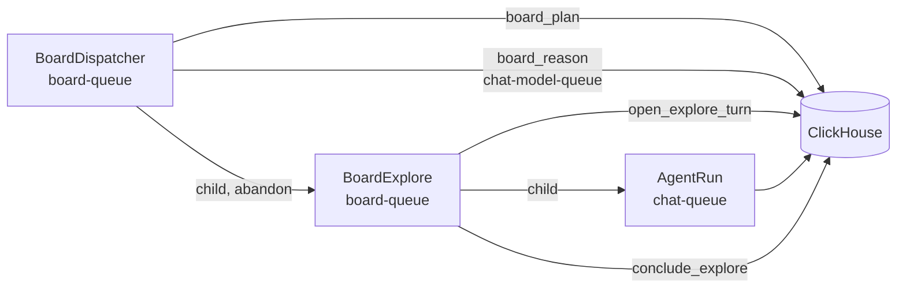

# Investigation boards

A board is a long-running investigation of one or more goals over one or more collections.
The worker splits the goals into intents. Each intent runs as one chat turn, which is an
explore, and the explore ends in one board fact with resolved citations. A person reads the
board under AI Chat, adds hints, rejects facts, and accepts or rejects the result.

A board uses the chat stack for its agent work. It adds one tool, `submit_board_fact`, which
only board turns have, and no agent or model route.

## Contents

- [Routes](#routes)
- [Storage](#storage)
- [Workflows](#workflows)
- [The fold](#the-fold)
- [Reason](#reason)
- [Explore](#explore)
- [Person actions](#person-actions)
- [The graph](#the-graph)
- [Limits and settings](#limits-and-settings)
- [Changing the board workflows](#changing-the-board-workflows)

## Routes

- `/ai_chat` shows the chat on the left and the board overview on the right: a card per board
  with its title, counts and a thumbnail of its graph. The overview shows while the chat gate
  is open, because the explores are chat turns.
- `/ai_chat/boards/new` is the create form. Send opens the new board.
- `/ai_chat/boards/:board_id?selected=` is the explorer. `selected` is a fact id or an intent
  id, and empty selects the board overview.

Every user can own boards. A board belongs to the user who created it, also for
administrators, and the server functions return "not found" for a board of another user.

## Storage

Migration `00043_investigation_boards.sql` adds six tables to the global database.
Migration `00044_board_settings.sql` adds the `internet_tools` column to `boards`.

| Table | Content | Writer |
|---|---|---|
| `boards` | The definition: owner, first goal, context, collections, internet tools. A drop sets `is_deleted`. A settings change writes a new version of the row. | the website |
| `board_events` | Every action, with a JSON payload. This table is the record of the board. | the website and the worker |
| `board_state` | The status and counters that the last fold wrote. | `board_plan` only |
| `board_intents` | The intents as the last fold derived them. | `board_plan` only |
| `board_facts` | The facts. A fact is written once and never changed. | the website and `conclude_explore` |
| `board_fact_citations` | The documents of each fact, resolved from the explore's `cite_documents` rows. | `conclude_explore` |

Ids are deterministic, so a retried activity writes the same row again. An intent is
`i{reason}.{k}` and its fact is `f{reason}.{k}`. An event id is `{type}:{subject}:{attempt}`
for worker events. The explore of an intent runs in the chat session
`board-{board_id}-{intent_id}`.

A board fact has one of six kinds.

| Kind | Meaning |
|---|---|
| `origin` | The collections and the context, written at creation. |
| `goal` | A goal, written at creation. The first goal is `goal`, the next ones `goal-2` to `goal-6`. |
| `sourced` | An explore finding with at least one citation whose quote the chat verified. |
| `inferred` | An explore finding without such a citation. A `sourced` claim without a verified quote is stored as `inferred`. |
| `not_found` | The explore searched and found nothing that answers the intent. |
| `correction` | The text of a person who rejected the review. |

## Workflows

`BoardDispatcher` has the fixed id `board-dispatcher`. The chat worker starts it at start-up
when it is not running. Every 5 seconds it runs `board_plan`, starts the reasons and explores
that the plan returns, and cancels the explores of paused and dropped boards. After 200
passes it waits for its reasons in flight and continues as new. The dispatcher waits for no
person. A person action is a row in ClickHouse, and the next pass reads it.

`BoardExplore` runs one intent. It opens a chat turn, runs it as an `AgentRun` child, and
concludes it. When the turn ends without a `submit_board_fact` call, it sends one conclude
turn in the same session and concludes again.

`board_plan` also reconciles. It reads the Temporal state of each running intent older than
60 seconds. When the `BoardExplore` closed without an end event, it writes
`explore_concluded` if the fact exists, `explore_cancelled` if the workflow never started, and
`explore_failed` otherwise. So a worker restart does not leave an intent running for ever.

## The fold

`tasks/P_board/fold.py` derives the state of a board from its events and facts. It reads no
storage and no clock. The module docstring lists the rules. These rules have the most effect:

- A pause, a resume, a review decision and a drop apply in event order. Only
  `review_accepted` completes a board. The worker can propose review, and a person decides.
- `explore_started` uses one attempt and one explore of the budget. A cancellation returns
  both. An intent fails after 2 failed attempts.
- A reason is due when the facts, hints or rejections changed since the last valid reason.
  It runs only on an active board with no open intent and no reason in flight.
- The board goes to review in three cases. The budget is used, a reason proposes review from
  sourced facts, or 3 reason replies in a row are invalid.
- The explore budget and the model steps of one explore start at 12 explores and 60 steps. A
  rejected fact or a rejected review adds 4 explores and 20 steps. A hint adds 1 explore and
  5 steps. The caps are 24 explores and 120 steps (`Folded.max_explores`,
  `Folded.explore_steps`).
- An explore that asked a question waits. The next hint opens its intent again.

## Reason

`board_reason` sends one model call on `chat-model-queue`, with the summarisation model
(`llm_summarization_model`). The prompt holds the goals, the live facts without their citation
labels, the hints, the rejected facts and the intents. The reply must be one JSON object with
`intents`, `review` or neither. `contracts.parse_reason` checks it.

- An intent must name live facts in `from`. An intent that repeats an earlier objective is
  dropped. At most 3 intents are kept.
- `review` has one entry per goal, with the facts that answer it and a statement. A goal's
  facts are sourced or not-found facts, and the review needs at least one sourced fact. A
  review that leaves out a goal counts as empty.
- A reply without a JSON object is invalid.

Every change that a check makes is in the `problems` list of the `reason_result` event.

## Explore

`open_explore_turn` writes the rows that `send_message` writes for a person: the session with
the board's internet setting and its options locked, the user message, and the stream row.
The turn then runs as an ordinary `AgentRun` of kind `board`, with the model step limit of
the fold. Its model is the model of the chat profile with the board's internet setting
(`llm_model_full_research` or `llm_model_internal_search`). A board turn does not write
follow-up suggestions or a session title.

A board turn has the tool pack `board`, which no chat turn has. Its tool `submit_board_fact`
takes the fact with inline `[Dn]` handles, its kind and at most 3 open questions, and ends the
turn. The workflow writes the fact as the answer of the turn, with the citation metadata of a
chat answer. The chat page shows the answer and, under it, what the turn gave to the board.
`conclude_explore` reads the call and resolves each handle from the `doc_refs` of the
session's `cite_documents` results. A turn that asks the person a question becomes an
`explore_question` event.

Citation labels are local to one chat session. The worker removes them from a fact before the
fact enters another prompt, and the citation rows keep the document identity.

The chat history leaves board sessions out unless the person ticks "Show board chats", and
`send_message` refuses a board session. The explorer links to the session page, where a person
reads the full turn.

## Person actions

| Action | Effect |
|---|---|
| Create | Writes the definition, the `origin` fact, a `goal` fact per goal, `board_created`, and one `hint_added` for each first hint. Every readable collection is selected at first, and the internet tools are on. The collections cannot change later. |
| Settings | Writes a new version of the `boards` row and `settings_changed`. Only the internet tools can change. Explores that run keep the setting they started with. |
| Add hint | Writes `hint_added`. The next reason reads it. It also opens intents that asked a question. |
| Reject fact | Writes `fact_rejected` with the reason. Later prompts leave the fact out and list it as rejected. The fact detail shows who rejected it, when and why. |
| Pause and resume | Write `pause_requested` and `resume_requested`. A pause cancels running explores and does not use their attempts. |
| Accept review | Writes `review_accepted`. The board is complete. |
| Reject review | Writes a `correction` fact and `review_rejected`, whose `from` names the facts of the rejected review. The board is active again. When the explore budget is used, the next pass sends it back to review. |
| Drop | Writes `drop_requested`, sets `is_deleted` on the `boards` row, cancels the running explores, deletes the board's chat sessions as the chat history deletes a chat (a tombstone on the session row), and deletes the rows of the other five board tables. |

## The graph

The explorer and the overview thumbnail draw one graph (`components/board_graph.rs`). x is
depth: the origin is the first column, the goals are the last column, and every other node is
one column after the deepest node it comes from. The edges follow the encoding of Cairn, which
records a completion as an edge from the facts to the goal and a reopened goal as an edge from
those facts to the person's correction.

| Edge | From | To |
|---|---|---|
| Flow | a fact that an intent names, or an intent | the intent, or the fact of the intent |
| Answers | a fact of the accepted review of a goal | that goal. Dashed while the review waits for the person. |
| Corrects | a fact of a rejected review | the correction of that review |

The layout settles before it shows. Each read that changes the board settles the new nodes in
one pass, and the nodes that were already placed keep their places. A node shows its id and
kind in the body font and its text in a small font.

## Limits and settings

| Limit | Value | Where |
|---|---|---|
| Board model work of all boards together | `server_settings` key `board_max_parallel_explores`, default 1 | `/admin/settings` |
| Explores of one board | 12, growing with corrections and hints to at most 24 | `tasks/P_board/model.py` |
| Model steps of one explore | 60, growing with corrections and hints to at most 120 | `tasks/P_board/model.py` |
| Goals of one board | 1 to 6 | `common::board_types::MAX_GOALS` |
| Attempts of one intent | 2 | `tasks/P_board/model.py` |
| Intents kept from one reason | 3 | `tasks/P_board/model.py` |

Each running explore and each reason in flight uses one slot of the global cap. The explore
turns also use the chat queues, so a board turn competes with the chats of people.

## Changing the board workflows

A change to `tasks/P_board/workflows.py` needs the drain of
[`tasks/Readme.md`](../../main_services/processing/tasks/Readme.md). Terminate
`board-dispatcher`, cancel every `board-explore-*` workflow, deploy, and let the worker start
the dispatcher again. The next pass reconciles the cancelled intents, and they run again.
