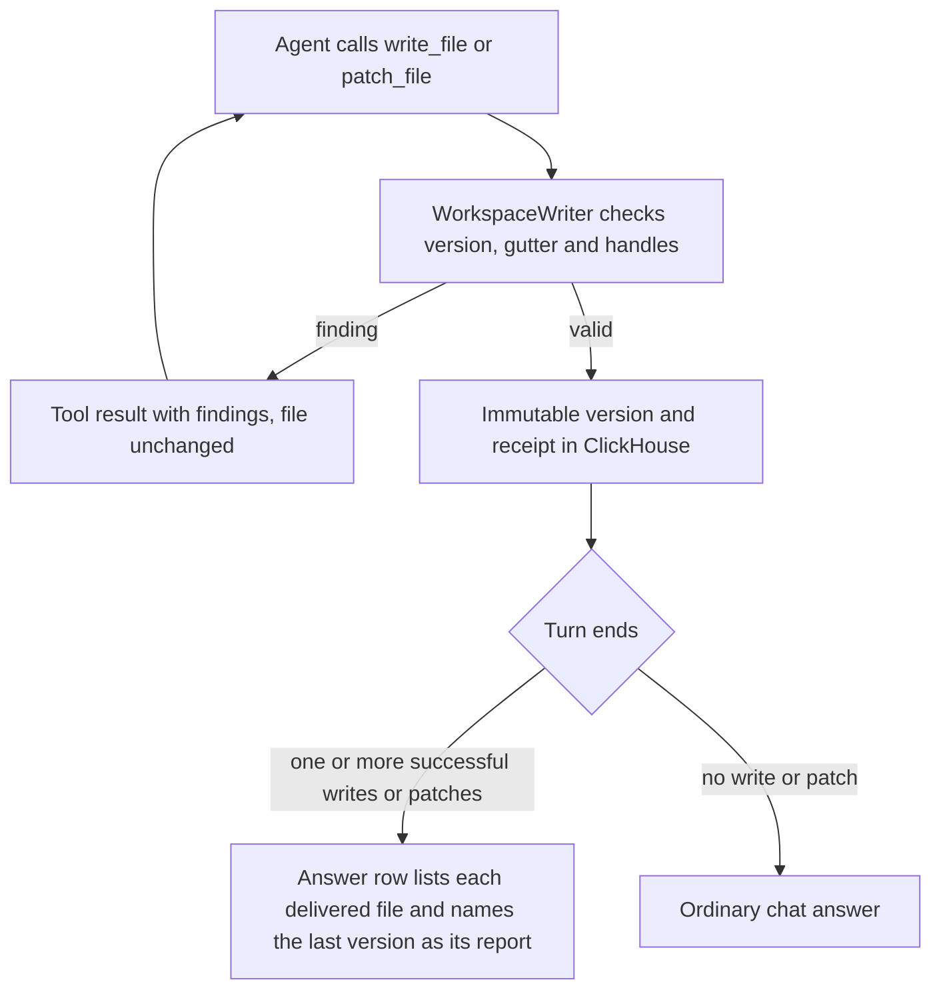
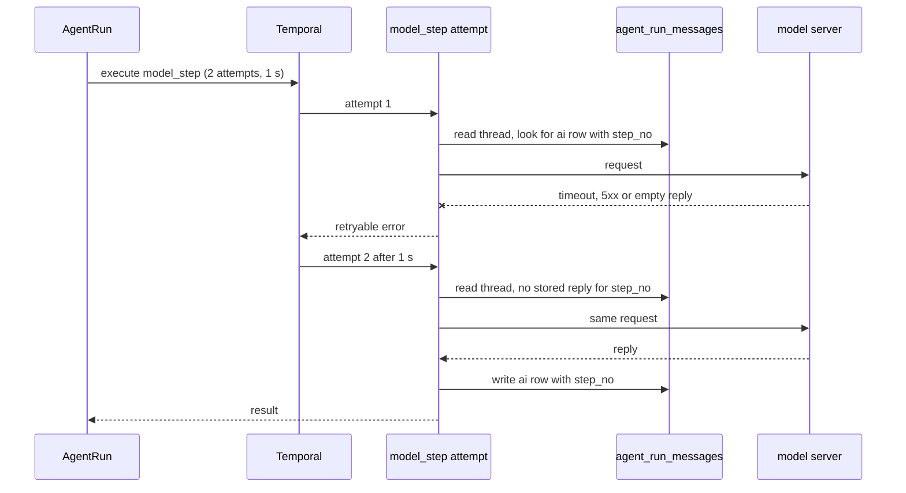
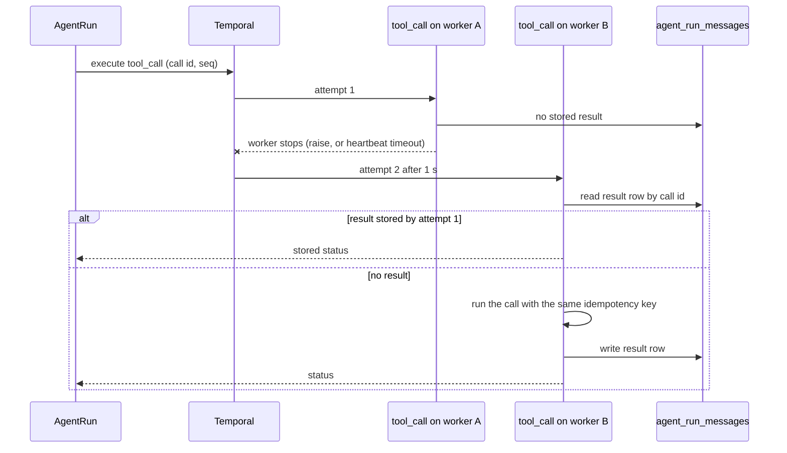
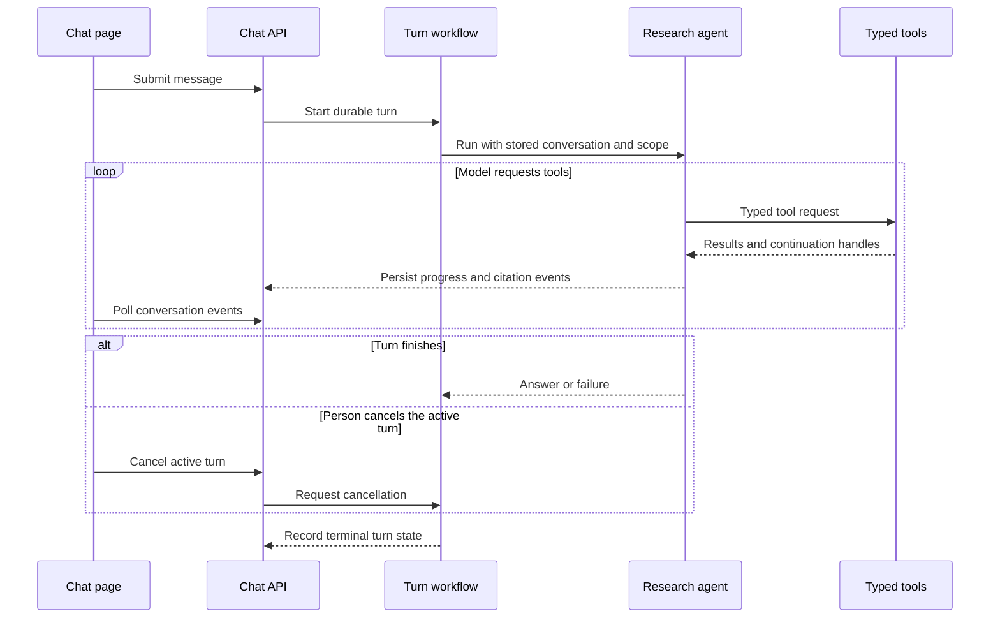

# Chat and agents

The chat turn end to end: what is fixed when a conversation starts, which agent answers,
how an answer streams back, how citations work, and what the admin views over it show.

The agents themselves and their tools are [main_services/agents/README.md](../../main_services/agents/README.md); the pipeline's
durable research path is [main_services/processing/tasks/P_agent/](../../main_services/processing/tasks/P_agent).

## Contents

- [Internet access stays fixed for a conversation.](#internet-access-stays-fixed-for-a-conversation)
- [Reaching the agents](#reaching-the-agents)
- [Citations, and why they are not the search cards](#citations)
- [Reports and workspace files](#reports-and-workspace-files)
- [Chat checks](#chat-checks)
- [Streaming a turn](#streaming-a-turn)
- [Timeouts and retries](#timeouts-and-retries)
- [Naming a conversation](#naming-a-conversation)
- [Admin: live chats](#admin-live-chats)
- [Admin: the inline SVG charts](#admin-the-inline-svg-charts)
- [Language-model access](#language-model-access)
- [Allocating a message sequence](#allocating-a-message-sequence)
- [Tool-event payload shapes](#tool-rows)
- [Images in tool results](#images-in-tool-results)

Routes (see [website/frontend/src/routes.rs](../../website/frontend/src/routes.rs)):

- `/ai_chat`, homepage ("What are you researching?") with recent-session cards and composer
- `/ai_chat/history`, full conversation list
- `/ai_chat/c/:session_id/:selected_result_hash/:doc_viewer_state`, transcript + document preview (60/40)

Storage lives in the global ClickHouse database: `chat_sessions` (migration `00011`) and
`chat_messages` (`00012`), plus `chat_message_stream` (`00018`) for in-flight output and
`chat_workspace_files` and `chat_workspace_receipts` (`00048`) for workspace files. The
tool payload columns (`tool_input` / `tool_output` / `doc_refs` / `created_ms` /
`agent_duration_ms`), `retry_errors`, the per-message `model`, the session `summary` and
the frozen option flags are all declared in those two `CREATE TABLE`s. The migration set
is collapsed, so do not look for them in `ALTER` files of their own.

`retry_errors` is written by nothing today: retries are Temporal's and it does not report
a per-attempt error to the row's writer. The column and the disclosure that renders it are
kept because a future writer would want exactly that shape, and an empty column renders
nothing.

## Internet access stays fixed for a conversation.

The first message stores `use_internet_tools` and locks the session options.
The composer then shows the stored option above the transcript.
The internet option defaults to on.

## Reaching the agents

The worker selects the agent from the stored internet option.
It sends turns with internet tools to the full research agent.
It sends other turns to the internal search agent.
The agent service names remain unchanged.

The same switch also picks the **model**. Each agent profile has a `server_settings` key
of its own (`llm_model_internal_search`, `llm_model_full_research`,
`llm_summarization_model`) resolved by `admin::llm::model_for_profile`. **Unset means
"use `llm_default_chat_model`"**, and an empty string is the same as unset, so a deployment
that never touches these keys runs one model everywhere. They exist because the profiles make
different demands: one binds four tools and reads a handful of
passages, the other binds thirty and reads the open web, and the summariser writes a chat
title. Without it the only way to make one faster is to change the model for everything.

A model the user picked in the composer still wins over the profile's: the key configures
the deployment, not the conversation.

The selfhosted provider can have a quality endpoint beside its base endpoint
(`[llm_provider.selfhosted] quality_base_url` and `quality_model`). A request that names the
quality model goes to the quality endpoint, and every other model goes to the base endpoint.
The worker ([tasks/llm_endpoints.py](../../main_services/processing/tasks/llm_endpoints.py)) and the agent services ([research_agent/endpoints.py](../../main_services/agents/research_agent/research_agent/endpoints.py))
apply this rule to every model call. A deployment selects the quality model as
`llm_default_chat_model`, so agent turns run on it, and the base model as
`llm_summarization_model`, so titles and board reasons stay on the base endpoint. Follow-up
suggestions use the answer's model, so they run on the quality endpoint too. The default chat model is the one that matters for a person's chat, because
the composer selects it and sends it with every message, and a sent model wins over the
profile keys. The chat policy checks ask the decision endpoint, `CHAT_CLASSIFIER_URL`.
The worker uses `llm_default_chat_model` for a request without a model. If that setting is
empty, it uses the configured `LLM_MODEL` value, as the website does. It gives an error
when both values are empty. The agent service also requires a selected or configured
model, and it does not insert a model id of its own.

**`llm_models.supports_tools` is `0` for every row**, and nothing populates it, so nothing
checks that a model chosen here can call tools at all. Choosing one that cannot produces a
turn that answers without ever searching, which reads as a bad answer rather than as a
misconfiguration.

## Citations

`cite_documents` identifies the documents that support the answer.
Search cards show the search results inside tool groups.
Citation cards appear at their references in the answer.
Tables show each source card after its cited row.
Document cards contain the matching source excerpt.
The search-term line links to the originating query with the cited document selected.
The line is absent when stored traces cannot identify that query.

Each citation carries a handle (`[D1]`, `[D2]`) allocated per chat **session** by the
collection-search MCP server, so a handle from the first turn still resolves in the ninth.
The server stores each new handle as an artifact before it returns it, so a restart of the
server keeps the numbering. A quote that is not in
the text stays unverified, and the result gives an exact passage of the text near it.
The quote check compares words only, so punctuation and mail reply markers do not affect it,
and a quote with small gaps verifies as the source span that holds its words.

Cited claims go into a workspace report (see [Reports and workspace files](#reports-and-workspace-files)).
The workspace tools check each handle of a report before they store it. No harness round
asks the model to repeat an answer. Each answer stores its citation status and tool scope in
its usage metadata. The status of a report answer describes the report version. The status
of a chat answer without a report is `invalid` when a handle does not resolve or names two
documents, and the check uses the citation results of the current and earlier turns. Earlier
turns can hold citation repair notes and replaced answers, and the transcript still shows
them.

`read_page` stores successful Markdown under the owner and chat session.
`cite_pages` verifies exact supporting terms against that captured text.
Its `[Wn]` handles identify source versions and survive browser service replacement.
A capture records the requested URL and the final URL after redirects as its aliases.
A citation of either URL resolves to the same capture, version and PDF window, and gets its handle.
An alias that names captures of different versions needs the version, so no other source is cited.
Unread pages and absent terms return individual errors.
Case differences return literal source terms for an explicit retry.
The failed call allocates no handle and keeps exact matching unchanged.
Web cards show linked titles, domains, and source quotes.
They open the captured Markdown in a side pane with exact find and match navigation.
The preview and find state survive URL reload.
The existing artifact access check protects captured text.
Bounded web read and citation results remain complete in the stored transcript.

The worker stores the typed evidence of each tool result beside it: the reads with their
spans, failed items, citations, notes, and artifacts.
Table row windows and cell text count as document reads. Table metadata and search results
count as discovery. A page find with no match does not count as a content read. The read
record keeps its source version and unread continuation when the page gives them.
`markdown_text.rs` renders bare document and web handles as controls that scroll to their cards.
Repeated references resolve beside their claim within the answer.
A Markdown link remains a link.
A bracket after a backslash, such as `\[D9]`, and a bracket in a code span are text.
Superseded answers of earlier turns remain inside collapsed tool groups.

**A quote that does not verify is shown, marked, never dropped.** A model that stops citing
is a worse outcome than a citation the reader can see is unverified.

De-duplication of document cards is **within a group and never across one**. A search card
and a citation card for the same document are two different statements about it, and
collapsing them would hide that the agent chose one of the things it found.

## Reports and workspace files

The agent writes each requested report, list, table or draft, and each answer with citations,
as a text file in the workspace of the conversation. The `report` skill of the research agent
holds the rule, and the system prompt of every run holds its routing text, so compaction
cannot remove it. An ordinary question that needs no citation and no document gets a chat
answer.

The session tool server serves three file tools, with the names of the Hermes agent file
tools. `read_file` reads a file with a `N|` line gutter, or lists the files. `write_file`
creates or replaces a whole file, and an existing file needs `expected_version`, the version
that the agent read. `patch_file` replaces one region through the matcher of the Hermes agent file tools, which reports the
strategy that matched, refuses an ambiguous match, and shows the closest lines when nothing
matches. A patch whose new text is already present succeeds and stores nothing.
The same server serves `update_plan`, which sets the plan of the conversation: the goal and
the whole step list with the status of each step. It writes no file.

Every write and patch of a session goes through one workflow, `WorkspaceWriter`, with the id
`workspace-<session id>` on `chat-queue`. ClickHouse has no compare-and-write, so the one
writer is what makes two writes with the same expected version fail. The tool server sends
the command with signal-with-start and reads the receipt of its operation id. The operation
id is the idempotency key of the tool call (`X-Hoover4-Idempotency-Key`), so a retried call
returns the stored result and changes the file once. The writer checks each handle of the
candidate against the successful citation results of the session. A handle that no result
gives, that names two sources, or whose quote did not verify gives a finding, and the file
does not change. The check does not show that a claim follows from its source.

When the turn ends, the last successful write or patch of its run, in call order, is the
report of the turn. The answer row stores its name and version (`report` in `usage_json`).
It also lists each file that the run wrote or changed, in the order of the first delivery,
with the last version of each file (`reports` in `usage_json`). A retried call with the same
call id counts once. The transcript shows the report version as the answer with its citation
cards. The chat text of the answer shows muted under it. When the turn delivered two or more
files, a Files line under the answer has one button for each file version. A row without
`reports` shows its `report` only. A later edit of a file does not change an earlier answer.
A turn that stops before its answer, fails or is cancelled stores the same list on its row,
and the transcript shows the list there. A turn that asks the person a question shows the
question, and its files stay in the workspace.

A write whose text holds handles only inside code formatting, such as `` `[W1]` ``, links no
citation. The file is stored, and the result gets a note that names the handle and tells the
agent to write it without backticks. The Workspace
button of the conversation opens a read-only pane with the file list and the content of one
version. The pane state is in the URL. Deleting the conversation writes a tombstone for each
version and cancels the writer, and the writer refuses a command for a deleted session.

[database/chat_workspace.py](../../main_services/processing/database/chat_workspace.py) holds the storage and the read format.
[tasks/P_workspace/](../../main_services/processing/tasks/P_workspace) holds the write and patch rules, the handle check, the writer and the report selection.

## Chat checks

The worker runs chat checks at two events of a turn: the turn start and each completed tool
batch. The `control_event` activity runs them. `AgentRun` keeps the
order of model steps, tool calls and checks.

A definition lists the rules of a profile. Each rule names a handler, an event, a frequency
and its parameters. Handlers are trusted Python modules. The folder
[tasks/P_agent/control/handlers/](../../main_services/processing/tasks/P_agent/control/handlers) holds the built-in handlers. The `chat_control_dir` key of
`[main_services]` can add a read-only folder with more handlers and definitions. When a turn
starts, the worker stores a copy of its assets on the opening row of the run. The copy holds
the definition, the digest of each handler file, the rendered system prompt and the skill
texts. The turn uses that copy until it ends, so a later change affects new turns only.

These definitions are built in.

| Definition | Rules |
|---|---|
| `chat-default` | Active in the repository for every profile. It loads skills at the turn start and after a result, ranks web reads, and writes progress, discovery and capture notes. |
| `chat-quality` | For a model that searches, reads and cites without guidance notes. It loads skills and ranks web reads. It has no progress, discovery or capture rule. |
| `chat-null` | No rule. |
| `chat-deterministic` | No classifier request. Skills load from the report trigger and from result facts. Progress notes count operations only. |
| `chat-advisory` | The classifier selects skills at the turn start. The progress signals give advice notes that name the chat check as their origin. They change no progress count and end no turn (`stuck_units` false). |
| `chat-repaired` | The `chat-default` rules with the corrected progress, completion and preparation behavior. A fired `stuck` signal adds a progress unit (`stuck_units` true), and the progress record names the cause of an ending in `stop_cause`. |

The last three definitions are versioned comparison policies. Each has its own revision. A
deployment selects a definition with
[definitions/active.json](../../main_services/processing/tasks/P_agent/control/definitions/active.json) in the `chat_control_dir` folder.

A definition can set `model_images`. `attach` is the default and sends each named image to
the model. `on_demand` sends an image only for a document read. A page read keeps its
screenshots as capture references for the person, and the result tells the model that they
exist. The setting is part of the revision only when it is not the default, so the revision
of an older definition does not change.

The opening row of a run stores the structured task of the turn (`task` in `usage_json`)
when the user row has one. A board explore turn has one: the objective, the context, the
known facts, the scope and the expected output. The checks read the task through
`facts.task_text`, which puts the objective first and marks a cut text with the number of
omitted characters. Each decision records the digest of the task that it read.

For each event the worker stores one decision before it writes any row of it. A retry reads
the stored decision and writes the same rows at the same keys. An action is a note, a skill
load or a tool call. Skill loads and tool calls run as a policy batch before the next model
step. The batch uses the normal tool path and the permissions of the run. The transcript
labels each row of a policy batch.

The checks ask the structured server of the selfhosted model (`CHAT_CLASSIFIER_URL`).
No other route receives chat content. A failed or absent route makes the answers unknown,
and the turn continues as it would without the check. Scores are recorded at full
precision. They are not calibrated probabilities.
Cancellation preserves completed request samples without applying policy actions.

The `chat-default` definition has these rules:

- At the turn start, the preparation check classes the request sources and scores the
  listed skills. It loads at most three skills in 15 seconds. It uses bounded context from
  the last two ended turns to resolve references in a follow-up request. A task whose
  record requests a file loads the `report` skill without a classifier request: a
  deliverable that names a file, an output action such as "write a report", a file
  destination such as "in a short report", or a named output path such as
  "save it as notes.md". An input file name, a prohibited write, a report title and a
  question about the files of a folder load nothing, and the first workspace write loads
  the skill for another form. The classifier request, the name check and the requirement list run
  as independent children. Each child records `ok`, `timeout`, `error`, `cancelled`,
  `skipped` or `disabled`, and a child whose classifier result failed records its status,
  so a slow or failed child does not discard the result of another. The requirement list
  is off unless a definition enables it.
- The opening row of a chat turn records the task record of the turn in its control
  record (`control["task_state"]`, `task_state.py`), derived once when the turn is pinned.
  It holds the active objective, the amendments of later turns, and each source rule with
  its turn and status. It also holds the requested output groups with their names and
  exact counts. A continuation such as "Continue." keeps the objective and its
  unfinished outputs. A permission supersedes the restrictions that it conflicts with, and
  a later rule replaces an earlier rule of its subject. An explicit request to use a source,
  such as "Search the web for ..." or a web address, supersedes an earlier rule that forbids
  that source, for its own task. A mention of a forbidden source without such a request
  keeps the rule and leaves the record unresolved. A cancellation removes the output
  that it identifies. An explicit new objective keeps the session rules and drops the
  earlier outputs. It names a new task, or asks its own question or research request after
  an optional courtesy word, and refers to no earlier work. A later message that the rules
  do not recognize, such as "Make the second one shorter.", becomes an amendment. The
  objective and its outputs stay, the record is unresolved, and it gives no completion
  evidence. The text task of an unresolved record shows that message first as its
  objective, and the earlier objective after it. Its report skill loads only for an output
  clause of that message. A singular count
  for each item of a set, such as "a report for each company", is no exact count. The text task (`control["task"]`) is derived from the record: the objective,
  the amendments, the active restrictions and the active permissions, without the
  sentences of superseded rules. The preparation and progress checks and the web read
  ranking read this task, objective first. A cut of the task text keeps the newest
  amendment whole and cuts the earlier fields first. The record reads earlier turns back to the
  newest stored record, at most 12 turns, and names an incomplete reconstruction. A board
  explore keeps its structured task as its record. An opening row without the record is
  read as a legacy task, which supports no completion evidence.
- A chat turn gets one source note: search the permitted collections first, and the web
  after them when the turn has web tools. No effort question or call quota applies.
- After a tool batch, a result that needs the table, email or citation method loads that
  skill. A successful web search of the model, and a page read that failed or holds a cut
  page, a find result or a page without text, load `web_research`. A browser call of the
  model loads `browser_use`. A skill text that is still visible to the model is not loaded
  again, and a skill that the turn does not list is not loaded.
- After a web search batch of the model, the worker reads the unread result addresses in
  search-rank order. It uses one `read_page` call of at most six addresses.
- A short page capture with no article text gets a note that names the page.
- A reply that reads one page while two or more search results stay unread gets one note.

An absent-name note requires the person's choice before the agent searches a suggested spelling.
Without web tools, preparation records whether the request asks for public sources, including past events.
The callable tools of the turn establish the capability. A public-source request gets a note that this turn has no web tools.
The note names no deployment setting and asks for no refusal, and the source choice and the document guidance stay.
The chat system prompt requires the name choice before candidate searches and the capability explanation before the answer.

## Streaming a turn

**Every turn is a Temporal workflow, and the website holds nothing open.** `send_message`
takes the session's **turn lock**, writes the user row, reserves the answer's `seq` as an
empty stream row, dispatches `AgentRun` to `chat-queue` and returns the transcript
*including* the submitted message. The start sends the ids of the turn and no text, and it
rejects a duplicate workflow id. Temporal answers a duplicate with HTTP 409, which the
website counts as started. The model call runs on `chat-model-queue`.
Each tool call runs on `agent-tool-queue`.
The worker stores the model thread and transcript rows in ClickHouse.
The page reads persisted rows through `chat_poll`.
When a turn ends, the page refreshes all its rows once.
This receives earlier tool results and citation metadata that incremental polling can miss.
The agent run sweep closes running rows whose workflows have ended.

The transcript reads the narration of each turn through `chat_turn_narration`.
It returns each `ai` row of the turn's threads with its text, its reasoning and the transcript seqs of its calls.
The text of a step with calls shows in gray above the card of its first call. A closed group shows its newest step text above its line.
The answer row holds the text of the final reply only. The plan prose of the round goes to the reasoning of the answer row, so it shows as narration beside the tool activity.
The page reads a finished turn once. It reads the running turn again at each new answer seq or changed tool row, so a reload recovers every finished step.
The reasoning view removes each narration text at its own position in the joined reasoning, and keeps a sentence of the reasoning that repeats it.

## Timeouts and retries

A turn is bounded twice, and the two bounds do different jobs.

**The activity** gets `start_to_close` 900 s and a 60-second heartbeat, much shorter than a
research run's 2 400 s and 10 minutes. A chat turn somebody is watching that has produced
nothing for a quarter of an hour is wedged, and failing it hands the answer slot back to
them.

**The heartbeat timeout and the stall window above are one pair.** The heartbeat timeout is
how long a dead worker goes unnoticed; the stall window is how long the page waits before
telling the user so. The page must never give up first: the interrupted marker's advice is
to ask again, and Temporal reschedules the activity on its own, so a page that gave up
early would earn the user the same answer twice from two workflows. 180 s against 60 s
leaves the reschedule 120 s to be noticed, picked up and write its first row. Both numbers
carry that reasoning where they are declared.

**The agent connection** is bounded by *silence*, not by duration: the worker's read
timeout is the longest gap between two bytes, and there is a separate absolute ceiling for
an agent that loops forever while still emitting events.

**A total-request timeout is the wrong bound for a streamed run**, and getting this wrong
is expensive to diagnose. A healthy internet-tools turn is a dozen provider calls at
50–120 s each; cutting it at a total makes the client report a body error whose message is
indistinguishable from a corrupt stream, while the agent, which never learns the reader
left, keeps working for another quarter of an hour and writes a full set of `ok = 1` rows
into `llm_call_events`. Log the error's whole cause chain and its timeout flag, never the
message alone.

### Retry classes

Temporal retries an activity. No code adds a message to the conversation to recover from a
failure of the infrastructure or of the model's output format. An activity raises a
transport failure. It returns a result only for an outcome that a second attempt cannot
change, such as a refused request. A turn that ends in an error writes an `error`
row into the transcript and logs at ERROR with the session and the turn uuid.

| Class | Activities | Attempts |
|---|---|---|
| External request | `model_step`, `tool_call`, `write_followups`, `summarize_if_first_turn`, `label_board`, `board_reason`, `convert_explore_report` | 2, the second after 1 s. A browser tool that can change the page gets 1. |
| Storage write | `open_run`, `control_event`, `write_asked_answer`, `write_incomplete`, `write_ending`, `record_step_failure`, `prepare_workspace_mutation`, `commit_workspace_mutation`, and the board storage activities | 5 (`ACTIVITY_MAX_ATTEMPTS`). Each write has a fixed key, so a repeat is harmless. |

No activity sends a second request to the same target. The collection server's backend
client, the browser router and the model client each send a request once. Two cases send a
different request, so they are not retries. The metasearch server tries another route when
a route fails. The agent service compacts again after the provider refuses a request as too
large. The compaction summary returns no summary on a failed request, so
the step continues when the request fits, and fails as `context_preparation` otherwise.
The chat checks ask their classifier inside the hook deadline, and a failed request gives
the answer `unknown`.

**A transport failure of a tool reaches Temporal.** The collection server marks a
connection error, a client timeout, and a 503 or 504 of a dependency as `retryable`. A 504
whose body is the route's own `timed_out` answer is a deliberate query deadline and is a
result. The browser router marks a failed read tool as `retryable`. The agent service
returns `retryable` with the error class `transport_failure`, also for a connection error
to the MCP server. The worker raises before it stores a result, and after the last attempt
`record_step_failure` stores `tool_unavailable`. An invalid argument, a refused access and a
missing document are results, and they get one request. A search with more than one query
form keeps the forms that succeeded, and it is retryable only when every form failed in
transport.

**An empty reply is not stored.** A reply with no text and no call fails its attempt of
`model_step` (`EmptyModelReply`). Its tokens stay in the attempt's `agent_step_events` row.
The second attempt sends the same request. When both attempts reply that way, the run ends
with the result of `write_incomplete` and the `end_reason` `empty_response`.

### Restart recovery

A worker restart during a step gives the same rows and the same answer as a run without the
restart. Each attempt reads its input from the stored thread and finds the result of an
earlier attempt before it sends a request. A model step finds its stored reply by `step_no`.
A tool call finds its stored result by call id, and it sends the same idempotency key in
every attempt. `./deploy` drains a worker for 90 s before it stops it, and Temporal sends a
step that a stopped worker left to a live worker.

## Naming a conversation

The first turn writes a provisional title from the user's own words, and the workflow then
asks the LLM for a better one. **It cannot fail the turn**: the answer is already written
and read by the time it runs. A transport failure gets the second attempt of the external
request class, and the workflow catches the last failure. Every other failure returns no
title. The provisional title is the fallback and doing nothing is the correct failure.

Naming a conversation is not a reasoning problem, and a reasoning model given one spends
its whole token budget on the thought and returns nothing usable. The request therefore
carries a hint asking the model to leave its thinking mode off. Sent as a hint and dropped
on a refusal, because a provider that has never heard of it rejects the whole request and a summariser
that fails on every call is exactly what the telemetry row exists to make visible. Every
outcome, including a discarded answer, writes a row into `llm_call_events` with `ok = 0`:
a model that hits its token limit every time must not look like one that never ran.

## Admin: live chats

`/admin/metrics` lists the agent runs running right now (user, conversation, the internet option, elapsed time) with a **Kill** button. It is a **Temporal visibility query** on
`WorkflowType = 'AgentRun'`, so it is true in both directions across a
website restart: it does not lose the runs that were already running, and it does not keep
listing one whose process died. Each open workflow is one entry. `AgentRun` reads session and turn identifiers from its stored row.

Kill is the same cancellation the user's own stop button sends, so an admin-stopped turn
ends the way a user-stopped one does: with an ending in the transcript rather than a
workflow that vanishes.

## Admin: the inline SVG charts

The events-per-hour bars on `/admin/metrics` and the ETA lines on a collection's
processing page are hand-written SVG, and two traps come with that.

**A `<title>` inside `<svg>` has to be built in the SVG namespace, and `dioxus-html` has
no such element.** It declares `title` in the HTML namespace only (the SVG twin collides
on the Rust identifier and is commented out in that crate), so `title { … }` written
inside a chart is created with `createElement` and lands in the document as an
`HTMLTitleElement`. Inside `<svg>` that is a foreign element: not rendered, not a tooltip,
and no warning on any build. `components::svg_title` declares the missing element by
shadowing the `dioxus_elements` module rsx resolves against, and the charts use
`svgtitle { … }`. The tooltip is the only place a bar's exact bucket timestamp and count
are readable, because the axis deliberately drops the date.

**Keys among SVG siblings are positions, never labels.** Two axis ticks can legitimately
carry the same text (three ticks all read `0s` on a finished pipeline, and the 24 h window
spans 25 hourly buckets so its two ends print the same `HH:MM`), and duplicate keys among
keyed siblings are a `debug_assert` in dioxus-core that kills the renderer on the next
re-diff, then puts *App panicked!* on the next page the operator opens. A release build
does not assert; it re-associates the wrong nodes instead. Both charts key by tick index.

The tick VALUES are chosen so they cannot collide in the first place: the count axis rounds
its top up to an even number, so the half-height rule is labelled with the value it is
actually drawn at rather than a rounded one, and a remaining-time axis whose whole range is
zero draws one baseline tick instead of three that all read `0s`.

## Language-model access

Nothing is provisioned anonymously. Every user is authenticated, no page is reachable
without an identity, and chat access follows from that identity like every other
capability.

A user driving a local accelerator hard is a **resource** question rather than a
permission one, and the chat rate limiter (`backend::api::rate_limit::check_and_record`) is
the control for it: its budget decays the longer a burst lasts, which is what distinguishes
a person working from a loop running.

A new turn is also refused when chat cannot work. `api::chat::gate` closes when no
provider is configured, when a non-self-hosted provider has an empty API key, or when
`chat_enabled` in `server_settings` is false. The composer overlay names which of those
three holds. An in-flight turn is left to finish. The frontend control is a hint. The
backend refuses `chat_send_message` and `chat_start_research` under the same three
conditions.

## Allocating a message sequence

A message's `seq` is `max(seq)+1` with no database-side sequence behind it, so two senders in
one session can pick the same number. Three mechanisms stand behind it, and all three are
required:

* **the session's `db_chat::turn_lock`**, which serialises allocation within this process.
  It is an in-process lock and it is released when the request handler returns. Long
  before the worker writes the answer;
* **`next_seq` counts `chat_message_stream` too**, not only `chat_messages`. Every turn
  allocates its answer seq up front and reserves it as a *stream* row; the transcript row
  appears when the workflow finishes. The lock cannot cover that gap (it went with the
  handler), so a `next_seq` reading only `chat_messages` handed the reserved seq to the
  next send and ReplacingMergeTree silently kept one of the two messages. Both entry
  points also refuse outright while `stream_state(...).active`, which is the same question
  the poller asks;
* **`next_seq` starts a fresh session at 1, not 0.** ClickHouse's `max()` over an empty
  `UInt32` column is 0 rather than NULL, so "no rows yet" and "one row at seq 0" produce
  the same number. Whether a session is on its first turn is read from the transcript,
  never inferred from the seq;
* **`message_uuid`** (migration `00012`), shared by every row of a turn and **read** rather
  than merely written: `db_chat::detect_seq_collision` looks for a second uuid at the reserved seq
  and refuses the turn if it finds one, so the user resends instead of losing a message. It
  reads without `FINAL` on purpose: `FINAL` collapses away the evidence. **A write-only
  collision detector is worse than none, because it reads as covered.**

## Tool rows

A tool row of the transcript is written twice. `model_step` writes a live row into
`chat_message_stream` for each call of a reply, at the seq it gave the call, with the name
and the arguments as `{"name": "…", "input": {…}}`. `tool_call` writes the finished row into
`chat_messages` at the same seq, with `tool_name`, `tool_input`, `tool_output` and the
document references, and marks the live row final. The name is in the stored call entry,
so a card is labelled while its call still runs.

A row of a policy batch has `origin` `policy` in its `usage_json`. A call that repeats an
identical search or read call of the same reply waits for that call and shows its result.
Its row has `shared_from` with the id of the first call. The transcript shows one label
line above each such row (`ChatMessageItem::call_origin_label`).

`search_collections` hits carry `collection_dataset` + `file_hash` (the
`DocumentIdentifier` key used by the document-preview stack).

Note there is **no tool name on a start event**. It appears only at `output.name` on the
end event, which is why the events have to be paired before a call can be labelled at all.

This format is parsed in two places in the worker, and they must agree:
[P_agent/stream_writer.py](../../main_services/processing/tasks/P_agent/stream_writer.py) while the turn streams, and [P_agent/trajectory.py](../../main_services/processing/tasks/P_agent/trajectory.py) when it is
written into the transcript. A parser that writes the raw event as the message body,
hardcodes the tool name and populates none of the payload columns produces a transcript
that renders as a wall of JSON in a card whose expand panel opens onto nothing. If you
change the shape, change both.

### Search progress and classifier traffic

The turn pins capabilities from callable tools and permitted collections. Rules skip when their required tools are unavailable.
Preparation classifies sources and names. It verifies absent names with indexed counts and suggests a clarification through `ask_user`.
Name lookups use the collections of earlier tool calls, or the collections explicitly named in the request before those calls.
Without either scope, they use all permitted collections. A string collection argument remains one collection name.
Code also retains names after "folder called", "folder named", "collection called" and "collection named" when the classifier omits them.
A progress decision records distinct keyword sources, empty results, repeated calls, refusals, todo churn and word counts.
Document-text, PDF and table-cell searches include their resolved document identity when the query has matches. Continuation pages retain that identity.
A policy batch, such as a skill load or an automatic page read, changes no count.
Progress is a new keyword source, a successful read, a useful metadata listing, a verified citation or a new file version.
Three batches without progress raise the note level. A batch with progress sets the level to 0.
Six model steps without progress at the third level end the turn through `write_incomplete` with the search summary and the delivered files.
No fixed search count or call budget applies.
Classifier signals require measured score thresholds. A failed request supplies no signal.
The `answered` signal is computed again for each batch. It adds advice only with delivery evidence of the task record.
A task that requests files needs every output group with its names and its exact count of new versions.
A task that requests no file needs a stored file version or a verified citation of a successful read.
A level note lists only the search steps of the relevant methods (`progress.methods`).
The source rules, the operations of the turn and the source choice decide them, and the callable tools alone decide nothing.
A signal never ends a turn.
Each classifier request writes metadata to `systemone_call_events` and traffic to `ai_service_telemetry`.
The admin report reads these rows only when an administrator selects Run report.

## Images in tool results

The agent model reads images in tool results when the catalog marks it
`supports_vision`. A tool result names its images in the embedded resource
`hoover4://image-refs`, beside `hoover4://doc-refs`. A reference holds the source and no
bytes: `collection` and `file_hash` of a document, or `artifact_id` of a page capture.

The references move through these layers.

1. `read_documents` names the image of each image or video document, at most 4 in one
   call. `read_page` names the screenshot of each page that it loads. A read of a kept
   text names its screenshot only when the call sets `screenshot` true.
2. `/tool_call` of the agent service returns them as `image_refs`.
3. `tool_call` of the worker stores them in the usage of the tool message, and in the
   `usage_json` of the transcript row.
4. `stream_writer.run_message` sends them with the message in each step request.
5. `images.parts_for` reads each image from `images/document` or `images/capture`, with
   the identity of the run, and appends a label line and an `image_url` part after the
   text of the tool message.

With `model_images` `on_demand`, step 2 moves the screenshots of a page read to
`capture_refs`. The worker stores them apart from `image_refs`, so no step request, token
estimate or summary reads them. The result gives the exact `read_page` arguments that
return each kept screenshot. The tool card shows the images of both lists to the person,
also after a reload, and names only the images of `image_refs` as received by the model. An
image that one message names twice is sent once. A later reference to an image that could
not be read is read again.

The content of the message stays text, so a restart builds the same image input from the
stored references. The website checks collection access or capture ownership on each read,
also for an image that the agent service has in its cache.
[research_agent/images.py](../../main_services/agents/research_agent/research_agent/images.py) describes the size limits, the cost estimate
and the model without images. [compaction.py](../../main_services/agents/research_agent/research_agent/compaction.py) describes the images of a summary.

## A turn persists tool work and citations.

The durable workflow records progress while the browser polls the conversation.

[Turn workflows](../../main_services/processing/tasks/P_agent/), [chat API](../../website/backend/src/api/chat/), and [research agents](../../main_services/agents/README.md) own these steps.
Tool results can expose continuation handles. The agent can request further pages within the tool limits.
