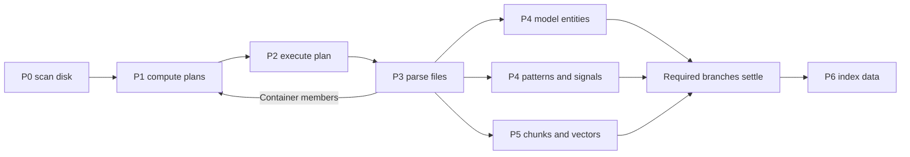
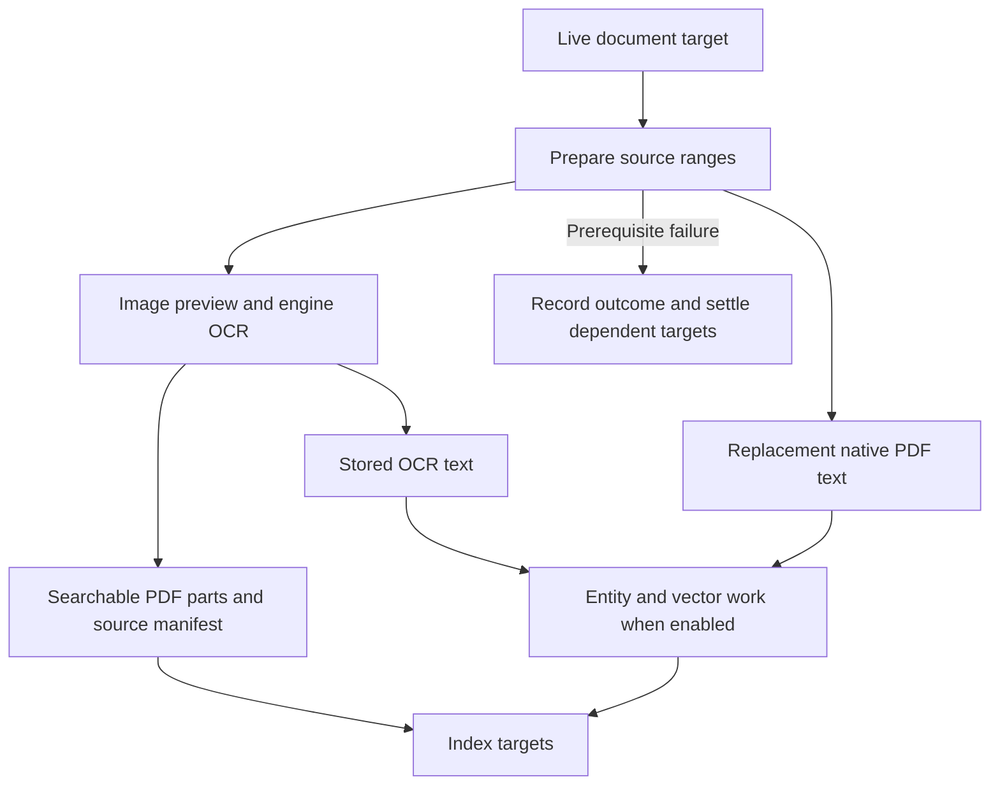

# Pipeline stages

Ingestion is a chain of Temporal workflows named `P0` through `P6`. Each stage reads what the
one before it wrote and writes to tables the others do not touch, which is what lets three of
them run at once.

The code is [main_services/processing/tasks/](../../main_services/processing/tasks), one directory per stage, each with a
[Readme.md](Readme.md) of its own. Where those go into detail, this page states the shape.

## Contents

- [The chain](#the-chain)
- [Preserve stored stage numbers.](#preserve-stored-stage-numbers)
- [Entity extraction and embedding run concurrently.](#entity-extraction-and-embedding-run-concurrently)
- [Text pages: the writer contract](#text-pages-the-writer-contract)
- [The extractor key is a label and a storage key at once](#the-extractor-key-is-a-label-and-a-storage-key-at-once)
- [Dates come from the document, never from ingestion](#dates-come-from-the-document-never-from-ingestion)
- [Stage timing, and the admin view over it](#stage-timing-and-the-admin-view-over-it)
- [Re-running a stage](#re-running-a-stage)

## The chain

| stage | reads | writes | directory |
|---|---|---|---|
| **P0 scan disk** | a dataset's directory tree | the file and directory tables, the blob table, and the object store | [tasks/P0_scan_disk/](../../main_services/processing/tasks/P0_scan_disk) |
| **P1 compute plans** | newly recorded blobs | processing plans, the batch boundaries every later stage works in | [tasks/P1_compute_plans/](../../main_services/processing/tasks/P1_compute_plans) |
| **P2 execute plan** | a plan | downloads its blobs and drives every stage below for them; resolves the canonical file type for the plan's hashes | [tasks/P2_execute_plan/](../../main_services/processing/tasks/P2_execute_plan) |
| **P3 parse files** | the downloaded bytes | text pages, per-format metadata, email headers, table cells, archive members | [tasks/P3_parse_files/](../../main_services/processing/tasks/P3_parse_files) |
| **P4 extract entities** | the text pages | model entity hits, pattern entity hits, and the marker that a document was scanned | [tasks/P4_extract_entities/](../../main_services/processing/tasks/P4_extract_entities) |
| **P5 chunk and embed** | the text pages | text chunks and their vectors, the durable vector store | [tasks/P5_chunk_embed/](../../main_services/processing/tasks/P5_chunk_embed) |
| **P6 index data** | everything above | the search engine's per-shard page tables, the entities table, the tree table, and a copy of the vectors into the disposable nearest-neighbour tables | [tasks/P6_index_data/](../../main_services/processing/tasks/P6_index_data) |

Two directories in the same place are **not** stages: [tasks/P_admin/](../../main_services/processing/tasks/P_admin) holds administrative
workflows that run on demand or as a self-scheduling singleton, and [tasks/P_agent/](../../main_services/processing/tasks/P_agent) holds
the durable research turn.

## Preserve stored stage numbers.

Indexing is `P6`, not `P5`. The embedding stage owns the number that runs before it, and
there is no `P4b` or `P4.5`. **The stage numbers are a stored contract.** `STAGE_INDEX` and
its siblings are values written into `processing_eta_samples` *and* constants in
[website/common/src/processing_types.rs](../../website/common/src/processing_types.rs). Renumbering a stage on one side leaves the admin
processing page silently short a bar, with no error anywhere.

## Entity extraction and embedding run concurrently.

`ExecuteSinglePlan` runs entity extraction, pattern scanning and chunk-and-embed as three
branches of one barrier. They can share a barrier because they read the same rows and write
to **disjoint** tables (model entities and their watermark, pattern hits and their scan
marker, chunks and vectors), and because only indexing needs all three. They also run on
different worker queues and against different services, so running them in sequence left a
tier idle for the others' whole duration.

All three must finish before indexing starts: the index reads the entity rows and copies the
vectors into the shard's nearest-neighbour table.

A barrier over a batch costs its slowest member, which is the thing to remember before
widening a batch. See [tuning](../operations/Troubleshooting.md) and the tuning skill.

## Text pages: the writer contract

`text_content` holds one row per page of text, per extractor variant, per file. Two rules
govern every writer, and breaking either is silent.

**`page_id` is never 0.** It is a real 1-based page number for paged formats and a 1-based
segment ordinal (roughly 256 KB apiece), for everything else. A scan therefore loses at
most one entity to a segment boundary, which is the accepted cost of segmenting at all.

**The writer is called once per `(file, extractor)` with the complete page list.**
`parse_common.insert_text_pages` trims rows above the highest page it writes, so a second
call for the same variant deletes the first call's pages. Every writer goes through it; none
of them may call it twice for one variant.

The table uses a replacing engine, so older versions can remain until a merge.
[The chunk reader](../../main_services/processing/tasks/P5_chunk_embed/activities.py) groups by dataset, hash, extractor, and page.
It selects `argMax(text, version)` for each group before chunking.

## The extractor key is a label and a storage key at once

`extracted_by` names which extractor produced a page. OCR variants carry an engine and
language prefix; native extractors carry none. The same string is a storage key, part of a
download route, and the label a user sees in the source selector.

**The convention is implemented twice on purpose** (once in [main_services/processing/tasks/text_sources.py](../../main_services/processing/tasks/text_sources.py) and once
in [website/common/src/document_sources.rs](../../website/common/src/document_sources.rs)), and neither runtime may depend on the other
being right. Call the shared formatter; never assemble or parse the string in a component.

One filename row per document is written into the search index with a sentinel page id and a
synthetic extractor key. It is **not a page**: every query over a page table must exclude it,
and a test greps for readers that forget.

## OCR targets, skips and the "Run OCR" ledger

Run OCR uses preparation, image preview, image OCR, image PDF, PDF variant, and index targets.
Preparation includes Office conversion, source ranges, page selection, and original native PDF text.
A PDF variant completes after every searchable part and its OCR text reach durable storage.
Successful empty text has an explicit completion marker.
A failed prerequisite settles dependent work with the same document outcome.
Newly available targets run within the same operation.

Index targets verify exact text-version receipts for `pdftotext`, `ocr_`, and `pdfocr_` sources.
P4, P5, and P6 run for replacement native text even when OCR languages are empty.
Historical raster results provide their stored text without another OCR request.
Current errors settle targets, and the error-retry action repeats failed work.
Run OCR records its targets in `ocr_run_targets` and fails while a target remains open.
A repeated completed run sends no OCR request.

PDF member cleanup follows unfinished plan execution and precedes new target selection.
It removes index entries only when no live path reaches the hash.
A duplicate hash with another live path remains searchable.
Current target selection, error selection, language changes, and index execution require live paths.

## Dates come from the document, never from ingestion

There is no upload date and no index date anywhere in the schema, by decision. Every date the
system shows or filters on came out of the document's own metadata, an email header that
actually parsed, or an archive that recorded its member's timestamp.

Deliberately *not* dates: the modification time of the worker's temporary file, which would
date the whole corpus today, and the modification time of a top-level file on disk, which is
when the corpus was copied. Both are recorded with a source marker and neither is indexed.

A document has a **set** of dates, not one, each kept with the key it came from, which is
what lets the viewer explain why a date filter did or did not match. How that set is
searched is [Search architecture](Search_Architecture.md).

## Stage timing, and the admin view over it

A rolling sampler writes per-stage progress into `processing_eta_samples` in the global
database, and per-activity durations, with one row for each file of a P3 stage activity,
land in `processing_task_runs`. Those two are what
answer "where is the time going" before any tuning decision, reading the workflow service's
own history instead gives you days of retention and nothing aggregable.

## Re-running a stage

A plan is marked finished when its stages have **run**, not when every document in it
succeeded. An ingest or plan-execution operation selects historical Error pairs after planning
and before plan execution. It deletes Errors for disabled stages and keeps Errors without a
plan. It clears the selected hashes' model and regex scan watermarks, then reopens their plans.

Reconciliation removes a selected historical Error only when this operation records a
matching successful task run and document outcome. A current Error event replaces an older
Error for the pair. The operation record keeps separate counts for selection, recovery,
current failures, disabled stages, missing plans and unsupported task names.

[main_services/processing/Readme.md](../../main_services/processing/Readme.md) lists those entry points with their flags.

Removing an OCR source also removes its regex hits, red flag evidence, scored passages, and scan markers.
The purge keeps other sources and other datasets.

## The processing branches join before indexing.

P2 runs the child stages. Recursive parsing creates additional plans for extracted members.

[P2 workflows](../../main_services/processing/tasks/P2_execute_plan/workflows.py) own execution and the barrier.
Disabled stages return without producing their capability data.
Document errors remain recorded when a plan finishes, and cancellation propagates through its workflows.

## OCR targets record prerequisites and outcomes.

[The OCR operation](../../main_services/processing/tasks/P_admin/ocr_rerun.py) selects targets from live document paths.
It keeps successful work and settles dependent targets when a prerequisite fails.
The operation finishes only after its target ledger has no open work.

