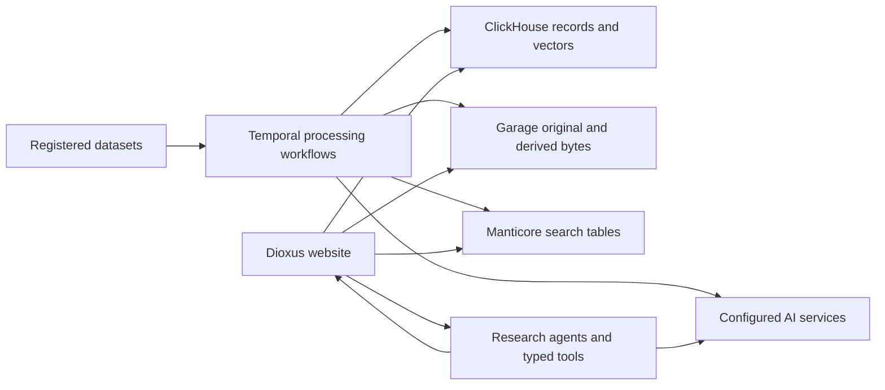

# Architecture

Explanation: the shape of the system and the reasons behind it. Procedure lives in
[`../operations/`](../operations/Readme.md).

- [Pipeline_Stages.md](Pipeline_Stages.md), P0–P6, what each stage consumes and produces
- [Storage_Model.md](Storage_Model.md), ClickHouse databases, Manticore shards, Garage buckets, deduplication
- [Search_Architecture.md](Search_Architecture.md), the fan-out, the match builder, the caching boundary
- [Website_Backend.md](Website_Backend.md), sessions, database routing, error surfacing
- [Chat_And_Agents.md](Chat_And_Agents.md), the chat turn, the agents behind it, citations and streaming
- [Boards.md](Boards.md), investigation boards: the dispatcher, reasons, explores and board facts
- [AI_Services.md](AI_Services.md), the GPU tier and its CPU twins
- [Settled_Decisions.md](Settled_Decisions.md), choices that read as defects, and the reason each one stands

## The components have separate responsibilities.

Registered datasets supply source files. Temporal coordinates processing, and the website reads stored results.

[Service composition](../../main_services/ops/docker/docker-compose.yaml), [pipeline workflows](../../main_services/processing/tasks/Readme.md), and [agent services](../../main_services/agents/README.md) own these relationships.
Collection, preservation, and publication outside the application remain the investigation team's responsibility.
