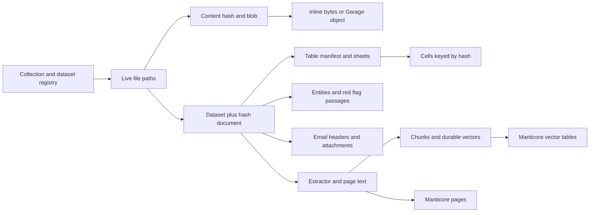
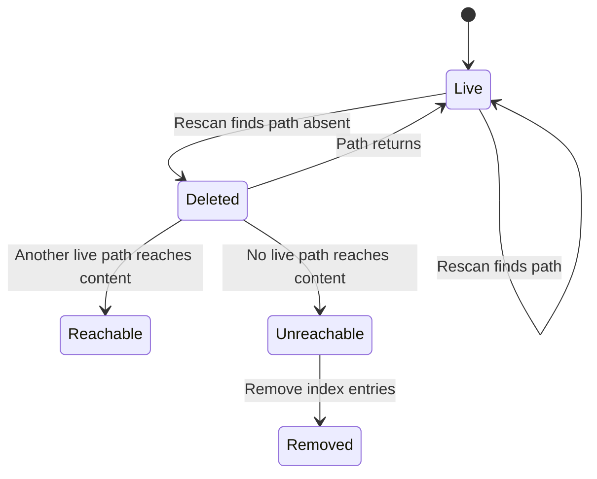

# Storage model

Where bytes and rows live, what deduplication means for the tables above them, and the two
keys that cross between stores.

## Contents

- [Each store has a defined responsibility.](#each-store-has-a-defined-responsibility)
- [Content-addressed blobs](#content-addressed-blobs)
- [ClickHouse: a database per collection](#clickhouse-a-database-per-collection)
- [The file tree, and what deletion means](#the-file-tree-and-what-deletion-means)
- [The object store: a bucket per collection](#the-object-store-a-bucket-per-collection)
- [Derived output is never source](#derived-output-is-never-source)
- [The search engine: one denormalised table per shard](#the-search-engine-one-denormalised-table-per-shard)
- [Verify ownership before reading a chat artifact.](#verify-ownership-before-reading-a-chat-artifact)

## Each store has a defined responsibility.

| store | holds | keyed by |
|---|---|---|
| ClickHouse | every row: files, blobs, parsed content, entities, plans, users, chat | `(collection_dataset, hash)` for document data |
| the object store | the bytes of every ingested file, plus derived output | the path recorded in the blob row |
| the search engine | one denormalised copy of what a result needs | `(collection_dataset, file_hash)` |

Nothing is authoritative in two places. The search engine is a copy that can be rebuilt from
ClickHouse; the object store holds bytes ClickHouse only points at.

## Content-addressed blobs

A blob is identified by a content hash, and the same content ingested twice is one blob. The
row also carries the auxiliary hashes a user might paste, the size, and either the object
path or a flag saying the value is small enough to live in ClickHouse itself.

Deduplication reduces the blob count when multiple paths contain identical bytes.
Blob and file counts can be equal when every file has distinct content.
Parsed content, entities, and chunks use content identity, while search documents also retain dataset identity.

**Document identity in the index is the pair, not the hash alone.** The same content in two
datasets of one collection is indexed twice, deliberately, because those are two documents
from a reader's point of view. The stack verification asserts exactly that.

## ClickHouse: a database per collection

One global database holds what is not collection-scoped: users, groups, the collection
registry, the dataset registry, sessions, settings, the search cache, chat, model
configuration, the stage timing samples, and the short-window telemetry tables.

Every collection has its own database holding its blobs, its file tree, its parsed content,
its plans and errors, and its term dictionaries. **A dataset's collection is fixed when the
dataset is created** and cannot be moved; creating a collection provisions its database, and
deleting one (allowed only when it holds no datasets) drops it.

The backend resolves the right database per query, immediately after the permission check, so
an unauthorised dataset never reaches a database name. The mapping from dataset to collection
is immutable and is cached in process.

## The file tree, and what deletion means

`vfs_files` holds one current row per path. Three properties of its key decide what the
table can answer:

- **The container hash is part of the sort key.** Without it, two containers holding the same
  inner path collapse into one row and the second container loses its children.
- **The content hash is deliberately *not* in the sort key.** With it, a file whose content
  changed at the same path inserts a second row beside the old one, and the tree then holds
  two versions of one path with no way to say which is current.
- **Deletion is a mark on the row, not a separate tombstone table.** A rescan that finds a
  path gone writes one row, and readers need no anti-join. The rescan is authoritative for
  the paths under its root, which is what makes deletion detectable at all.

The table is a replacing engine versioned on an update timestamp with the deletion mark as
its delete column, so the newest row for a path wins. **A plain count therefore counts
superseded rows and tombstones**: every consumer either reads the final state explicitly or
is wrong.

Removing a document from the index is driven by **reachability from live paths**, not by
walking tombstones: a blob still reachable through another path stays indexed.

The materialised tree `vfs_nodes` stores two values on every node: the number of files below
it and their stored size. The file count opens every archive and email below the node, and
it counts a container's members once for each path at which the container lives. The size
counts the bytes at the node's own container level, so an archive adds its own size once
and its members do not add theirs again. A row reads -1 for both until a tree build writes
them. Readers that find -1, or no row, compute the values from the other rows by path
prefix.

## The object store: a bucket per collection

Buckets are named for the collection they hold, alongside one system bucket for everything
that is not collection data.

**Readers take the bucket out of the blob row's stored path.** A reader that rebuilds the
bucket name from its own configuration works on one collection and fails on the next, and
fails by not finding an object rather than by erroring.

## Derived output is never source

Everything the system generates rather than ingests (searchable PDFs, captured chat
artefacts) lives under a `derived/` prefix, and **the disk-scan stage must never walk it.**

The reason is a loop, not tidiness: an artefact the scanner can see would be ingested,
re-derived by the stage that produced it, and produce another, forever. A blob row pointing
into `derived/` is the signature of that loop having started, which is why the stack
verification asserts that no blob row references the prefix.

## The search engine: one denormalised table per shard

A collection's searchable data lives in a dynamic number of shard tables, capped by the
indexing planner on both text bytes and row count, plus one entities table and one tree table
per collection.

Each page row carries its document metadata.
Search and facet queries can therefore read one denormalized table without joining a separate metadata table.
Performance depends on indexed content, shard count, filters, and the query environment.

How queries fan out over those shards, and what is exact versus approximate across them, is
[Search architecture](Search_Architecture.md).

## Verify ownership before reading a chat artifact.

An artefact id reaches the backend through a tool payload that a language model wrote. Every
read resolves it to its owning session and username and enforces owner-or-admin.

**Someone else's id is a 403, not a 404.** Collapsing the two hides a real permission failure
behind an apparent missing row, and the difference is exactly what an audit of that surface
needs to see. The username is denormalised onto the artefact row so the check never has to
join.

The rows are the **sole** index of those objects' existence. Nothing else in the system
knows they are there, so the deletion of a chat tombstones the row first, the daily sweep
deletes the object, and only then drops the row. No artifact expires by age: chats and boards
are kept until a person deletes them. A store-level expiry cannot remove an object, which is why the order is
that way round.

## Document identities connect stored data.

Paths identify file locations. Content hashes identify bytes, and dataset plus hash identifies a searchable document.

[Collection migrations](../../main_services/processing/database/db_collection_migrations/), [document readers](../../website/backend/src/api/documents/), and [indexing](../../main_services/processing/tasks/P6_index_data/) define the stored keys.
This diagram shows logical relationships and does not imply foreign-key constraints.

## Live paths determine index cleanup.

Deleting one path does not remove content that remains reachable through another live path.

[VFS reconciliation](../../main_services/processing/tasks/P0_scan_disk/) and [index maintenance](../../main_services/processing/tasks/P6_index_data/) own these transitions.
