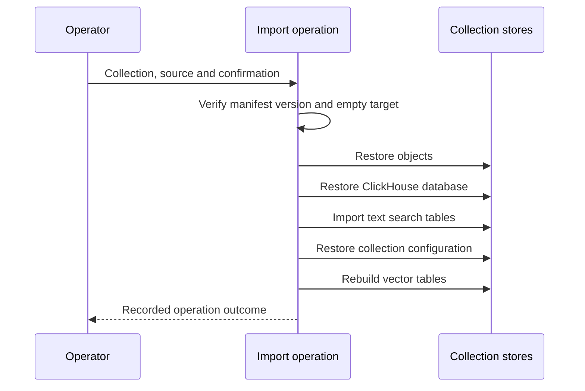

# Export and restore a collection.

Collection export writes recoverable collection data under the configured backup root.
[The operation implementation](../../main_services/processing/tasks/P_ops/Readme.md#the-backup-format) defines the complete format.
[The command parser](../../main_services/processing/main.py) defines the accepted inputs.

## Verify the prerequisites.

Use the processing command environment with its generated configuration.
Verify that the backup root is mounted in the operations container.
Choose a destination name below that root.
A destination is a subdirectory name and cannot specify another filesystem path.
Verify available space for objects, database data, text indexes, and manifests.
Keep deployment paths and access details in the private infrastructure inventory.

## Export a collection.

Run the command from the processing command environment.
Replace the example collection and destination with the intended names.

```sh
uv run main.py export-collection example --destination example-backup
```

The command follows its operation by default.
Use `--no-wait` to print the operation identifier and detach.
Interrupting the following command detaches from the operation and does not cancel its work.
Inspect its operation record to determine the outcome.

The export copies Garage objects, the ClickHouse database, and Manticore text tables in that order.
It records collection configuration and artifact sizes in a versioned manifest.
Backup format version 2 stores durable vectors in ClickHouse and does not export disposable Manticore vector tables.
Original dataset source directories remain outside this backup.
Preserve those directories separately when recovery requires another scan.

The export first writes `<destination>.partial-<op_id>`.
It renames that directory to the final destination only after writing the complete manifest.
A partial directory is not a completed backup.
A failed or cancelled export keeps its partial directory and cannot replace a completed destination.

## Restore into an empty target.

Verify the backup manifest before starting import.
The target must have the same collection name as the backup.
The target collection must be absent or empty in every store.
The importer verifies occupancy before writing source data.
It refuses incompatible format or schema versions.
Do not remove target data until its preservation and removal are authorized.

```sh
uv run main.py import-collection example --source example-backup --confirm example
```

The confirmation value must match the collection name.
The importer restores objects, ClickHouse data, and text search tables before configuration rows make the collection available.
It rebuilds disposable vector tables from stored vectors.
A failed import can leave residue that blocks another import.
Inspect that residue through the recorded operation before preparing another empty target.
[The restore implementation](../../main_services/processing/tasks/P_ops/restore.py) defines these checks and failure behavior.



## Verify the restored collection.

Verify the operation's terminal state and recorded failures.
Compare document and dataset counts with the export manifest and retained collection records.
Open representative original files and derived sources.
Search known terms in each restored dataset.
Verify collection access for the intended groups.
Verify vector table availability when embeddings are enabled.
Record any unavailable source or index separately from successful database restoration.
