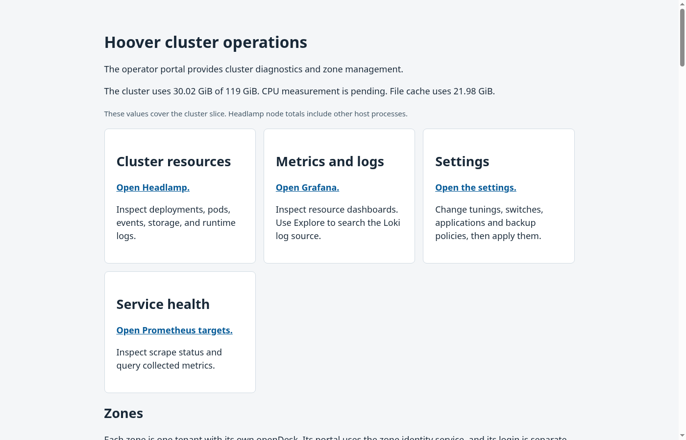
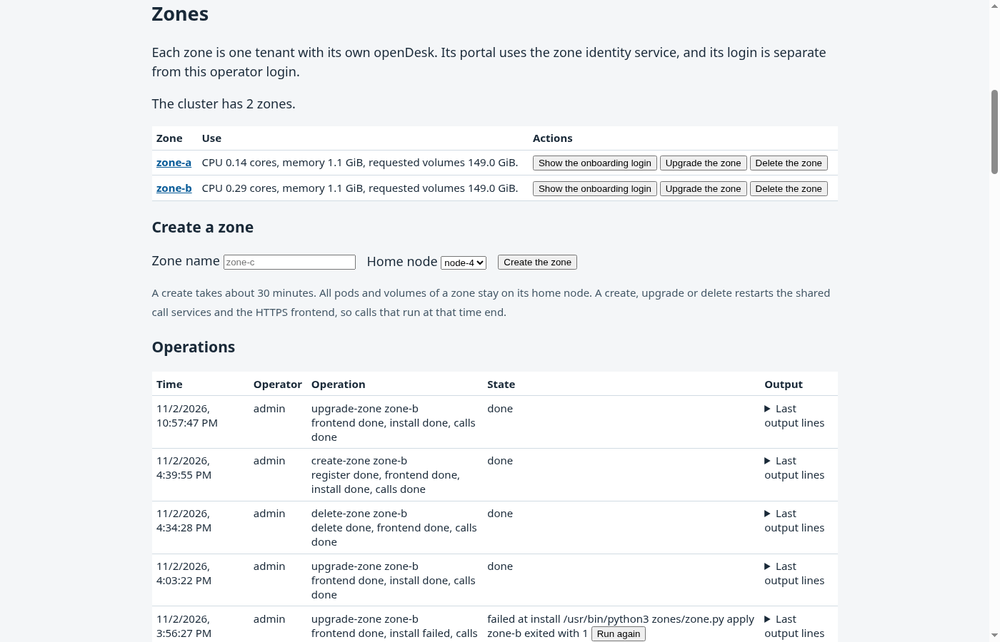
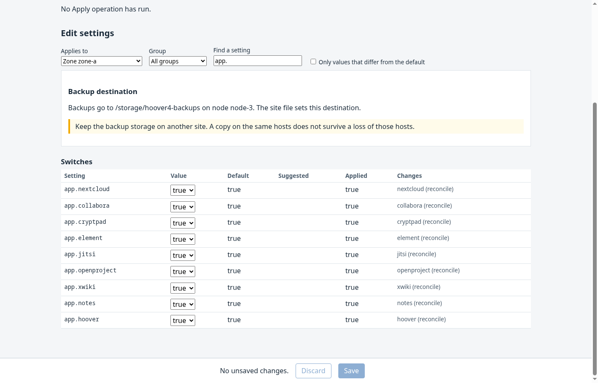
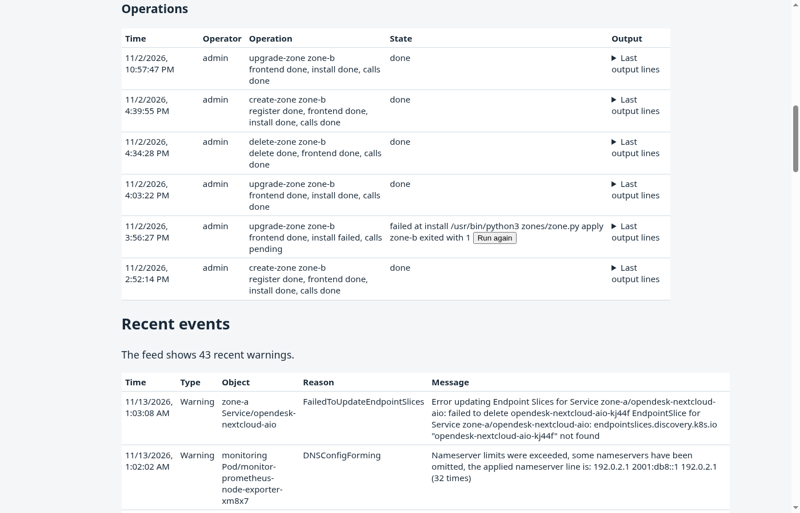
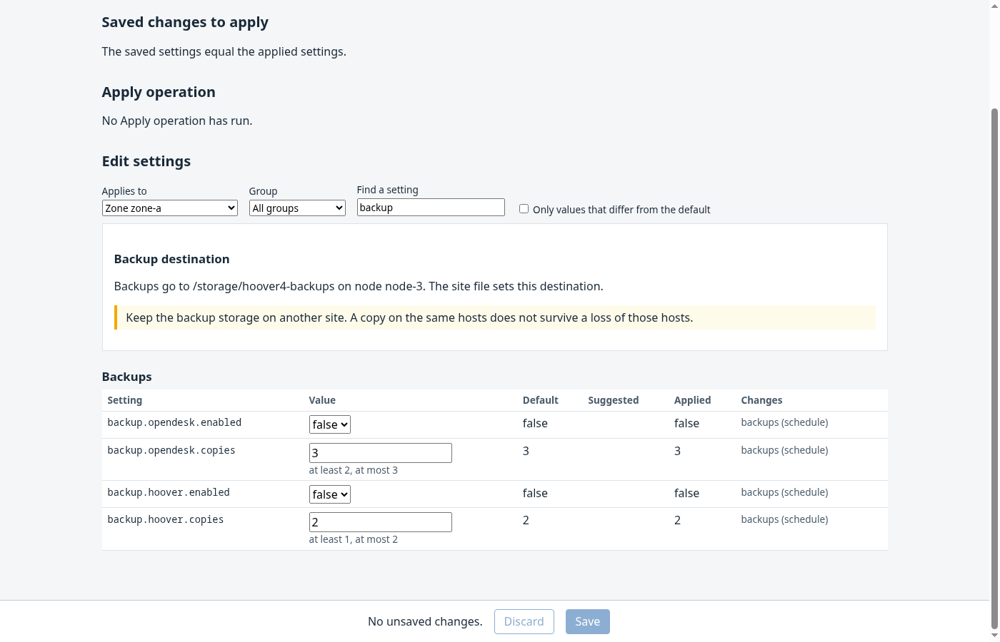

# Operate the zones of a cluster site

A zone is one tenant of the site. It has its own openDesk, its own Hoover installation and its own sign-in service.
Two roles work with a zone.

| Role | Signs in to | Tasks |
|---|---|---|
| Platform operator | The operator portal `https://operator.<suffix>/` | Create, upgrade, back up, restore and delete zones. Change the settings of the site and the zones. |
| Zone administrator | The portal of the zone `https://portal.<zone>.<suffix>/` | Manage the users and groups of the zone. |

The operator login and the zone logins are separate. An operator login gives no access to the data of a zone.

## Contents

- [Sign in to the operator portal](#sign-in-to-the-operator-portal)
- [Create a zone](#create-a-zone)
- [Give the zone to its administrator](#give-the-zone-to-its-administrator)
- [Change the applications and settings of a zone](#change-the-applications-and-settings-of-a-zone)
- [Recover from a failed operation](#recover-from-a-failed-operation)
- [Upgrade a zone](#upgrade-a-zone)
- [Back up and restore a zone](#back-up-and-restore-a-zone)
- [Delete a zone](#delete-a-zone)
- [Manage the users and groups of a zone](#manage-the-users-and-groups-of-a-zone)

## Sign in to the operator portal

1. Open `https://operator.<suffix>/`.
2. Sign in with the operator account.
3. The start page shows the cluster resources, the links to Headlamp, Grafana, Prometheus and the settings, the zones, the operations and the recent warning events.

Select **Sign out** at the end of the page to end the session.

## Create a zone

1. In **Create a zone**, type the zone name. A zone name is `zone-` followed by 1 to 12 lower-case letters or digits.
2. Select the home node. All pods and volumes of the zone stay on this node.
3. Select **Create the zone**.
4. Follow the operation in **Operations**. The table shows the steps and the last output lines. A create takes about 30 minutes.

A create, upgrade or delete restarts the shared call services and the HTTPS frontend. Calls that run at that time end.

## Give the zone to its administrator

1. In the zone list, select **Show the onboarding login** of the zone.
2. Give the portal address, the user name and the password to the administrator of the zone through a private channel.
3. Ask the administrator to change the password at the first sign-in.

## Change the applications and settings of a zone

1. Open **Settings**.
2. Select the scope of the zone. The settings `app.<name>` turn openDesk applications and Hoover off and on.
   An application that is off has no running pods and keeps its data.
3. Change the values and select **Save**. The page lists the saved changes that wait for Apply, and the services that each change restarts.
4. Select **Apply**. The page shows the steps of the operation.

A value that you save during a running operation waits for the next Apply.

## Recover from a failed operation

A zone operation or an Apply that fails keeps its finished steps.

1. Read the error and the last output lines of the operation.
2. Correct the cause. The private infrastructure log and [the troubleshooting guide](Troubleshooting.md) help with known causes.
3. Select **Run again** for a zone operation, or **Retry** for an Apply. The operation continues at its first unfinished step.
4. Select **Abandon** to stop a failed Apply. Its unfinished scopes keep their earlier applied values.

## Upgrade a zone

Select **Upgrade the zone** in the zone list. The runner installs the source revision of the runner on the zone.
A site upgrade with `k3s/deploy-k3s up` also upgrades every zone. [The operations manual](Cluster_Operations.md#upgrade-the-site) describes it.

## Back up and restore a zone

A zone copy holds the openDesk databases and volumes of the zone and the volumes of its Hoover installation.

1. Turn on `backup.opendesk.enabled` and set `backup.opendesk.copies` in the settings of the zone, and Apply.
2. The runner makes one copy each week. The zone closes during the copy and opens again with its earlier replicas.
3. Restore a copy from the operator host with `backups.py restore-zone`. [The operations manual](Cluster_Operations.md#restore-a-zone) describes the steps.

## Delete a zone

A delete removes the zone namespaces with all their volumes. No copy remains in the cluster.

1. Make a zone copy first when the data must stay available.
2. Select **Delete the zone** in the zone list.
3. Type the zone name to confirm. The portal refuses another name.

## Manage the users and groups of a zone

The zone administrator does these tasks in the portal of the zone.

1. Sign in to `https://portal.<zone>.<suffix>/` with the administrator account.
2. Open the user administration of the portal.
3. Add a user with a user name, a name and an email address, or change an existing user.
4. Add the user to groups. The group of the zone administrators gives the administrator rights in the applications.
5. The applications receive a changed user or group within a few minutes.
