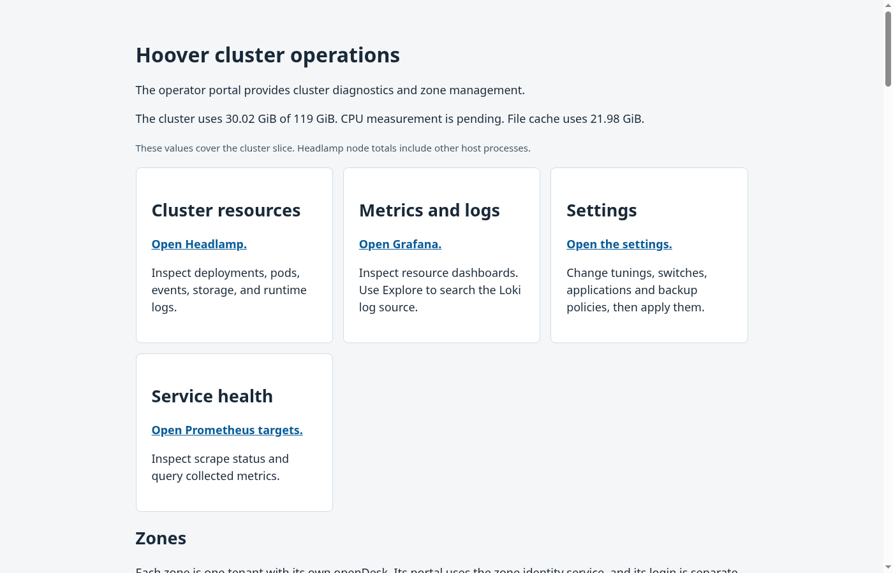

# Install a cluster site

The k3s installation is experimental.

This manual installs Hoover and openDesk on a k3s cluster with `k3s/deploy-k3s`.
[The cluster deployment reference](../../../k3s/Readme.md) describes each command and file in detail.
Keep host names, addresses and credentials in the private site folder and in the private infrastructure inventory.

## Contents

- [Prepare the operator host](#prepare-the-operator-host)
- [Write the site file](#write-the-site-file)
- [Choose the node roles](#choose-the-node-roles)
- [Choose the certificates of the HTTPS frontend](#choose-the-certificates-of-the-https-frontend)
- [Give the operator SSH and sudo access to each node](#give-the-operator-ssh-and-sudo-access-to-each-node)
- [Install the site](#install-the-site)
- [Add a GPU node](#add-a-gpu-node)
- [Sign in for the first time](#sign-in-for-the-first-time)
- [Verify the installation](#verify-the-installation)

## Prepare the operator host

The operator host is a workstation that reaches every node with SSH. It runs the driver and the operator runner.

1. Install Python 3 and `podman` or `docker`. `k3s/deploy-k3s` builds the operator image ([k3s/images/operator](../../../k3s/images/operator)) when its inputs change.
   The image holds Ansible, `kubectl`, `helm`, `ssh` and `git`. The host needs no other tool.
2. Clone the repository. Every step runs the scripts of this checkout. The record of a run keeps the commit and the uncommitted changes.
3. Put the site file in a folder of your choice. Its state folder is beside it, with the name of the file without its extension.
   A site file directly in `k3s/private/` keeps `k3s/private/` as its state folder. Git ignores `k3s/private/`.

## Write the site file

Give the site file with `--site FILE` or `HOOVER4_SITE`. The default is `k3s/private/hoover4-site.ini`. It is the only file that holds host paths.
[The single-node and remote examples](../../../k3s/tests/fixtures) show the format.

| Section | Content |
|---|---|
| `[site]` | The site name, the domain suffix of the zones, the control-plane node and the operator user. |
| `[node.<name>]` | The roles, addresses, storage tiers and volume group of the node, and the TLS mode of a public node. |
| `[gpu_pool]` | The GPU nodes or the address of an external GPU pool, and the key file of the pool. |
| `[backup]` | The backup node and the backup folder on that node. |
| `[hoover.<name>]` | One Hoover installation: its zone, its home node, its store layout and its storage identity. |

Check the file before each change:

```sh
python3 k3s/config.py check <site file>
```

## Choose the node roles

| Role | Work of the node |
|---|---|
| `control-plane` | Runs the k3s server with the embedded etcd datastore. A site has one control-plane node. |
| `worker` | Runs the pods of the zones. |
| `public` | Receives the public HTTPS traffic and runs the HTTPS frontend. |
| `registry` | Holds the image registry. |
| `data` | Exports the dataset folders of the Hoover installations over NFS. |
| `calls` | Runs the TURN and media servers of the video calls. |
| `gpu` | Runs the GPU services. A GPU node has no other role. |

Every k3s server uses embedded etcd, also on a site with one node. One server does not make the datastore highly available.

## Choose the certificates of the HTTPS frontend

The HTTPS frontend runs on the first public node. Set `tls_mode` in its `[node.<name>]` section.
`config.py check` refuses a missing key of the selected mode, so `up` stops before the first step.

| `tls_mode` | Use it when | Keys |
|---|---|---|
| `cloudflare` | The domain is at Cloudflare. certbot gets a public wildcard certificate with the DNS challenge. This is the default of a node that is not local. | `tls_dns_credentials_file`: the certbot Cloudflare credentials file on the public node. |
| `internal` | The site is on a LAN or has no public domain. Caddy issues the certificates from its own CA. This is the only mode of the local node of a single-node site. | No key. |
| `files` | You have a certificate from another authority. | `tls_certificate_file` and `tls_key_file`: the full certificate chain and the key, as files on the public node. |

With `internal`, the frontend step copies the root certificate of the CA into `frontend/local-ca.crt` of the state folder, and prints that path.
Import that file as a trusted certificate authority in each browser that opens the site. The pods of the zones trust it without a change.

With `files`, the certificate must have the names `*.<suffix>` and `*.<zone>.<suffix>` of each zone.
A zone without its name stops the frontend step and the zone creation, and the message names the missing names.
Replace the files on the public node, then run the frontend step again.

## Give the operator SSH and sudo access to each node

The host steps are Ansible plays ([k3s/ansible](../../../k3s/ansible)) that the driver runs in the operator image.
The image mounts `~/.ssh` read-only and the SSH agent socket, so `ssh` uses the configuration and the keys of the current user.
Ansible writes new host keys into `known_hosts` of the state folder.

1. Give the user of the workstation SSH access with a key to every node. `ssh_address` of the node names `user@host`. Without it, the node name and `~/.ssh/config` apply.
2. Give that user `sudo` on every node.
   Without a password, the plays run unattended. With a password, add `--ask-become-pass` to the command. The driver asks once for each command.

The installer adds no SSH key, no sudo rule and no root script to a node.
The host play removes `/usr/local/libexec/hoover4`, the sudo rule `/etc/sudoers.d/90-hoover4` and the revision folders of `~/k3s-install` of an earlier installer.

## Install the site

1. Show the configuration and the steps. The command changes nothing.

   ```sh
   k3s/deploy-k3s render --target all
   k3s/deploy-k3s check --target all
   ```

2. Install the site from the commit of the checkout:

   ```sh
   k3s/deploy-k3s up --site <site file> --target all
   ```

   The steps `hosts:prepare` and `hosts:k3s` run one Ansible play each on all target nodes in parallel.
   The k3s play writes the admin kubeconfig into the state folder, with the node address of the server. `hosts:verify` reads every node through it.
   The driver then installs the cluster services, the registry, the images, the ingress, the HTTPS frontend, monitoring, the operator portal and runner, the GPU services, each zone and the call services.
3. When a step fails, read its error, correct the cause, and continue with the same inputs:

   ```sh
   k3s/deploy-k3s up --resume <record>
   ```

   A resume refuses a changed site file, another commit of the checkout and another cluster. Start a new run after such a change.
4. A complete run writes `deploy/applied.json` in the operator state. `k3s/deploy-k3s status` shows the applied revision.

## Add a GPU node

A GPU node keeps its existing VPN interface. Name that interface in the site file.

1. Add `[node.<name>]` with the role `gpu`, the architecture `arm64` or `amd64`, the VPN address, `vpn_interface` and `wireguard_public_key`.
   The public key is the key of the existing VPN interface of the node.
   The installer configures no peer on the GPU node. Without `wireguard_peers`, the other nodes reach it through the existing VPN.
   To give the GPU node a direct peer, set `wireguard_peers` to the node that it can reach, for example the public node. Do not set `wireguard_via`.
   Add the reverse peer on the GPU node by hand: the public key of that node, its endpoint, and its VPN address as AllowedIPs. `k3s/deploy-k3s check` lists it in `manual_peers`.
2. Install the NVIDIA driver on the node. The k3s play refuses a GPU node where `nvidia-smi -L` fails.
   The host play adds the NVIDIA repository and installs the NVIDIA container toolkit when the node does not have it.
3. Run `k3s/deploy-k3s up --target <name> --steps hosts`.
4. Stop the Compose GPU services of the node only after the GPU pool of the cluster answers authenticated requests.

The direct peer takes the VPN address of the GPU node away from the earlier route of the peer node.
Until the reverse peer exists on the GPU node, the peer node cannot reach that address. A GPU pool at that address then does not answer it.
Add the reverse peer first. Then run the host steps of the peer node, and check the address from it and from the other nodes.

## Sign in for the first time

1. Open the operator portal at `https://operator.<suffix>/`.
2. Sign in with the operator account. Its password is in `k3s/private/operator-login/`.
3. Create the first zone. [The zone manual](Zone_Operator_Manual.md) describes the zone tasks.

<a href="img/operator-home.png"></a>

## Verify the installation

| Check | Command |
|---|---|
| The server uses etcd | `kubectl get node <server>` shows the role `etcd`. The verify step of the driver also saves a snapshot. |
| The nodes are Ready | `kubectl get nodes` |
| The run is complete | `k3s/deploy-k3s status` names the applied record and revision. |
| The logins of a zone work | `python3 k3s/tools/verify-lab-logins.py <zone>` |

[The operations manual](Cluster_Operations.md) describes upgrades, settings, backups and restore.
[The migration manual](Cluster_Migration.md) describes the move of an earlier installation into a site.
