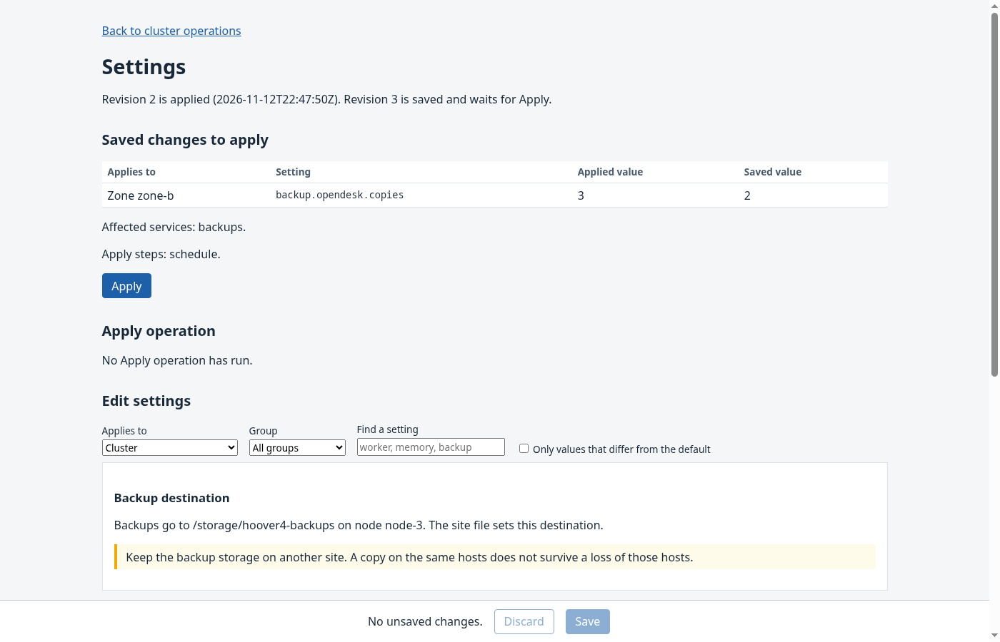
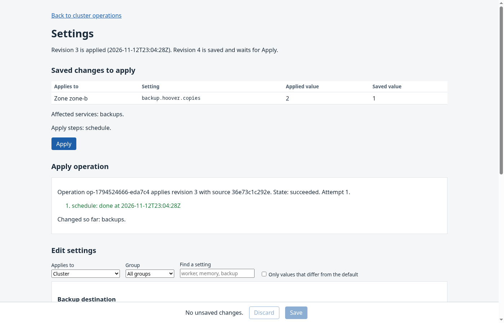
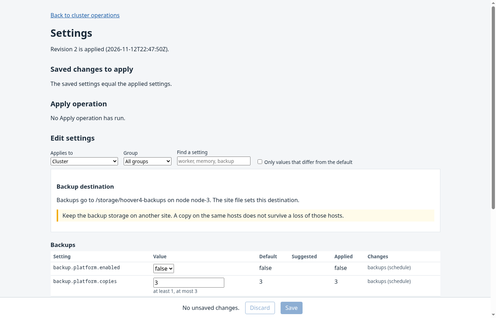

# Operate a cluster site

The k3s installation is experimental.

This manual describes the daily tasks of a platform operator on a site of `k3s/deploy-k3s`.
[The installation manual](Cluster_Installation.md) installs a site, and [the zone manual](Zone_Operator_Manual.md) describes the tasks of each zone.
[The cluster deployment reference](../../../k3s/Readme.md) describes each command in detail.

## Contents

- [Upgrade the site](#upgrade-the-site)
- [Return to an earlier release](#return-to-an-earlier-release)
- [Save and apply settings](#save-and-apply-settings)
- [Stop and start the site](#stop-and-start-the-site)
- [Restart or update one node](#restart-or-update-one-node)
- [Upgrade k3s, gVisor and Kata](#upgrade-k3s-gvisor-and-kata)
- [Add or remove a node](#add-or-remove-a-node)
- [Renew the certificates](#renew-the-certificates)
- [Read the memory use](#read-the-memory-use)
- [Reset a site](#reset-a-site)
- [Monitor the site](#monitor-the-site)
- [Back up the site](#back-up-the-site)
- [Restore a zone or the platform](#restore-a-zone-or-the-platform)
- [Reach an installation from a workstation](#reach-an-installation-from-a-workstation)

## Upgrade the site

An upgrade installs the scripts and the images of the commit of the checkout.

1. Check out the commit in the checkout that runs `k3s/deploy-k3s`. Set `HOOVER4_SITE` to the site file, or add `--site <site file>` to each command.
2. Show the steps. The command changes nothing.

   ```sh
   k3s/deploy-k3s render --target all
   ```

3. Run the upgrade:

   ```sh
   k3s/deploy-k3s up --target all
   ```

4. When a step fails, read its error and correct the cause. Continue the same record:

   ```sh
   k3s/deploy-k3s up --resume <record>
   ```

5. Check the result with `k3s/deploy-k3s status`. The applied revision is the commit of the last complete run.

The record of a run pins the commit, the uncommitted changes of the checkout, the site file, the saved settings revision and the cluster.
A resume refuses a change of these inputs. A second `up` of the same commit changes no object, starts or restarts no pod and builds no image. A commit that changes no input of an image keeps its tag.
A zone step runs the openDesk waves only when an input of the zone or a Helm release of the zone changed since its last complete run.
After a change by hand, for example a deleted zone user or an edited object, run `k3s/deploy-k3s up --target all --full`.
A waiting or failed step stops every step that depends on it.
The step `placement` lowers the CPU requests of the site by one factor when the pods do not fit, and resizes the running pods in place. A normal `up` moves no running pod. `up --rebalance` moves running pods to their planned nodes one at a time, so run it in a maintenance window.
Between two runs no pod moves, except in the cases of [Keep the pods in place](../../../k3s/Readme.md#keep-the-pods-in-place).

One site operation runs at a time. The driver, the settings Apply, the zone operations, the Compose import and the zone and platform backups share one lock.

## Return to an earlier release

`deploy/previous.json` in the operator state names the release before the applied one.
Check out that commit, then run `k3s/deploy-k3s up --target all` to return to it.
An earlier image does not reverse stored data. A database migration of the later release stays applied, so check that the earlier release reads it.

## Save and apply settings

The operator settings hold the tunings, switches, applications, memory limits and backup policies of the site and its zones.
The settings page is `https://operator.<domain>/settings.html`.

1. Edit a value and select **Save**. A save changes no service.
2. Read the pending changes and the services that each change restarts.
3. Select **Apply**. The runner applies the newest saved revision, one scope at a time.
4. When the operation fails, read its error, correct the cause, and select **Retry**. A retry continues at the first unfinished step.
5. Select **Abandon** to stop a failed operation. The scopes that it did not finish keep their earlier applied revision.

<a href="img/settings-pending.png"></a>

After the operation, the page shows its steps and the next saved revision that waits for Apply.

<a href="img/settings-applied.png"></a>

A value that you save during a running operation stays pending for the next Apply.
Select **Processing pools of the site** in **Applies to** to change ClamAV, Tika, Tesseract, the searchable-PDF builder, the PDF search and the regex scanner for every zone.
An Apply of these values restarts the changed pools. A concurrency value or a switch also restarts the workers of the zones.
A zone that keeps its own copies of these services shows them in its own **Hoover installation** settings.
The setting `gpu.runtime` applies the GPU pool and checks each GPU service with and without the pool key.

## Stop and start the site

```sh
k3s/deploy-k3s down --target all
k3s/deploy-k3s up --target all --start
```

`down` stops the zone gates, then the applications and workers, then the Temporal of the site, then the stores with the shared ClickHouse, Manticore, Garage, Cassandra and OpenSearch of the namespace `hoover-stores`, then the HTTPS frontend and k3s.
It also suspends the CronJobs of the zones. The workers end through their grace period, and no workflow is cancelled.
`up --start` starts the parts in the reverse order and resumes only the CronJobs that `down` suspended.

A host that systemd stops or restarts gives its pods 150 s to stop. `poweroff --force` and a power loss stop the pods without a clean stop.

Each shared store keeps one copy of its data, without replication or failover. While a node is stopped, the part of the store data on that node is out of reach for every zone. The collection copies of the backups are the recovery path for a lost volume. See [the lost store nodes](../../../k3s/Readme.md#lost-store-nodes).

## Restart or update one node

A node that systemd stops or restarts gives its pods 150 s to stop. While the node is down, its pods and its part of the store data are out of reach. A node with store volumes stops the use of the stores in every zone.

1. Update the packages of the node, when necessary.
2. Restart it on the node:

   ```sh
   sudo systemctl reboot
   ```

3. Wait until the node is Ready and its pods run:

   ```sh
   kubectl get nodes
   python3 k3s/tools/sweep.py hoover-stores <zone> --wait 900
   ```

Do not use `poweroff --force`. It skips the stop of the pods, and the stores then start with a crash recovery.

## Upgrade k3s, gVisor and Kata

This procedure is not tested.

The versions and digests of k3s, gVisor and Kata Containers are pinned in [the defaults of the k3s role](../../../k3s/ansible/roles/hoover4_k3s/defaults/main.yml). Each node downloads them and checks the digest.

1. Change the version and the digest of each architecture in a commit.
2. Run `k3s/deploy-k3s up --target all`. The step `hosts:k3s` installs the new files on each node and restarts k3s where its files changed. The pods of a node stop and start again with k3s.
3. Check the nodes with `kubectl get nodes -o wide`.

## Add or remove a node

This procedure is not tested.

1. To add a node, prepare it as [the installation manual](Cluster_Installation.md#prepare-the-nodes) describes, add it with its roles to the site file, and run `k3s/deploy-k3s up --target all`.
2. The reference describes no removal of a node. A node with store volumes or zone claims holds data that no other node has. Restore that data from the copies before the node goes, as [the recovery manual](Cluster_Recovery.md#recover-a-lost-node-or-volume) describes.

## Renew the certificates

| `tls_mode` | Renewal |
|---|---|
| `cloudflare` | certbot on the public node renews the certificate. Its deploy hook restarts the HTTPS frontend. |
| `internal` | Caddy issues and renews the certificates from its local CA. A new CA needs a new `frontend/local-ca.crt` in each browser. |
| `files` | Put the new certificate and key on the node at the paths of the site file, then run `k3s/deploy-k3s up --target all`. |

## Read the memory use

Each pod has a memory request and a memory limit. A pod of gVisor or Kata can move cold pages into compressed memory and swap up to its swap quota, and k3s itself uses no swap. [Use swap and zswap](../../../k3s/Readme.md#use-swap-and-zswap) describes the quotas.
The alarms `NodeMemoryLow`, `NodeMemoryPressure`, `NodeOutOfMemoryKill`, `NodeSwapAlmostFull`, `PodSwapNearQuota` and `ContainerOutOfMemory` show memory problems. [The troubleshooting manual](Cluster_Troubleshooting.md#an-alarm-is-active) names the action for each.

## Reset a site

`deploy-k3s reset` erases every zone of the site: the data, the accounts, the credentials, the volumes, the backups and the etcd snapshots. The site services, the shared stores with their other tenants and the zone definitions stay. The next `deploy-k3s up` creates the zones again with new data.

1. Check the site and the zones of the reset:

   ```sh
   k3s/deploy-k3s check --target all
   k3s/deploy-k3s status
   ```

2. Reset the site. The command prints the record id, the zones and the steps first.

   ```sh
   k3s/deploy-k3s reset --target all
   ```

3. When the reset stops, correct the cause that the record names, then continue it with `k3s/deploy-k3s reset --resume <record>`.

## Monitor the site

The operator portal at `https://operator.<domain>/` links the monitoring tools.

| Tool | Use |
|---|---|
| Headlamp | Inspect the deployments, pods, events, volumes and logs. |
| Grafana | Read the resource dashboards. Use Explore to search the logs in Loki. |
| Prometheus | Read the alarms at `/alerts` and the scrape targets. |

The portal shows the active alarms above the recent warning events. The list holds the firing Prometheus alarms and the backup alarms: a failed copy, a job without space, a paused destination, and a destination without a backup policy.
No alarm leaves the cluster. Alertmanager is off, so the site sends no mail and no message.

The portal also shows the operations of the zones.

## Back up the site

`backup` of the site file names the backup node and its backup folder.
The settings `backup.opendesk.*`, `backup.identity.*` and `backup.hoover.*` of each zone and `backup.platform.*` of the cluster turn each job on and set its retained copies.
The operator pod runs on the backup node, and its runner container writes the copies into the folder of that node. No copy needs SSH.

1. Give the backup node a file system for the backups. With `volume_group` and `size_gb` in `backup` of the site file, `deploy-k3s up` creates and mounts a logical volume. Without them, mount the file system yourself. Add `backup.mirror` to keep each copy on a second node as well.
2. Run `deploy-k3s up`. The host step creates the folders `zones`, `platform` and `staging` and the marker of the folder.
   A folder without the marker pauses every job, so a missing mount does not fill the disk.
   When the fstab names a mount at the folder and it is not mounted, the step writes no marker.
3. Turn on the backup policies on the settings page, and Apply.
4. Read the state of the jobs and the list of copies in the runner container:

   ```sh
   run="kubectl -n operator-portal exec deploy/portal -c runner -- env KUBECONFIG=/tmp/kubeconfig-runner python3 /opt/hoover4/k3s/platform/backups/backups.py"
   $run status
   $run copies
   $run copies --mirror
   ```

| Copy | Folder below the backup folder |
|---|---|
| The data of a zone: openDesk and its Hoover installation | `zones/<zone>/<generation>/` |
| The people of a zone: the directory and the Keycloak database | `zones/<zone>/identity/<generation>/` |
| A Hoover collection of a zone | `zones/<zone>/collections/<collection>/<generation>/` |
| The platform recovery set | `platform/<generation>/` |

The commands take names only. A zone copy reads the running zone and stops no application.
A copy replaces an older copy only after its check against its manifest. A failed job keeps the older copies.
The platform job copies the newest scheduled etcd snapshot of k3s through a short pod on the control plane. k3s saves a snapshot every 12 hours. When k3s ran through two schedule times without a new snapshot, the job fails and its error names the age. Then read `journalctl -u k3s` on the control plane. A time without power does not count.
A copy holds no Secret and no password of a service. The users keep their password hashes in the identity copy.

The settings page shows the backup folder and the backup policies of the selected scope.

<a href="img/settings.png"></a>

## Restore a zone or the platform

[The recovery manual](Cluster_Recovery.md) describes the restore of a zone, of the platform and of a lost node, volume, control plane or state folder.
Test a restore at an interval, for example each quarter: restore the identity copy and the zone copy of a zone into a test zone, and sign in there.

## Reach an installation from a workstation

The relay of an installation serves its MCP servers, interfaces and stores on the loopback address of the control-plane node.
Development tools reach them through an SSH tunnel. No port opens to the network.

1. Start the relay with the ports of the Compose installation:

   ```sh
   python3 k3s/platform/mcp-relay/install-relay.py <installation> apply --ports compose
   ```

2. Start an SSH tunnel from the workstation to the control-plane node, with one `-L 127.0.0.1:<port>:127.0.0.1:<port>` for each port that the client uses.
3. Check the MCP servers through the tunnel. The check fails on a tool error, a wrong server name, or a call without the token that is not refused.

   ```sh
   python3 k3s/tools/mcp-relay-check.py --secret-from k3s:<Hoover namespace> mcp-collections=<port> mcp-todo=<port>
   ```
