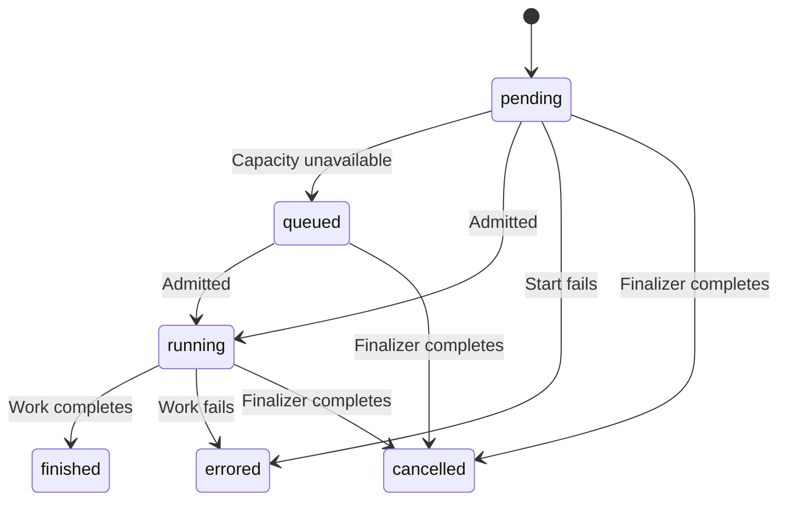

# Administration routes manage stored data and operations.

[Admin pages](../../../website/frontend/src/pages/admin/) and [admin APIs](../../../website/backend/src/api/admin/) own these controls.
[The administration manual](../../user-manual/Admin_Manual.md) explains the procedures.

## Controls

| Route family | Controls | Constraint |
|---|---|---|
| Collections and datasets | Create, rename, inspect access, inspect processing, and dispatch supported actions. Provision the storage of an existing collection again. | A dataset belongs to its collection permanently. A name field shows the identifier that it saves, with capital letters lowercased and a dash, space or full stop changed to an underscore, and refuses an identifier that exists. Provisioning creates a missing database or bucket and keeps the collection row. |
| Dataset creation | Pick a dataset mount and a folder directly beneath it. In a writable mount, name a new folder, which the server creates. In a writable mount, select Accept uploads. | The form takes no path. A read-only mount offers no new folder and no Accept uploads, and the server refuses both. With one mount the form shows no mount select. Accept uploads is disabled while another dataset of the collection accepts uploads. |
| Dataset upload setting | Turn Accept uploads on or off on the dataset page. | The checkbox shows for a disk dataset whose folder is beneath a writable mount, and for a dataset that accepts uploads. Turning it on is refused while another live dataset of the collection accepts uploads. Turning it off is always accepted. |
| Dataset OCR languages | Select Tesseract languages from a checklist with a filter. Turn EasyOCR on or off and select its languages. Select Use the collection default for each engine. Apply the selection. | The checklists offer the languages that the services report, and Tesseract script models are left out. Each value shows its source: this dataset, the collection default or the installation default. Apply saves the settings and asks the pipeline to calculate the OCR step. It starts no operation itself. An empty EasyOCR value turns EasyOCR off. The EasyOCR list marks preloaded languages and shows failed model downloads. |
| Collection OCR defaults and vectors | Set the OCR defaults of a collection. Turn vectors on or off for the collection. | A default changes the datasets that inherit it, and the page names them. A dataset override stays unchanged. Vectors show the installation default until a value is set. An installation without an embedding service cannot turn vectors on. |
| Processing updates | On the dataset page, inspect each update step with its count, state, explanation and last run. Select steps and start Update processing. Ask for Check again. On the collection page, do the same for the collection steps with Update collection, and inspect a status line for each dataset. | Waiting, failed and cancelled steps are selected by default. An empty selection disables the button, and the server refuses it. A request whose counts changed is refused with the new counts, and no work starts. A dataset update that writes to the search index is refused while the collection steps wait. Rescan disk stays a separate control. |
| Processing | Inspect five stage groups, errors, throughput, and task time. | Display groups are P0, P1, P2/P3, P4, and P6. |
| Operations | Filter states and collections, open details, repeat supported operations, and cancel active work. | Destructive actions require the displayed target confirmation. An `ingest_upload` operation shows like `add_dataset` and counts plans. It cannot be repeated, because its upload queue claims its batches. |
| Operation detail | Inspect counts, plans, events, and failure links. | Plans and events use separate 100-row pages. |
| Errors/Failures | Filter document errors and grouped operation failures. | Document errors and operation failure trees are separate records. |
| Users and groups | Inspect account origin, edit supported fields, and grant collection access. Set the Group admin and Uploader flags of a membership on the user page and on the group page. Disable membership controls during a write and its refresh. Show Saving membership while they wait. | The backend verifies administrator access. A change of one flag keeps the other flag. Adding an existing member keeps the stored membership. A membership from the login proxy starts with both flags clear and keeps them across logins. |
| Settings | Change runtime settings and inspect deployment configuration. | Deployment configuration is read-only. |
| LLM | Refresh the model catalog, inspect selected models, and run reports. | Reports run only when requested. |
| AI status and metrics | Inspect providers, active turns, queues, and datastore activity. | Configured and serving capabilities can differ. |
| Feedback | Search reports, open details, change read state, and archive reports. | Archiving preserves the independent read state. |

## States

| State | Display |
|---|---|
| Pending or queued operation | The operation waits for admission: a slot of its kind, or the end of a running operation of the same dataset or collection. The progress cell reads "waiting for a free slot or a free target". |
| Running operation | Progress uses the operation's available work unit. An update operation counts steps. |
| Update step up to date | The applied output matches the current versions, settings and inputs. The count is the estimate of a manual run. |
| Update step waiting | The step has work. An automatic run or a person starts it. |
| Update step failed or cancelled | The last attempt at the current fingerprint did not settle, and the fingerprint is not applied. No automatic run starts it again until the fingerprint changes. The button stays available. |
| Failed files retry available | The automatic work of the step is applied, and files with errors remain. A manual run retries them. A cancelled manual retry also shows this state. |
| Update step not calculated | The pipeline has not calculated the step yet. |
| Finished operation | The operation ended. Its document errors still require separate inspection. |
| Failed operation | The operation identifies its recorded failure and available detail. |
| Cancelled operation | The cancellation finalizer recorded termination. |
| Empty filtered list | The list states that the selected filter has no rows. |
| Request failure | The affected component displays the request error. |

## Constraints

Collection and dataset locks prevent conflicting dispatch according to the operation kind.
Admission also keeps two operations of overlapping targets from running together, whatever their kinds.
An older operation that waits for its own target does not take a slot from a newer operation of the same kind with a free target.
Deleting or purging a dataset stops its unfinished upload batches. Files already placed stay in the folder.
New uploads into the dataset are refused until that operation ends. Cancelling the deletion does not restore the stopped uploads.
Cancelling queued work requires the same finalizer as cancelling running work.
A progress denominator can remain unknown while new targets appear.
A completed plan can contain failed documents.
Provider changes use deployment configuration, while supported runtime settings take effect without deployment.

## Operation states distinguish waiting from completion.

[Operation workflows](../../../main_services/processing/tasks/P_ops/workflows.py) own the state transitions.
Cancellation uses its finalizer and retains completed work.
A repeated operation receives a new operation identifier.

