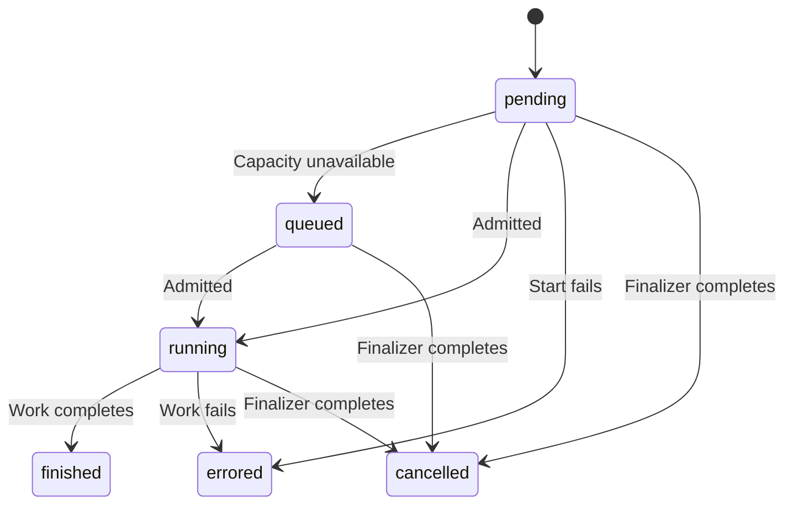

# Administration routes manage stored data and operations.

[Admin pages](../../../website/frontend/src/pages/admin/) and [admin APIs](../../../website/backend/src/api/admin/) own these controls.
[The administration manual](../../user-manual/Admin_Manual.md) explains the procedures.

## Controls

| Route family | Controls | Constraint |
|---|---|---|
| Collections and datasets | Create, rename, inspect access, inspect processing, and dispatch supported actions. | A dataset belongs to its collection permanently. |
| Processing | Inspect five stage groups, errors, throughput, and task time. | Display groups are P0, P1, P2/P3, P4, and P6. |
| Operations | Filter states and collections, open details, repeat supported operations, and cancel active work. | Destructive actions require the displayed target confirmation. |
| Operation detail | Inspect counts, plans, events, and failure links. | Plans and events use separate 100-row pages. |
| Errors/Failures | Filter document errors and grouped operation failures. | Document errors and operation failure trees are separate records. |
| Users and groups | Inspect account origin, edit supported fields, and grant collection access. | The backend verifies administrator access. |
| Settings | Change runtime settings and inspect deployment configuration. | Deployment configuration is read-only. |
| LLM | Refresh the model catalog, inspect selected models, and run reports. | Reports run only when requested. |
| AI status and metrics | Inspect providers, active turns, queues, and datastore activity. | Configured and serving capabilities can differ. |
| Feedback | Search reports, open details, change read state, and archive reports. | Archiving preserves the independent read state. |

## States

| State | Display |
|---|---|
| Pending or queued operation | The operation waits for admission or a service slot. |
| Running operation | Progress uses the operation's available work unit. |
| Finished operation | The operation ended. Its document errors still require separate inspection. |
| Failed operation | The operation identifies its recorded failure and available detail. |
| Cancelled operation | The cancellation finalizer recorded termination. |
| Empty filtered list | The list states that the selected filter has no rows. |
| Request failure | The affected component displays the request error. |

## Constraints

Collection and dataset locks prevent conflicting dispatch according to the operation kind.
Cancelling queued work requires the same finalizer as cancelling running work.
A progress denominator can remain unknown while new targets appear.
A completed plan can contain failed documents.
Provider changes use deployment configuration, while supported runtime settings take effect without deployment.

## Operation states distinguish waiting from completion.

[Operation workflows](../../../main_services/processing/tasks/P_ops/workflows.py) own the state transitions.
Cancellation uses its finalizer and retains completed work.
A repeated operation receives a new operation identifier.

