# Hoover4 administration manual

Open **Administration** from the account control.
Your account must have administrator access.
Use this manual to manage collections, processing, users, settings, and failures.
[The user manual](User_Manual.md) explains document investigation tasks.

## Find an administration task.

- [Dashboard](#dashboard)
- [Collections](#collections)
- [Processing](#processing)
- [Datasets](#datasets)
- [Errors and failures](#errors-and-failures)
- [Feedback](#feedback)
- [Users and groups](#users-and-groups)
- [Settings](#settings)
- [LLM](#llm)
- [AI status](#ai-status)
- [Metrics](#metrics)
- [Inspect operations and their details.](#inspect-operations-and-their-details)
- [Inspect document errors and operation failures.](#inspect-document-errors-and-operation-failures)
- [Inspect model usage and service metrics.](#inspect-model-usage-and-service-metrics)
- [Export, restore, and collect diagnostics.](#export-restore-and-collect-diagnostics)

## Dashboard

The dashboard shows counts of users, groups, collections, and datasets. Each count links to its section. The Datasets
card opens the Datasets section of the Collections page.

<a href="img/admin-dashboard.png">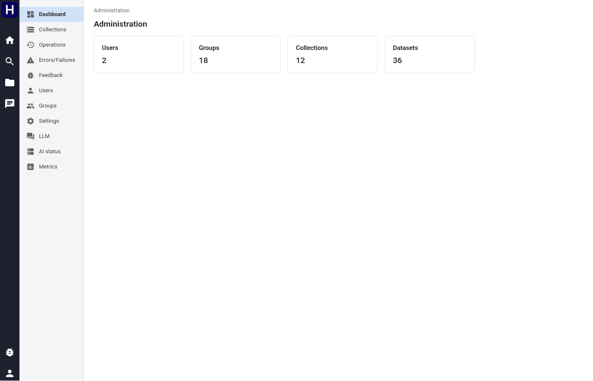</a>

## Collections

The first table shows each collection's display name, dataset count, documents, size, state
and access. The state is Processing while an operation changes the collection, and Done
otherwise. A failed operation also ends in Done. The Datasets section lists the datasets of
every collection with their documents, size, indexed documents, errors, state and creation
date. The form at the bottom adds a collection. A name has lowercase letters, digits and
underscores. The form shows the name that it saves: capital letters become lowercase, and a
dash, a space or a full stop becomes an underscore. The form refuses a name that exists.

<a href="img/admin-collections.png">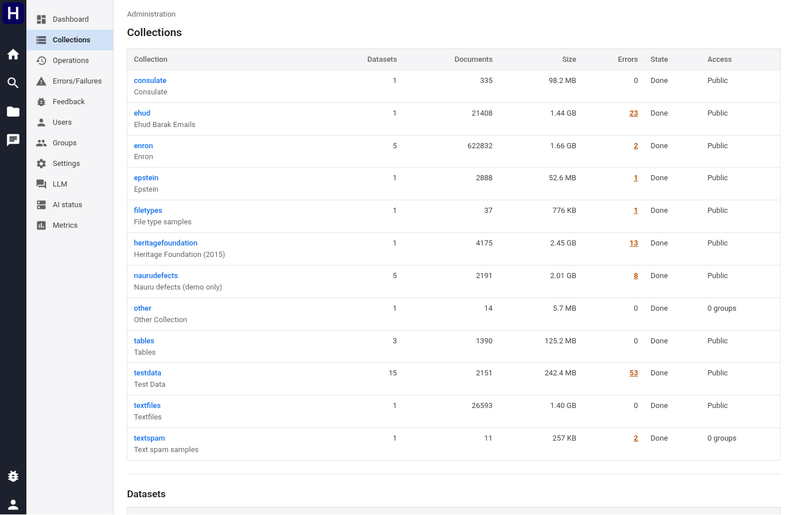</a>

A collection's own page lists its datasets first, then renames it, links to its processing
view, sets its access, and shows its newest ten operations. Adding a collection creates its
database and its file bucket, then opens the collection page. When the page reports that the
last storage provisioning failed, repeat the `ensure_collection` operation on the operations
page. A collection or a dataset that accepts uploads has an **Uploads** mark in the lists.

<a href="img/admin-collection.png">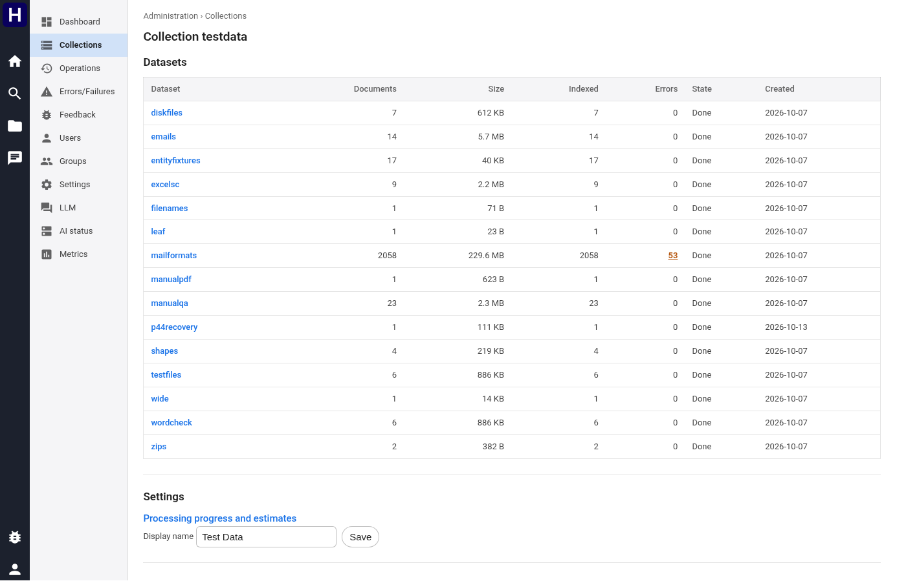</a>

## Processing

Open the processing view during ingestion. It shows five progress groups per dataset.
**P0 Scan & deduplicate**, **P1 Compute plans**, **P2/P3 Execute plans & parse**,
**P4 Extract entities (NLP)**, **P6 Index for search**, each with a progress bar and a
count, an error count beside the dataset name, a throughput chart, what is running right
now, and a table of where the processing time actually goes.

## Datasets

A dataset's page shows its type and source path, when it was created, and its statistics:
state, documents, size, indexed documents, errors, and finished plans.

**OCR languages** sets the languages of the two OCR engines. Select Tesseract languages from
the checklist, and type in the filter to find one. Turn EasyOCR on or off with **Enabled**,
and select its languages. **Use the collection default** makes the dataset follow the
collection default. Each value shows its source: this dataset, the collection default or
the installation default from `hoover4.ini`. EasyOCR languages that the image did not
preload download on first use. A failed download shows under the list. **Apply** saves the
settings. When automatic updates are on, the OCR update then starts without a second click.

**Processing updates** lists the update steps of the dataset. Each step shows how many files
it changes, its state, what it does and its last run. A step waits when new versions,
settings or files leave stored results out of date. An interrupted ingestion and an OCR
settings change are examples. Waiting, failed and cancelled steps are selected. Select
the steps to run and press **Update processing**. **Check again** asks the pipeline to count
the steps now. When the counts changed since the page loaded, the request is refused, the
new counts show, and nothing runs. A failed or cancelled step does not start again
automatically. Start it with the button when the cause is fixed.

The OCR step runs OCR for the current languages, deletes the text of removed languages and
indexes the changed text. Saved OCR results provide their text without another OCR request.
The failed files step runs the failed stages again. The automatic run retries a file once
for each new version of the stage that failed. **Retry** on the processing page also repeats
failed files.

**Rescan disk** in the separate Disk module reads the dataset folder again and ingests new
files.

The collection page shows the collection steps with **Update collection**, and one status
line for each dataset. A dataset update that writes to the search index waits for the
collection steps. The collection page also sets the vectors of the collection. When vectors
are off, the pipeline computes no new vectors and search does not use the stored vectors,
which stay. When no value is set, the collection follows the installation.

<a href="img/admin-dataset.png">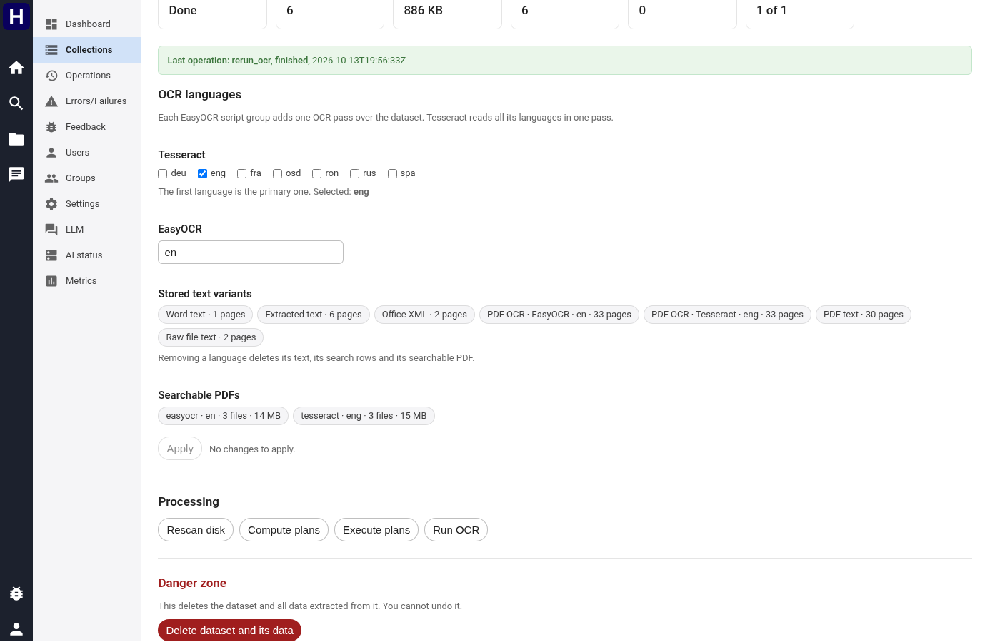</a>

## Errors and failures

The Errors/Failures page has two sections. Operational failures lists failed operations, grouped by
their error. Document errors lists the newest error of each document and task in every collection.
Filter by collection, dataset, task and error text. A table above the list counts the documents of
each dataset and task. On the Collections page, an error count opens the errors of its collection or
dataset.

## Feedback

<a href="img/admin-feedback.png">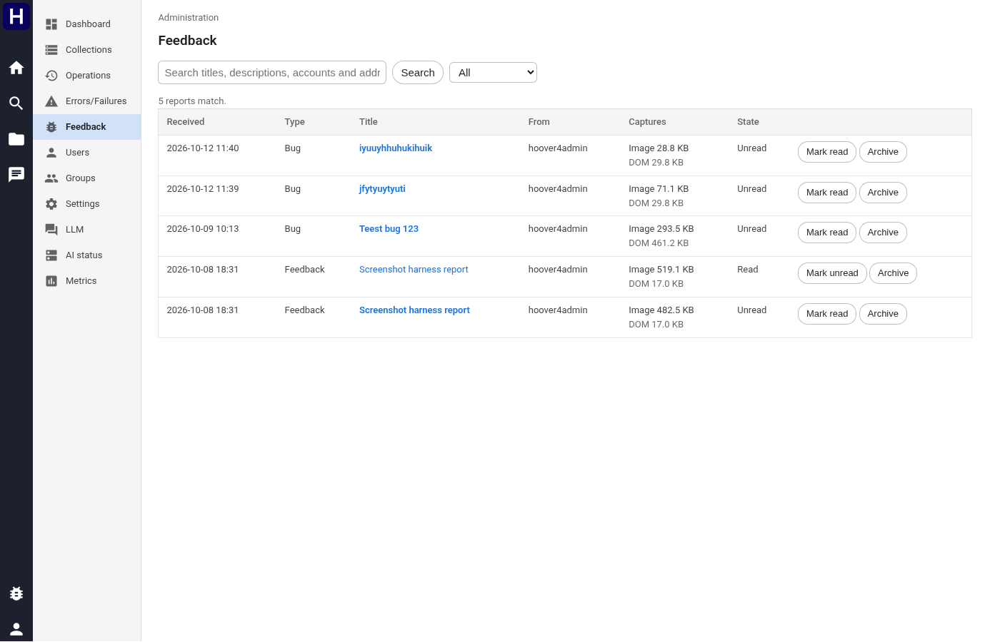</a>

The image shows the admin feedback controls.

The Feedback page lists the reports that people sent, newest first. Search finds text in the
title, the description, the account and the page address. The status list shows the reports
that are not archived, the unread reports, the archived reports, or all of them. Select a title
to see the description, the page image, a link to the page copy, and the debug context. **Mark
read** and **Archive** are separate, so an archived report keeps its read state.

<a href="img/admin-feedback-detail.png">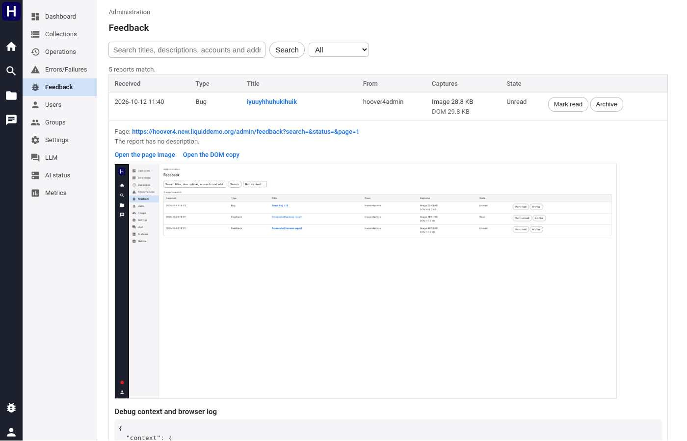</a>

Select **Open the page image** to inspect the screenshot.
Select **Open the DOM copy** to inspect the saved page.
The debug context and browser log appear below the image.

## Users and groups

Users are listed with their origin: the identity the proxy asserted the first time each
one reached the site.

A user's page edits their name, email and superuser flag, shows their group memberships, links
to their LLM usage, and holds the delete action.

Groups work the same way, and a group's page is where **collection access** is granted.

## Settings

This page holds the server settings you can change without a redeploy: the chat switch, the
board work limit and the session lifetime. Chats and boards are kept until a person deletes
them, so no setting removes chat content by age. The models are not
here: `hoover4.ini` sets them. Below
them sits the deployment configuration that is read-only because it comes from
`hoover4.ini`.

<a href="img/admin-settings.png">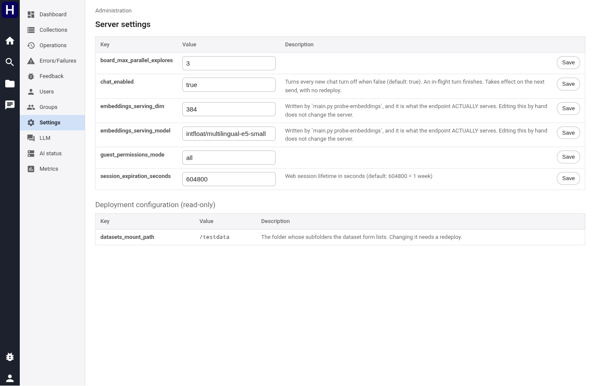</a>

## LLM

The provider table with its model count, when the catalogue was last refreshed and whether it
is stale, and a **Refresh catalog** button. **Models** shows, read only, the model of agent
turns and the model of titles, summaries and board work, which `hoover4.ini` sets, and the
**Thinking** switch. **Catalog** lists every model the provider offers with usage counts.

## AI status

Configured versus actually serving, per capability (embeddings, rerank, NER, OCR, LLM,
browser) with reachability and the endpoint behind each. Below it, the vector shards and the
browser router's live session count.

Compare the configured and serving providers when a capability fails or returns different model information.

## Metrics

Live chat turns, then usage over the last 24 hours: events by type, events per hour, and the
busiest users. Events record who, which route or function, and when, never a URL or a query
string.

<a href="img/admin-metrics.png">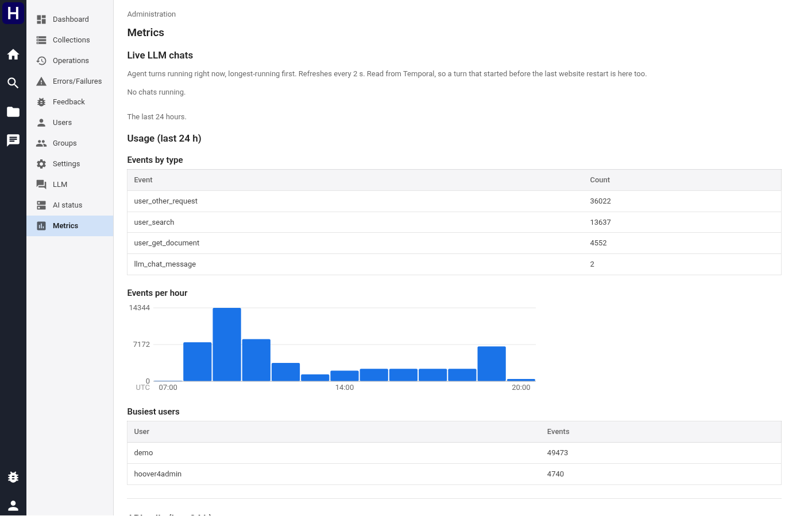</a>

## Inspect operations and their details.

<a href="img/admin-operations.png">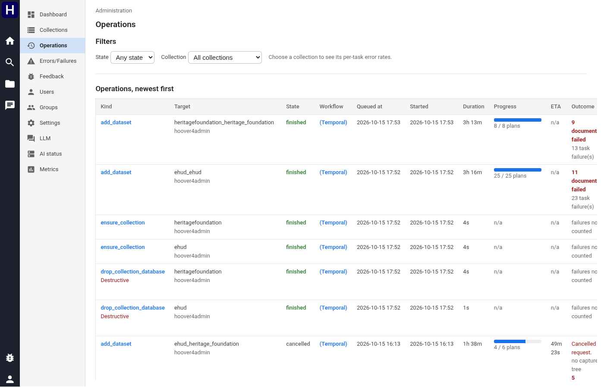</a>

The image shows the admin operations controls.

<a href="img/admin-operation.png">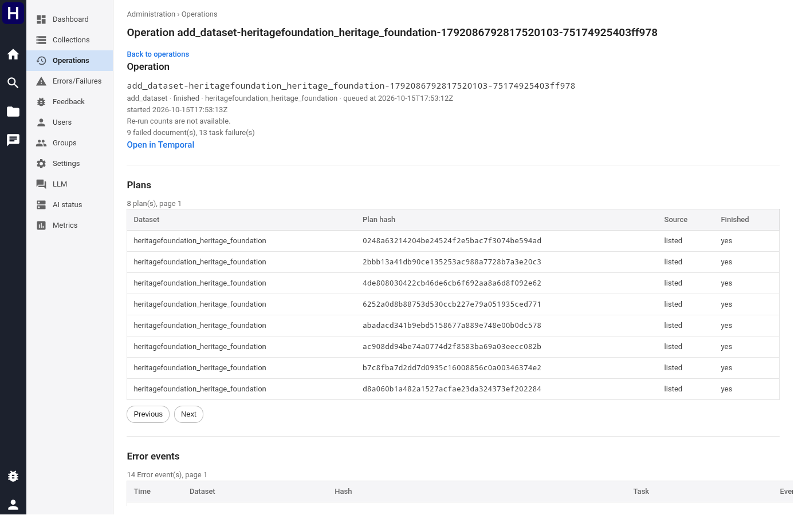</a>

The image shows the admin operation controls.

Open **Operations** to list processing and maintenance requests.
Filter by state, operation kind, collection, or dataset.
Open an operation to inspect its inputs, progress, counts, plans, events, and recorded failures.
A queued operation waits for admission. A running operation can still have document errors.
Completion records the operation outcome and does not establish that every document succeeded.

Use **Cancel** on an active operation when its work must stop.
Wait for its terminal state before starting conflicting work.
Completed targets remain stored, and supported repeat operations can use them.
Use the available repeat control to review the recorded inputs before starting another operation.
A destructive action requires the target confirmation shown by the interface.
Collection and dataset locks can delay or refuse conflicting work.

## Inspect document errors and operation failures.

<a href="img/admin-failures.png">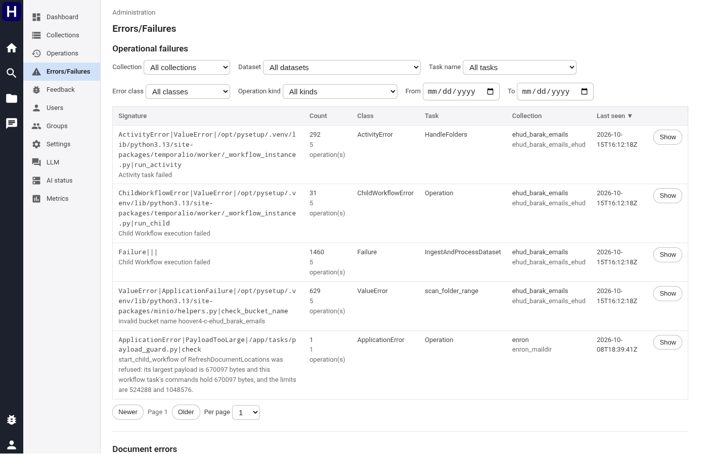</a>

The image shows the admin failures controls.

Open **Errors/Failures** and select the relevant record family.
A document error identifies a document and task.
An operation failure explains why an operation or stage stopped and can contain nested causes.
Open the failure detail to inspect its tree and linked operation.
Use the collection or dataset processing **Retry** control to repeat supported failed document tasks.
Inspect the resulting operation and error counts after it finishes.
A successful repeat resolves an earlier document error only when the matching task records success.

## Inspect model usage and service metrics.

Open a user and follow the model usage link for that account.
The LLM page provides reports for error counts, recent errors, tool calls, top users, and chat checks.
Select **Run report** in the section you need.
Select the report period and model or user restrictions available in the report.
Use Metrics to inspect active turns, model activity, tool work, worker queues, and datastore activity.
Use an active turn's cancellation control to stop that turn when required.
Inspect the resulting turn state before starting replacement work.

## Export, restore, and collect diagnostics.

[The recovery procedure](../operations/Backup_And_Restore.md) explains collection export and restore.
[Operations workflows](../../main_services/processing/tasks/P_ops/Readme.md) define maintenance operations.
[The operations guide](../operations/Readme.md) links deployment and datastore procedures.
These tasks require operator access to the command environment.
A product administrator account does not itself supply host access.
Verify the export manifest and destination before a recovery operation.
Restore requires an empty target collection and its supported manifest version.
Verify restored document counts, source bytes, search data, and vectors before using the recovered collection.
