# Hoover4 administration manual

Open **Administration** from the account control.
Your account must have administrator access.
Use this manual to manage collections, processing, users, settings, and failures.
[The user manual](User_Manual.md) explains document investigation tasks.

## Dashboard

Counts of users, groups, collections and datasets, each linking to its section. The Datasets
card opens the Datasets section of the Collections page.

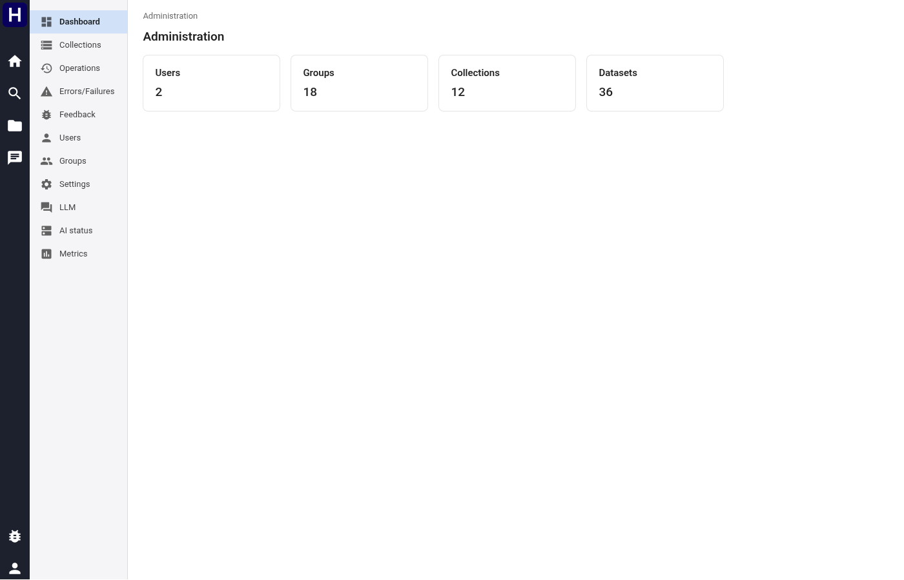

## Collections

The first table shows each collection's display name, dataset count, documents, size, state
and access. The state is Processing while an operation changes the collection, and Done
otherwise. A failed operation also ends in Done. The Datasets section lists the datasets of
every collection with their documents, size, indexed documents, errors, state and creation
date. The form at the bottom adds a collection.

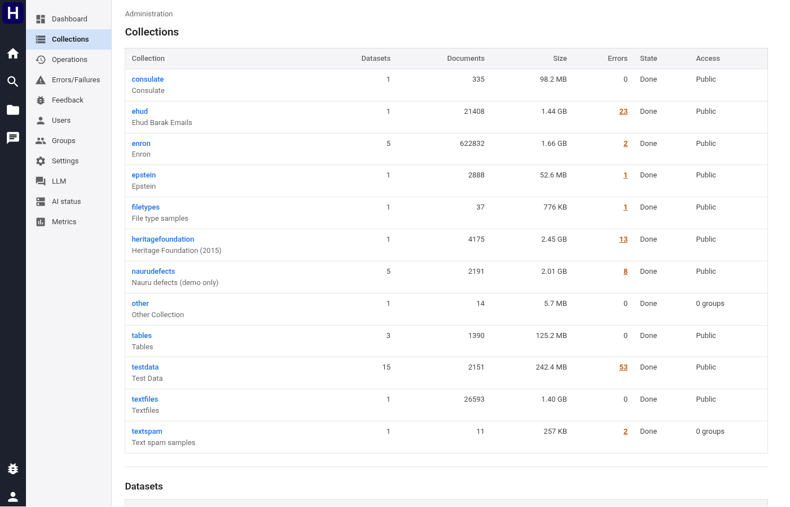

A collection's own page lists its datasets first, then renames it, links to its processing
view, sets its access, and shows its newest ten operations.

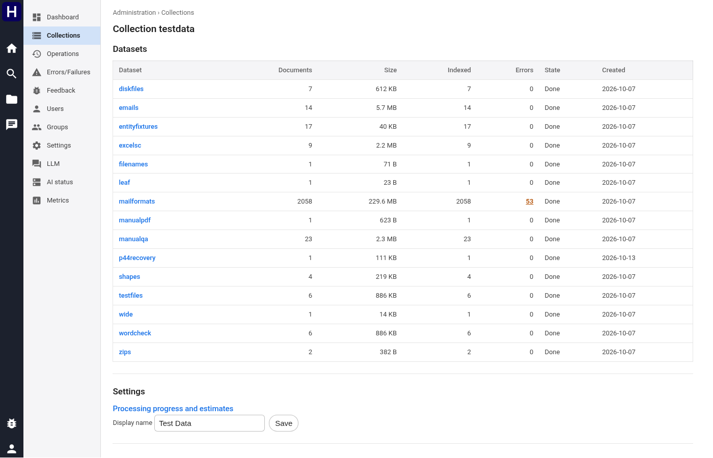

## Processing

Open the processing view during ingestion. It shows five progress groups per dataset.
**P0 Scan & deduplicate**, **P1 Compute plans**, **P2/P3 Execute plans & parse**,
**P4 Extract entities (NLP)**, **P6 Index for search**, each with a progress bar and a
count, an error count beside the dataset name, a throughput chart, what is running right
now, and a table of where the processing time actually goes.

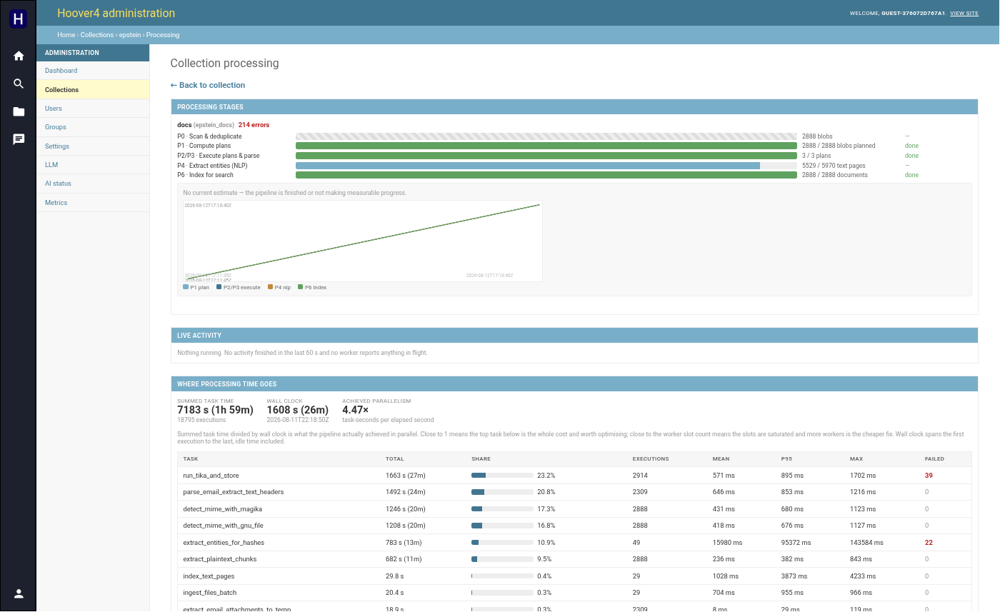

## Datasets

A dataset's page shows its type and source path, when it was created, and its statistics:
state, documents, size, indexed documents, errors, and finished plans. It also shows the OCR
languages in use.

**Run OCR** completes the work required by the dataset's current OCR settings.
It first completes unfinished processing and removes earlier PDF member documents.
It then prepares PDF sources, completes previews, runs missing OCR work, and indexes changed text.
Saved OCR results provide their text without another OCR request.
The operation also indexes replacement native PDF text when OCR languages are empty.
It skips small or empty images and retains known PDF defects as metadata.
Current processing errors settle the affected work.
**Retry** on the processing page repeats failed files.

The progress bar counts plans while unfinished processing runs, then OCR and indexing
targets. New OCR text adds indexing targets, so the total can increase during the run. A
second **Run OCR** on a finished dataset sends no OCR request. A cancelled run loses no
completed work, and the next **Run OCR** continues from it.

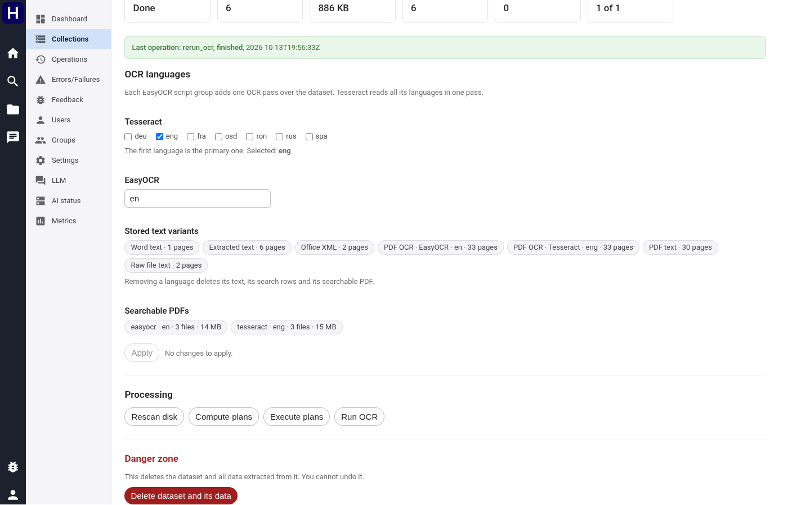

## Errors and failures

The Errors/Failures page has two sections. Operational failures lists failed operations, grouped by
their error. Document errors lists the newest error of each document and task in every collection.
Filter by collection, dataset, task and error text. A table above the list counts the documents of
each dataset and task. On the Collections page, an error count opens the errors of its collection or
dataset.

## Feedback

The Feedback page lists the reports that people sent, newest first. Search finds text in the
title, the description, the account and the page address. The status list shows the reports
that are not archived, the unread reports, the archived reports, or all of them. Select a title
to see the description, the page image, a link to the page copy, and the debug context. **Mark
read** and **Archive** are separate, so an archived report keeps its read state.

## Users and groups

Users are listed with their origin: the identity the proxy asserted the first time each
one reached the site.

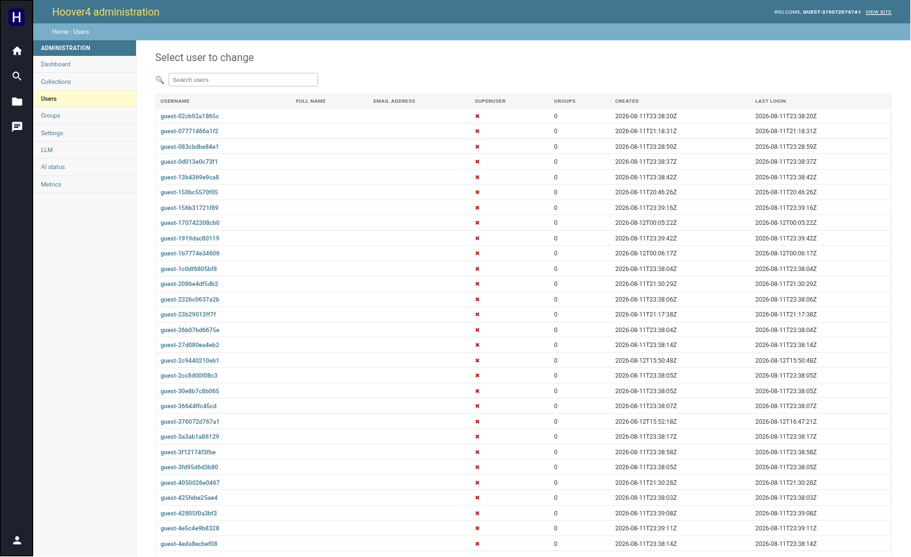

A user's page edits their name, email and superuser flag, shows their group memberships, links
to their LLM usage, and holds the delete action.

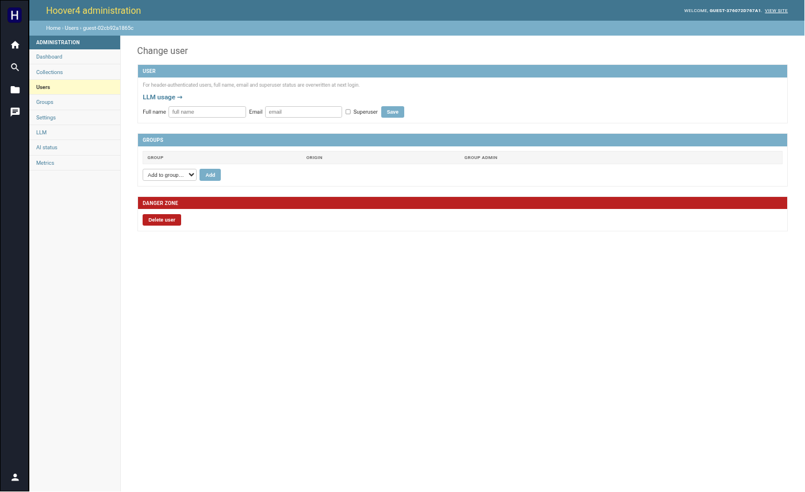

Groups work the same way, and a group's page is where **collection access** is granted.

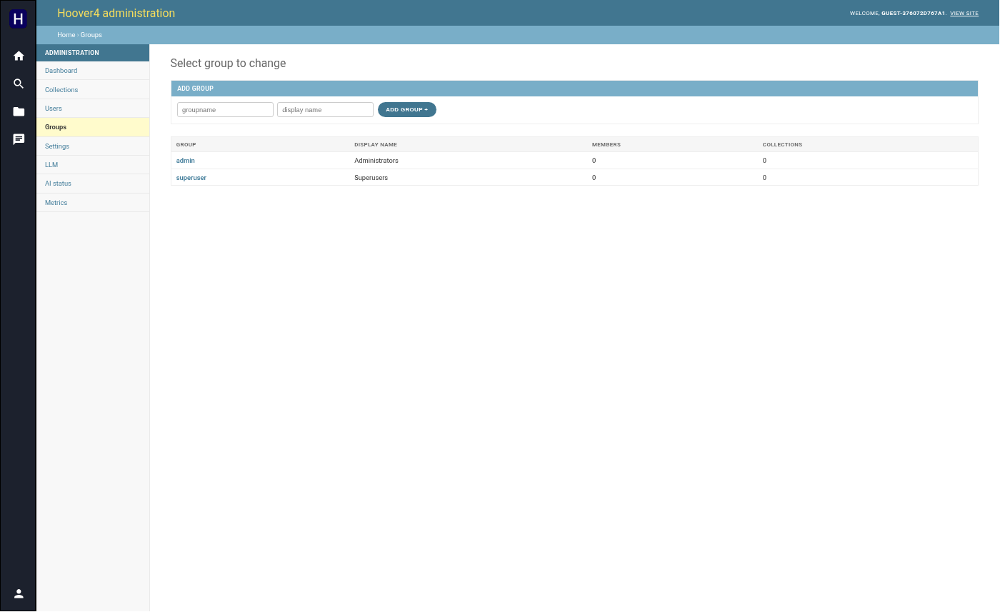

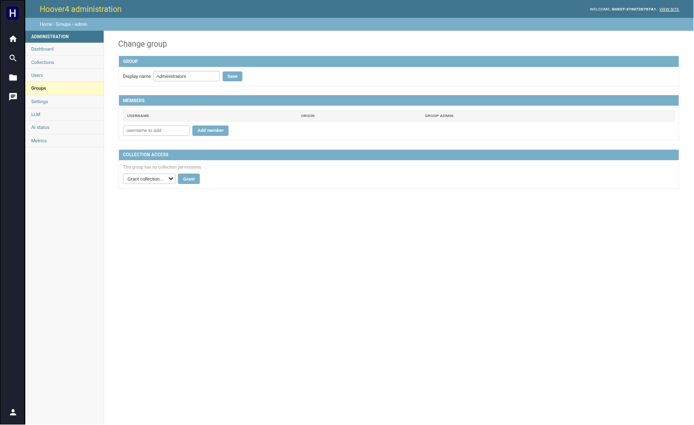

## Settings

This page holds the server settings you can change without a redeploy: the chat switch, the
board work limit and the session lifetime. Chats and boards are kept until a person deletes
them, so no setting removes chat content by age. The models are not
here: `hoover4.ini` sets them. Below
them sits the deployment configuration that is read-only because it comes from
`hoover4.ini`.

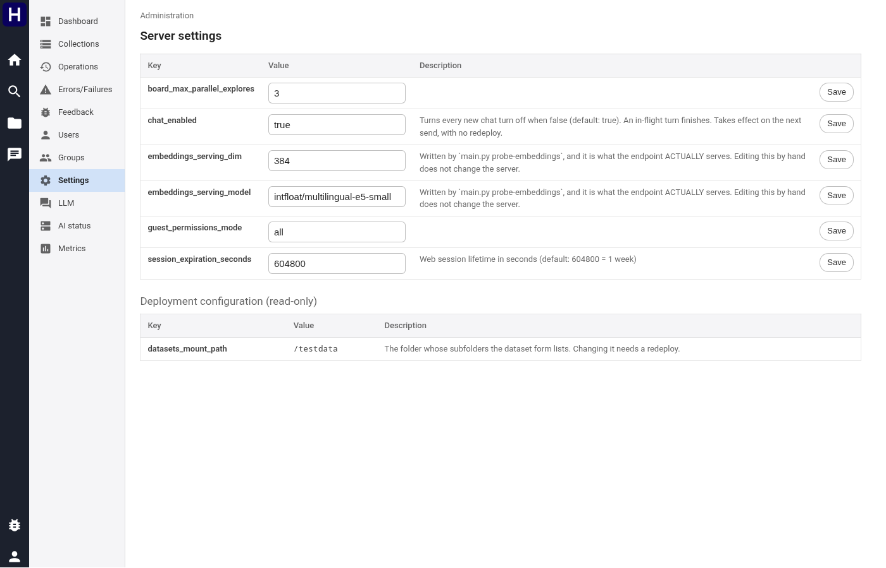

## LLM

The provider table with its model count, when the catalogue was last refreshed and whether it
is stale, and a **Refresh catalog** button. **Models** shows, read only, the model of agent
turns and the model of titles, summaries and board work, which `hoover4.ini` sets, and the
**Thinking** switch. **Catalog** lists every model the provider offers with usage counts.

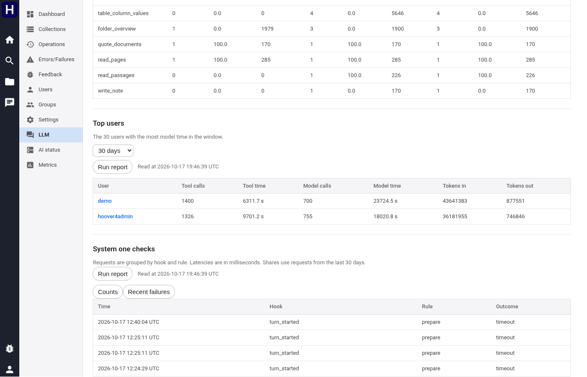

## AI status

Configured versus actually serving, per capability (embeddings, rerank, NER, OCR, LLM,
browser) with reachability and the endpoint behind each. Below it, the vector shards and the
browser router's live session count.

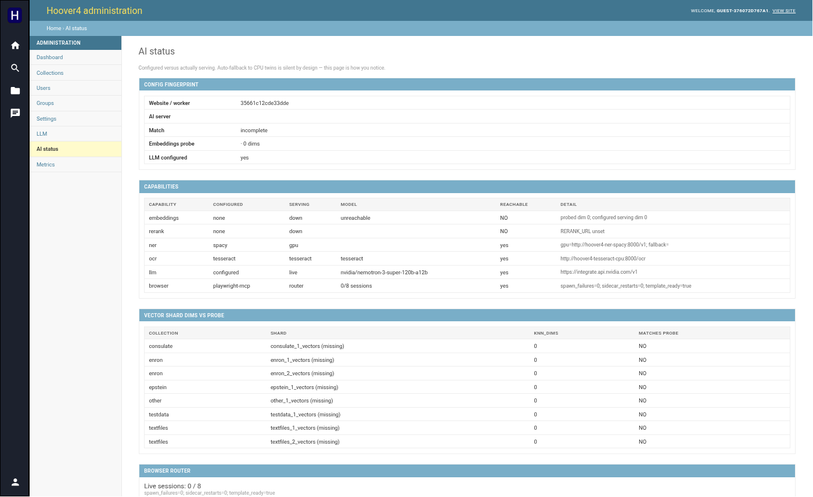

Compare the configured and serving providers when a capability fails or returns different model information.

## Metrics

Live chat turns, then usage over the last 24 hours: events by type, events per hour, and the
busiest users. Events record who, which route or function, and when, never a URL or a query
string.

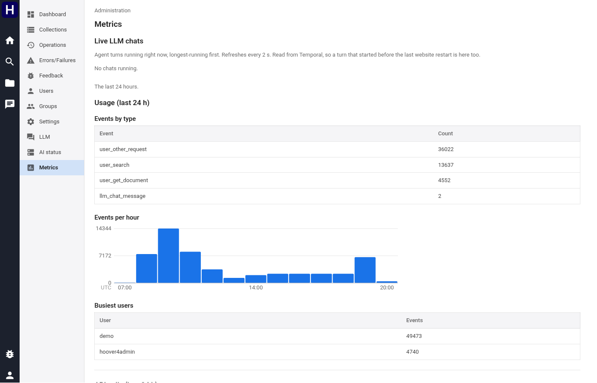

## Inspect operations and their details.

Open **Operations** to list processing and maintenance requests.
Filter by state, operation kind, collection, or dataset.
Open an operation to inspect its inputs, progress, counts, plans, events, and recorded failures.
A queued operation waits for admission. A running operation can still have document errors.
Completion records the operation outcome and does not establish that every document succeeded.

Use **Cancel** on an active operation when its work must stop.
Wait for its terminal state before starting conflicting work.
Completed targets remain stored, and supported repeat operations can use them.
Use the available repeat control to review the recorded inputs before starting another operation.
A destructive action requires the target confirmation shown by the interface.
Collection and dataset locks can delay or refuse conflicting work.

## Inspect document errors and operation failures.

Open **Errors/Failures** and select the relevant record family.
A document error identifies a document and task.
An operation failure explains why an operation or stage stopped and can contain nested causes.
Open the failure detail to inspect its tree and linked operation.
Use the collection or dataset processing **Retry** control to repeat supported failed document tasks.
Inspect the resulting operation and error counts after it finishes.
A successful repeat resolves an earlier document error only when the matching task records success.

## Inspect model usage and service metrics.

Open a user and follow the model usage link for that account.
The LLM page provides reports for error counts, recent errors, tool calls, top users, and chat checks.
Select **Run report** in the section you need.
Select the report period and model or user restrictions available in the report.
Use Metrics to inspect active turns, model activity, tool work, worker queues, and datastore activity.
Use an active turn's cancellation control to stop that turn when required.
Inspect the resulting turn state before starting replacement work.

## Export, restore, and collect diagnostics.

[Administrative workflows](../../main_services/processing/tasks/P_admin/Readme.md) define collection export, restore, purge, and diagnostic commands.
[The operations guide](../operations/Readme.md) links deployment and datastore procedures.
These tasks require operator access to the command environment.
A product administrator account does not itself supply host access.
Verify the export manifest and destination before a recovery operation.
Restore requires an empty target collection and its supported manifest version.
Verify restored document counts, source bytes, search data, and vectors before using the recovered collection.
