# Hoover: user manual

Use this manual to search collections, read documents, browse folders, ask chat questions, and work with investigation boards.
[The administration manual](Admin_Manual.md) explains collection management and processing.
Your administrator supplies the site address and account access.

---

## Contents

1. [Getting in](#1-getting-in)
2. [The layout](#2-the-layout)
3. [Home](#3-home)
4. [Search](#4-search)
5. [Filters](#5-filters)
6. [Sorting and paging](#6-sorting-and-paging)
7. [Reading a document](#7-reading-a-document)
8. [Storage, browsing by folder](#8-storage-browsing-by-folder)
9. [AI chat](#9-ai-chat)
10. [Investigation boards](#10-investigation-boards)

11. [Sharing and bookmarking](#11-sharing-and-bookmarking)
12. [Review search and processing limits.](#12-review-search-and-processing-limits)

---

## 1. Getting in

Sign in through your deployment's sign-in page.
Your group memberships determine which collections you can read.
Ask your administrator when an expected collection is absent.
Administration controls appear only for accounts with administrator access.

---

## 2. The layout

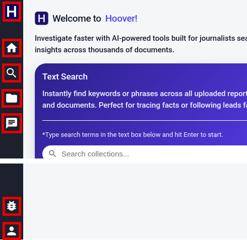

Every page shares the dark rail down the left edge. From the top:

| icon | goes to |
|---|---|
| **H** | the home page |
| house | Home |
| magnifier | Search |
| folder | Storage (the file browser) |
| speech bubble | AI chat |
| bug (bottom) | report a bug or send feedback |
| person (bottom) | administration, for administrators only |

Hold the pointer over an icon to show its name beside it.

Some pages have a divider between two panes: search results and the preview, the storage
listing and the preview, the three panes of a document tab, and a conversation and its side
pane. Drag a divider to change the width of a pane, and double-click it to put it back. Each
width is remembered on this browser.

<a href="img/home.png">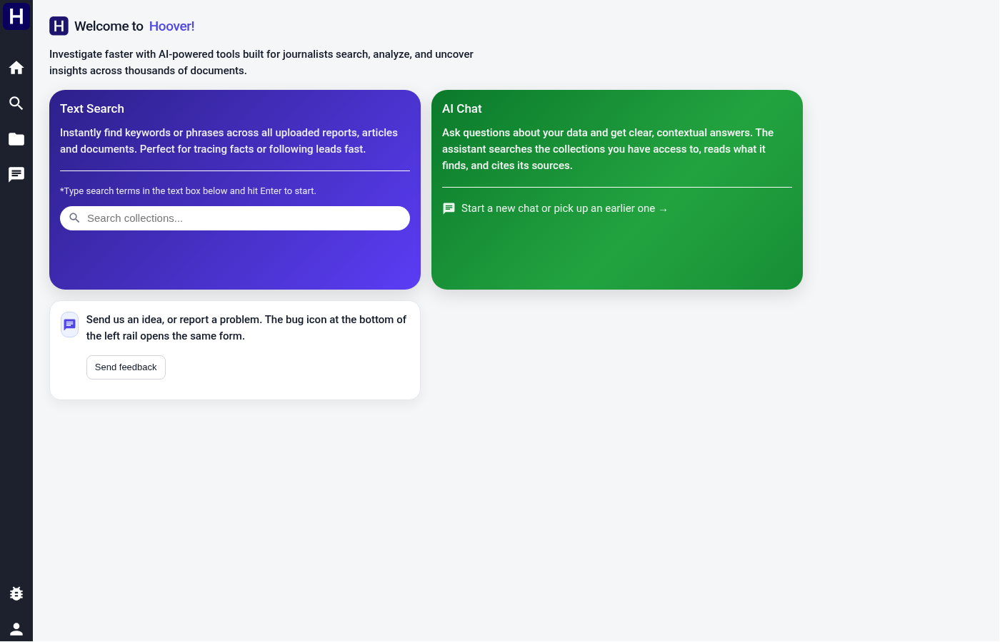</a>

 

---

## 3. Home

The landing page has two cards.

**Text Search** carries the search box. Type a term and press <kbd>Enter</kbd>, the box
submits on Enter, there is no separate button.

**AI Chat** links to a new conversation or to your earlier ones.

Below them is a feedback card. Its button opens the same report as the bug icon in the rail.

### Reporting a bug or sending feedback

<a href="img/feedback-form.png">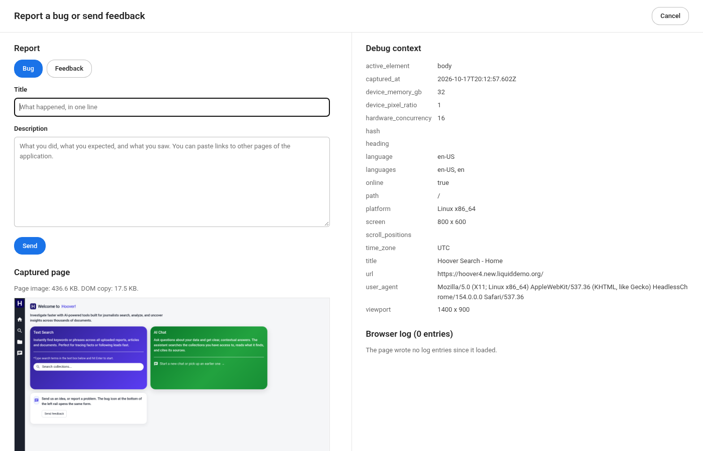</a>

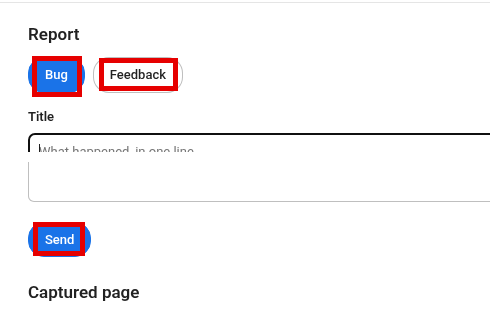

Select the bug icon at the bottom of the rail. The icon turns red while the browser copies the
page and draws an image of it. A full-screen form then shows the image, the size of the image
and of the page copy, the browser information and the browser log. Select **Bug** or
**Feedback**, write a title and a description, and select **Send**. You can paste links to
other pages of the application into the description. Frames, some canvases and some embedded
viewers can look different in the image, and the form names them when the page has them.

 

---

## 4. Search

Submitting a query opens the search page: the query box and toolbar across the top, the result
list on the left, and the document preview on the right.

<a href="img/search-results.png">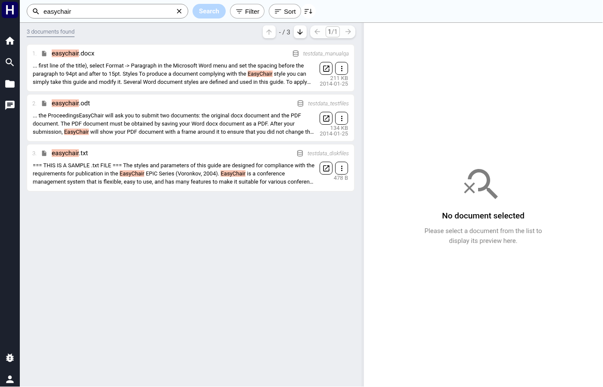</a>

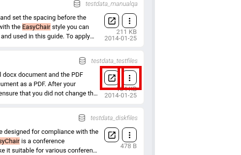

Reading a result card:

* the **number** in the left margin is the result's position in the whole result set. It keeps
  counting across pages, so page 26 starts at `501.`;
* the **title** is the document's filename;
* the **chip on the right** (`testdata_testfiles`, `enron_maildir`, …) is the *dataset* the
  document belongs to, written `<collection>_<dataset>`;
* the **snippet** is text from the document with your search terms highlighted in orange;
* the two buttons at the right of each card are **open in the full-page viewer** and the
  **actions menu**. See [result actions](#result-actions);
* under the two buttons are the **file size** and a **date**. The date is the latest date of
  the document when the list is sorted newest first, and its earliest date otherwise. A value
  that the index does not know leaves its line empty.

Clicking anywhere else on the card selects it and loads it into the preview pane on the right.

<a href="img/search-preview-pdf.png">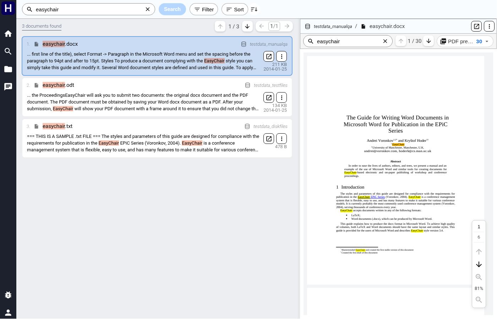</a>

### What you can type

<a href="img/search-repair.png">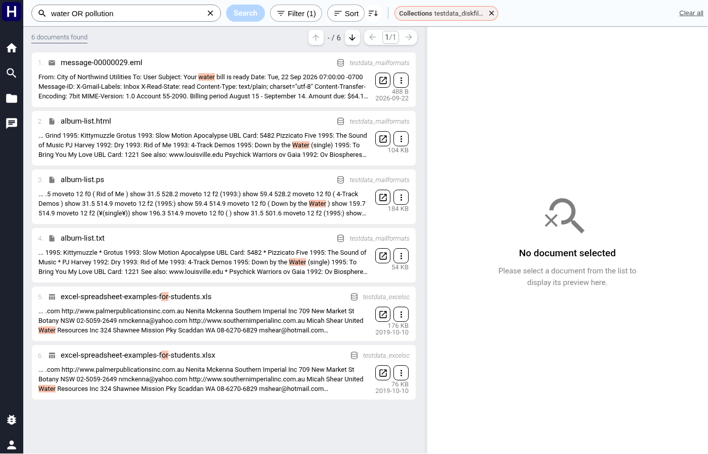</a>

The image shows uppercase Boolean query results.

The query accepts these full-text operators.

| You type | The search does this. |
|---|---|
| `contract draft` | It requires both words. |
| `"exact phrase"` | It requires adjacent words in this order. |
| `contract -draft` | It excludes documents with `draft`. |
| `power \| energy` | It requires either word. |
| `comput*` | It matches this prefix. |
| `*pollut*` | It matches words containing at least three specified letters. |
| `dasovi?h` | It matches one varying character. |
| `dasovic%` | It matches zero or one character. |
| `"water pollution"~10` | It matches words within ten positions. |
| `"water pollution plant"/2` | It requires any two words. |
| `water NEAR/5 pollution` | It matches nearby words in either order. |
| `water NOTNEAR/5 pollution` | It excludes nearby occurrences of the second word. |
| `skilling << resigned` | It requires this word order. |
| `"(water \| sewage) plant"` | It accepts either word inside the phrase. |
| `"(water \| sewage) plant"~10` | It accepts either word inside the proximity search. |
| `"(water \| sewage) plant"/2` | It accepts an alternative inside the quorum search. |

Word forms do not match automatically. Search `contract \| contracts` or `contract*` to include both forms.
The search repairs unmatched quotes, brackets, and stray operator characters.
The normal result view does not display these repair details.
A short-infix notice explains the three-character minimum when it applies.
A query needs at least one positive word. Use `contract -draft` when you need an exclusion.

### Apply a search scope.

Open **Filter**, then **Collections**.
Select the datasets you need and apply the filter.
An empty query lists documents within the selected scope.
Your account must have access to at least one readable collection.
Clearing a dataset restriction returns to the permitted search scope.

### Move searches from legacy Hoover.

 

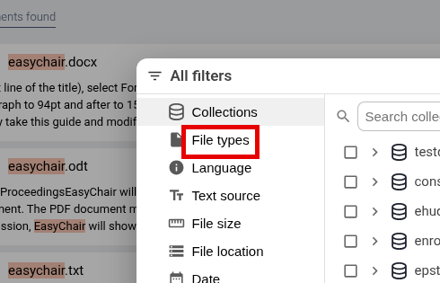

| Legacy input | Hoover4 instruction |
|---|---|
| `water AND pollution` | Hoover4 rewrites uppercase `AND` and requires both words. |
| `water OR sewage` | Hoover4 rewrites uppercase `OR` to `\|`. |
| `water NOT sewage` | Hoover4 rewrites uppercase `NOT` to exclusion. Keep a positive term. |
| `water and pollution` | Lowercase `and`, `or`, and `not` remain ordinary search words. |
| `from:john.smith@example.com` | The prefix is removed and the address becomes text. Use **Email Sender** for a sender restriction. |
| `to:john.smith@example.com` | The prefix is removed and the address becomes text. Use **Email Receiver** for a recipient restriction. |
| `filename:invoice.pdf` | Field-prefix syntax does not select a filename field. Search the filename text or use Storage name search. |
| `filetype:email` | Use the **File types** filter. |
| `@field value` | Field operators are unavailable. Use the corresponding filter. |
| `comput*` and `*pollut*` | Prefix and infix wildcards remain available. An infix needs at least three characters. |
| `word~1` | This is not a legacy fuzzy edit-distance query. A stray tilde becomes a separator. Use the documented wildcard operators. |
| `"water pollution"~10` | This is a phrase proximity query. The number describes word positions. |
| Earlier bookmarks | Recreate legacy queries with current filters. Legacy addresses have no automatic migration contract. |

The collection tools report query repairs to the assistant.
The normal search result view does not show the same repair notes.
Use the operator reference to interpret a repaired expression.
Public tags, private tags, stars, batch-search screens, and Nextcloud upload controls have no established current equivalent.
Use collection filters, document links, Storage, and the supported dataset ingestion procedure for the relevant current tasks.

### When no result is found

<a href="img/search-suggestions.png">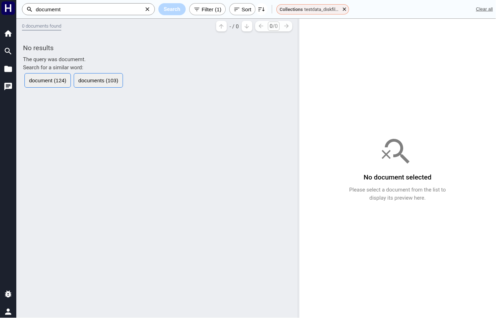</a>

The image shows similar word suggestions for an empty result.

The result area shows **No results** and the query.
A loading line appears while the search verifies similar indexed words.
When similar words have matches under your filters, buttons show their queries and document counts.
Select a button to search that query with the same filters.
When no suggestion exists, the page says that no similar words were found in the selected collections.
A partial notice identifies incomplete suggestions or search results. An empty query shows no suggestion section.

### Result actions

The **⋮** button on a result card opens a small menu:

<a href="img/result-menu.png">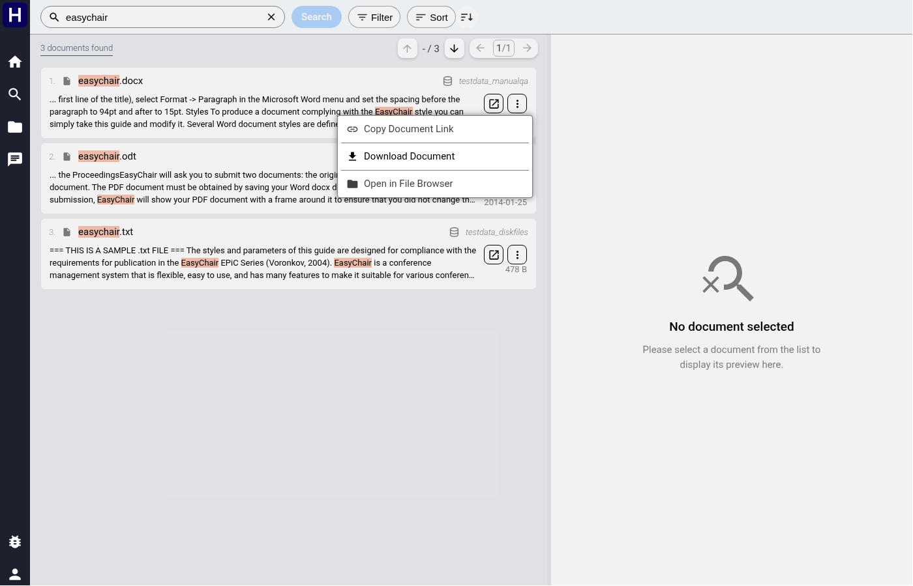</a>

 

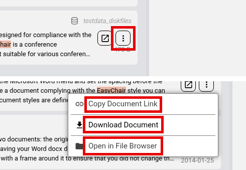

* **Copy Document Link.** Puts a permanent link to this document on your clipboard.
* **Download Document.** Downloads the original file with its real name
  (`stanley.ec02.pdf`, not a hash).
* **Open in File Browser.** Jumps to [Storage](#8-storage-browsing-by-folder) with this
  document selected, so you can see what sits next to it on disk.

 

---

## 5. Filters

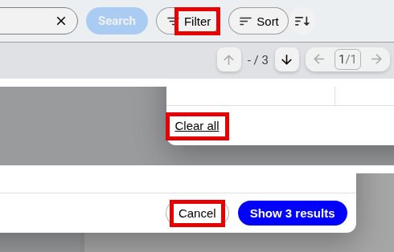

**Filter** in the toolbar opens the filter dialog. Select a pane on the left. Changes
accumulate across panes. The button at the bottom right applies them together and states how
many documents you will get.

**Clear all** (bottom left) drops every filter; **Cancel** closes without applying.

### Collections

Restrict the search to particular datasets. Counts are how many of your current results come
from each.

<a href="img/filter-collections.png">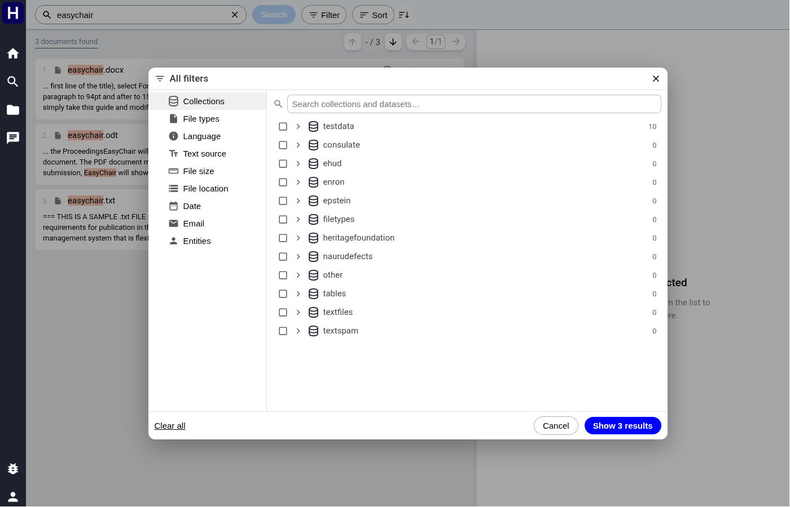</a>

### File types

 

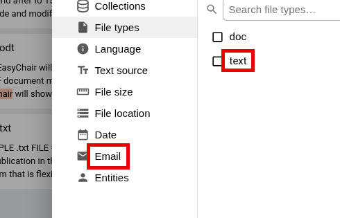

Broad categories, `text`, `email`, `html`, `code`, `pdf`, `doc`, `image`, `archive`, `other`.

<a href="img/filter-file-types.png">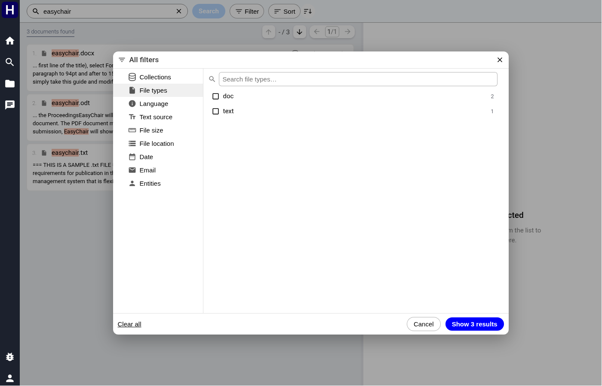</a>

### Language

<a href="img/filter-language.png">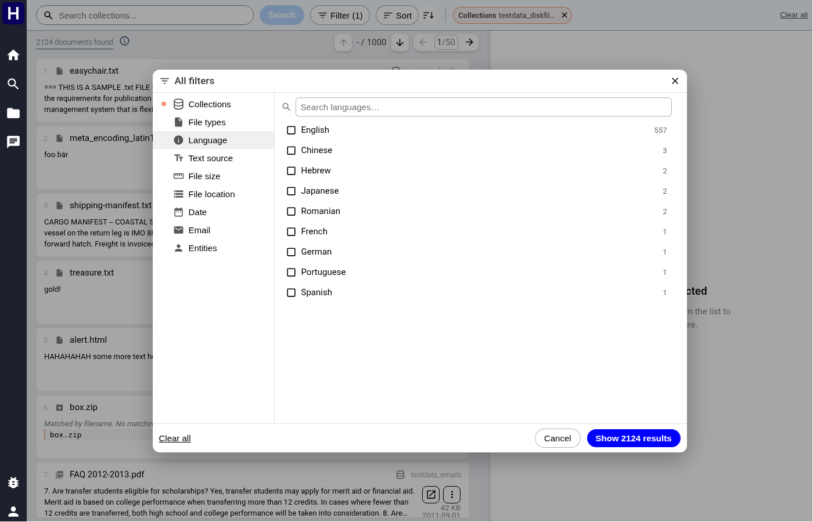</a>

The image shows the filter language controls.

The languages detected in the documents' text. For an email, the language comes from its
body and not from its headers.

### Text source

<a href="img/filter-text-source.png">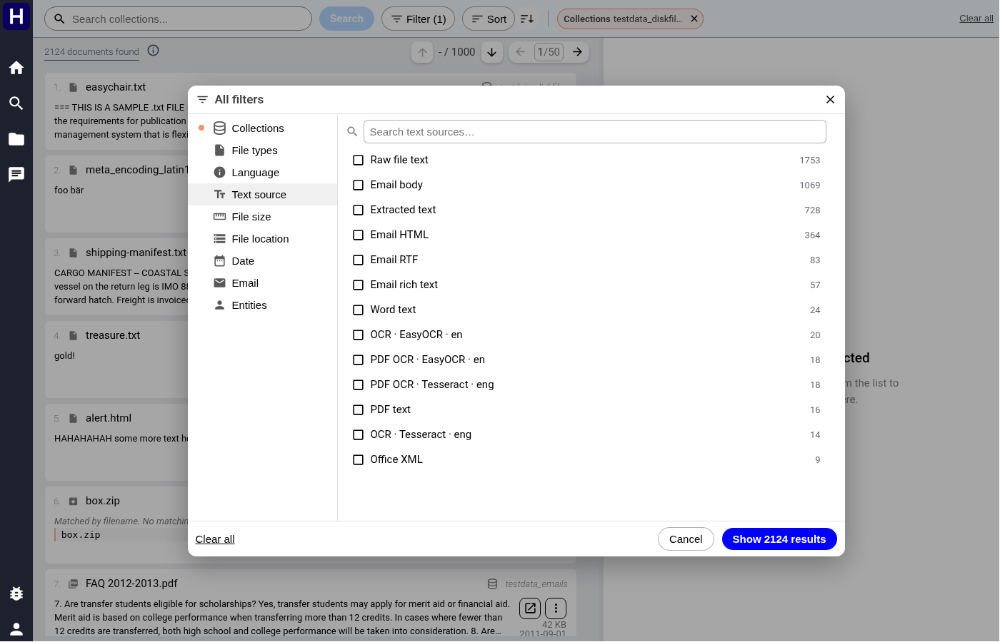</a>

 

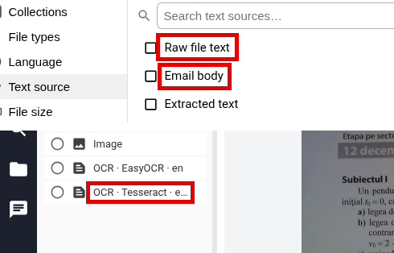

The image shows the filter text source controls.

Where the matching text came from: for example **Raw file text**, **Email body**, or an OCR
engine such as **OCR · Tesseract · eng**. Ticking a source keeps documents whose text from
that source matches the query.

### File size

Four ready-made bands, or your own range in megabytes.

### File location

A folder tree. Ticking a folder finds **everything below it**, including files inside archives
and attachments inside emails.

<a href="img/filter-file-location.png">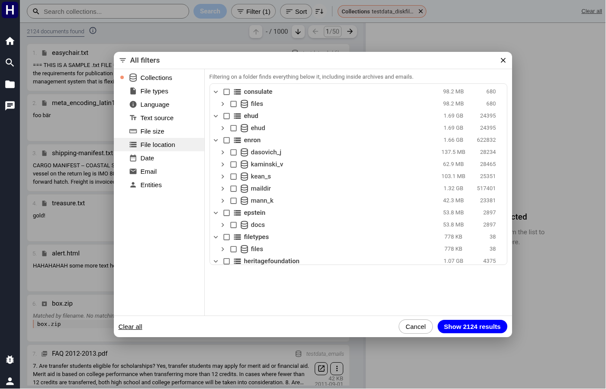</a>

### Date

Four modes (*No filtering*, *Before…*, *After…*, *Between…*) plus **Unknown only** for
documents whose date could not be established. The histogram under them shows how your results
are spread over time, and **clicking a bar filters to that period**.

<a href="img/filter-date.png">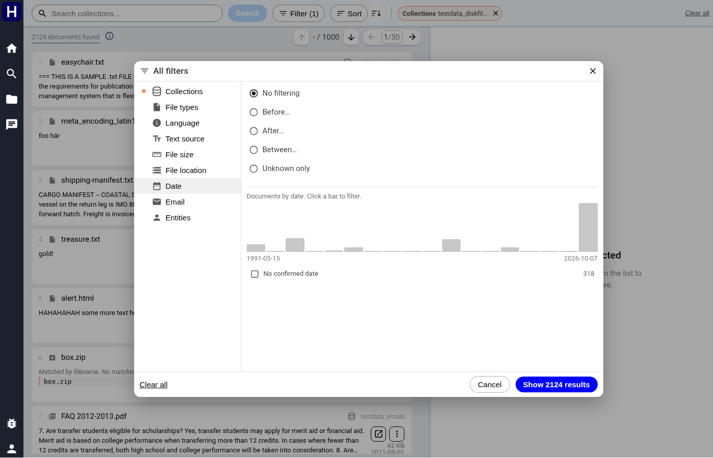</a>

 

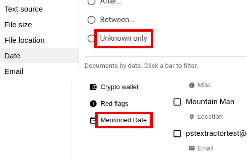

A document matches when its earliest-to-latest confirmed date interval overlaps the selected range.
For example, confirmed dates in 2000 and 2010 make the document match a range in 2005.
This does not establish that the document contains an individual date in 2005.
**Unknown only** selects documents without a confirmed document date.
**Mentioned Date** filters dates extracted from document text and uses separate entity values.

### Email

 

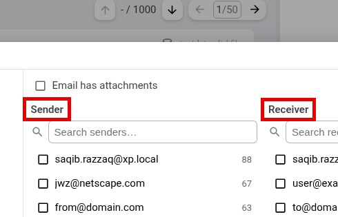

Filter by **Sender** or **Receiver** address, with per-address counts, and a
*Email has attachments* switch.

<a href="img/filter-email.png">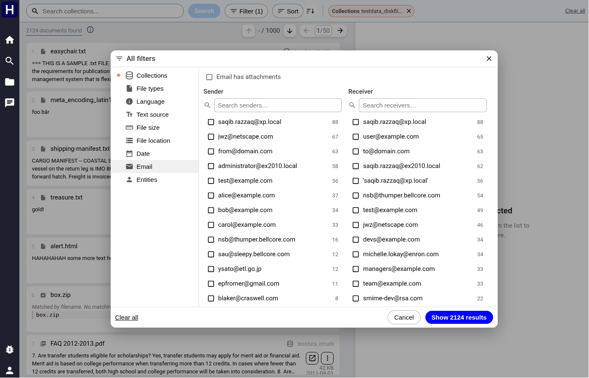</a>

### Entities

People, organisations, locations and other names that were extracted from the documents
automatically. Pick one or several to keep only documents mentioning them.

<a href="img/filter-entities.png">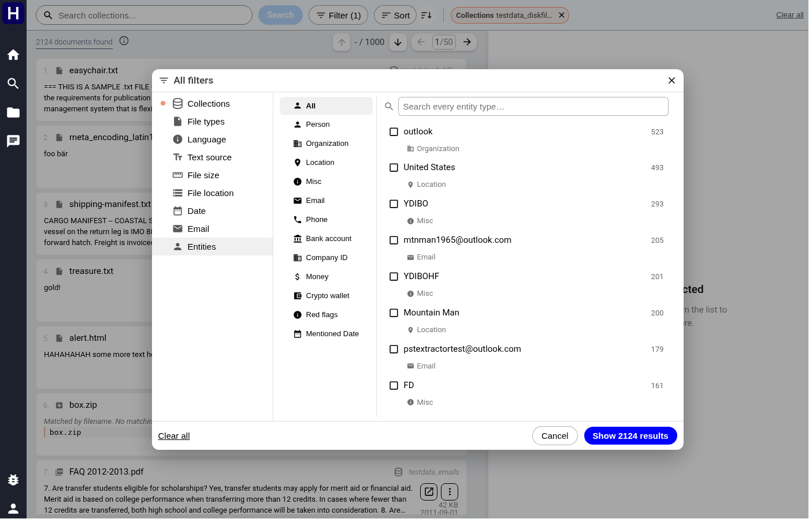</a>

### Red flags

<a href="img/filter-red-flags.png">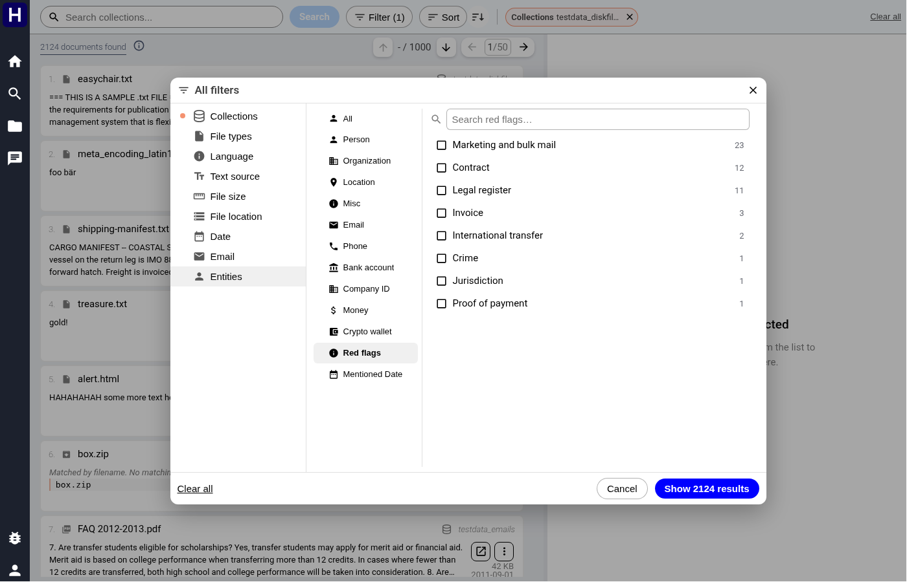</a>

 

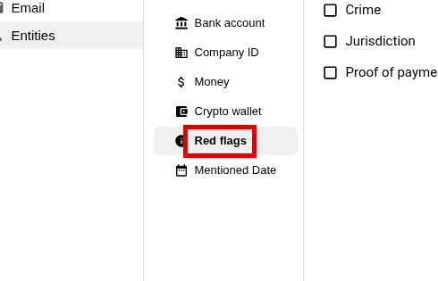

The image shows the filter red flags controls.

Select **Red flags** in the filter dialog.
Select one or more categories and apply them.
Counts use the other active search restrictions.
A red flag directs document review and does not establish misconduct.
Open a matching document to inspect its scored passages and supporting signals.

### Applied filters

 

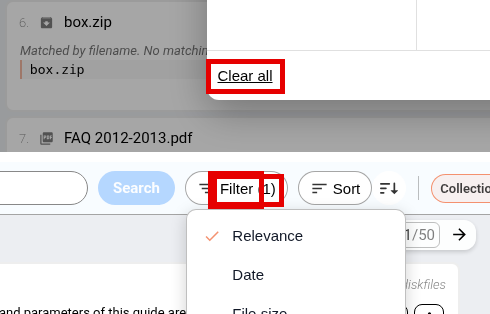

Once applied, the active filters are listed under the toolbar with a **Clear all** beside them,
and the toolbar's **Filter** button gains a count: `Filter (1)`.

 

---

## 6. Sorting and paging

**Sort** offers *Relevance*, *Date*, *File size* and *Name*.
The arrow changes direction for Date, File size, and Name.
Relevance always uses descending score order.

<a href="img/sort-menu.png">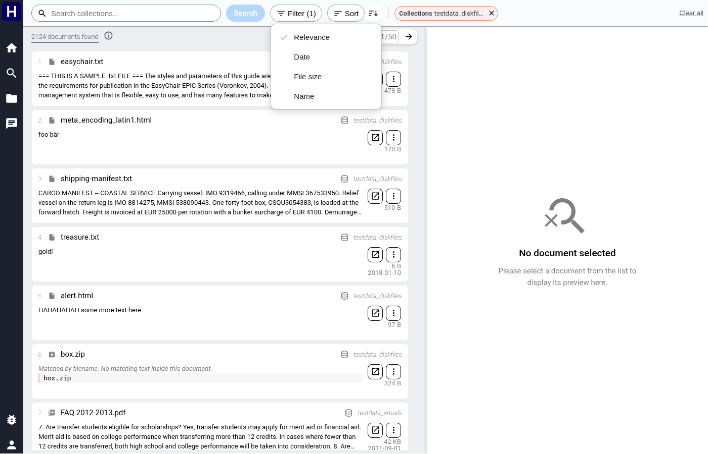</a>

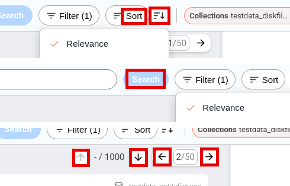

> Choosing a sort marks your choice; press **Search** to put it into effect.

*Relevance* orders by the search score. With an empty query every document has the same
score, so choose *Date* to order such a list by time.

Paging is at the top right of the result list: arrows for previous and next, `1/51` for where
you are, and the up/down arrows next to `- / 1000` step through individual results without
leaving the page.

<a href="img/search-pagination.png">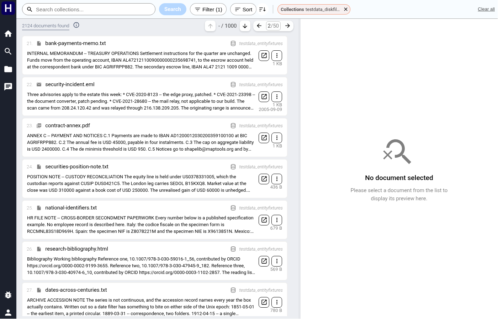</a>

**Only the first 1 000 results of any search can be opened**, however many were found. If your
search matches more than that, narrow it with [filters](#5-filters) rather than paging.

 

---

## 7. Reading a document

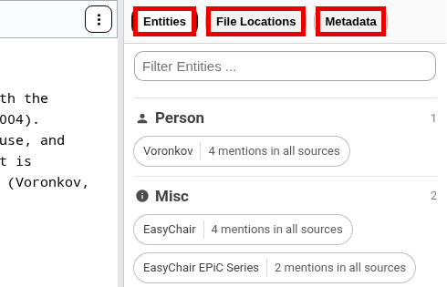

Selecting a result opens the viewer, either in the right-hand pane or full-page. Three columns:

* **left**: search within this document, and the list of *sources*;
* **middle**: the document itself;
* **right**: the **Entities**, **File Locations**, and **Metadata** tabs.

<a href="img/document-text.png">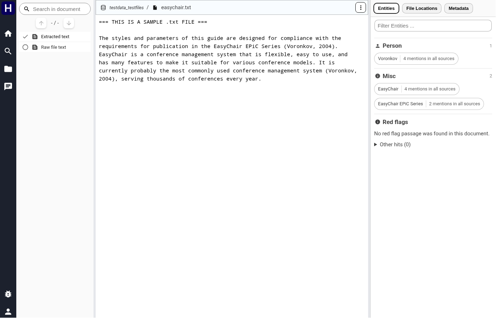</a>

### Sources

<a href="img/document-archive.png">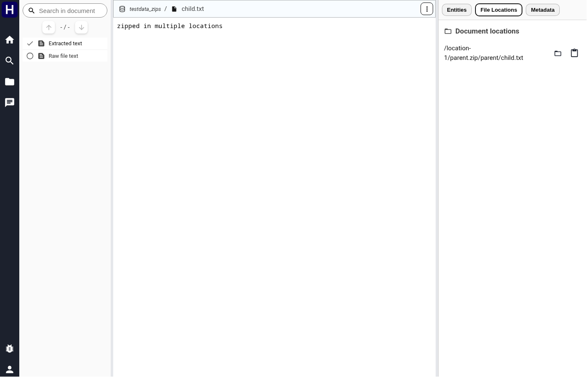</a>

 

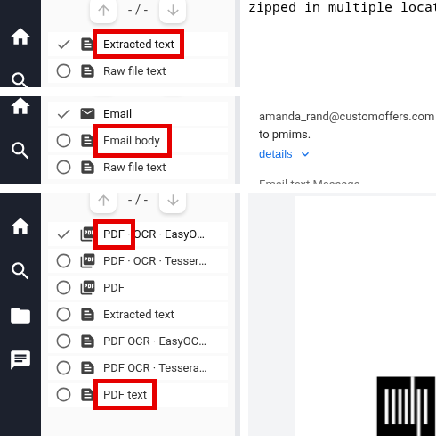

The image shows archive member file locations.

 

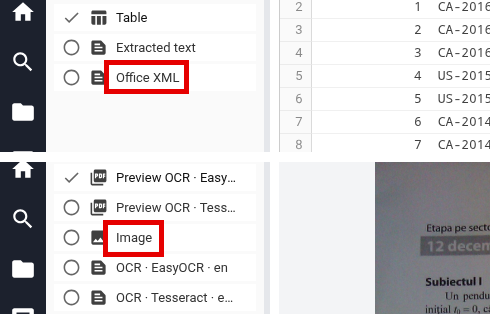

One file can be readable in several ways, and each way is a source you can switch between:

| source | what it is |
|---|---|
| **Extracted text** | the text a general extractor pulled out |
| **Plain text** | the raw file as text |
| **Email** | the message rendered as an email, subject, addresses, date, body |
| **Email body** | the selected parsed body |
| **PDF** | the real PDF, rendered page by page |
| **PDF · OCR · Tesseract · eng** | the same PDF after optical character recognition |
| **PDF text** | the text layer, without the page images |
| **PDF OCR · Tesseract · eng** | OCR text from selected PDF pages |
| **PDF preview** | a PDF preview of a supported Office document |
| **PDF preview · OCR · Tesseract · eng** | a searchable Office preview |
| **Preview OCR · Tesseract · eng** | a searchable image preview |
| **Office XML** | a `.docx` / `.odt` rendered from its XML |
| **Image** / **OCR · Tesseract · eng** | the picture, and the text read out of it |
| **Table** | a spreadsheet or delimited-text grid with sheet and column controls |
| **File Locations tab** | every path in the collection where this exact content appears |

A PDF gets the full viewer, page navigation, zoom, and the page counter at the bottom right:

<a href="img/document-pdf.png">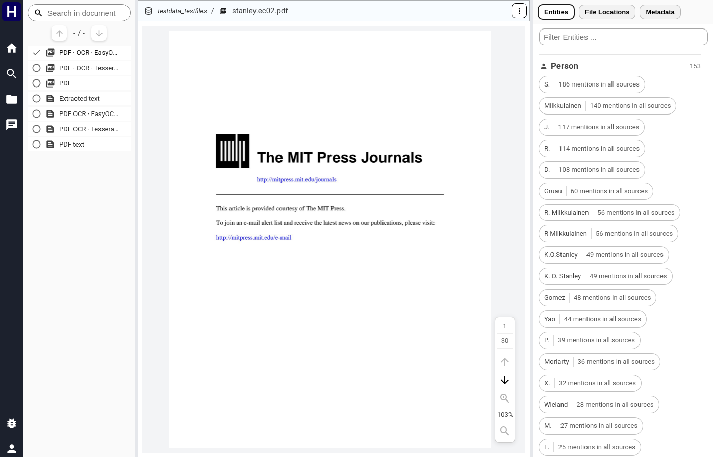</a>

PDF navigation uses document page numbers across all parts.
The viewer loads the required part when you change pages.
Complete PDF downloads include every part.

An image shows its dimensions next to the source, and the OCR variant shows what was read out
of it. A browser shows only some image formats. For the others, such as HEIC, TIFF and SVG,
the pipeline stores a JPEG copy, and the viewer and the text recognition use that copy. A
video shows its first frame before you start it. When an image has no such copy and the
browser cannot show it, the viewer gives a link that downloads the file.

<a href="img/document-image-ocr.png">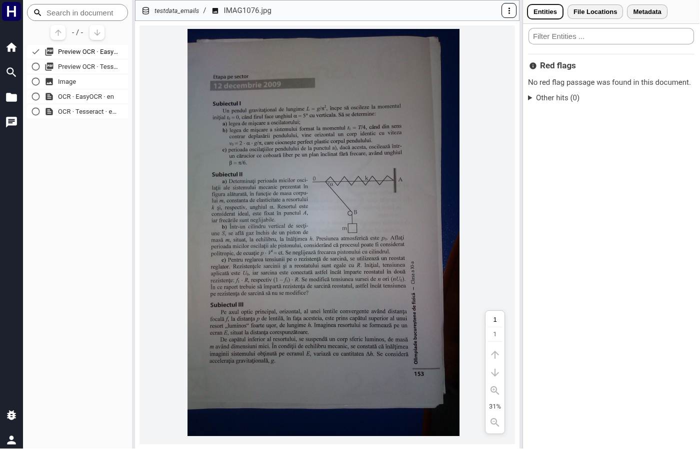</a>

 

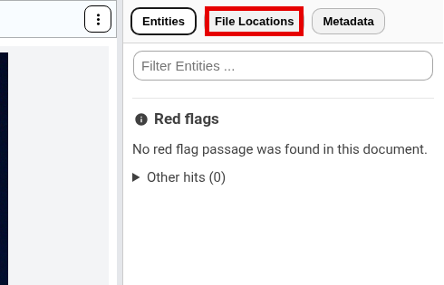

A file found inside an archive shows its container in the breadcrumb, here `parent.zip` above
`parent/child.txt`:

Select the **File Locations** tab to list the paths that contain the same content.
Use a path control to open its folder or copy the path.

<a href="img/document-file-locations.png">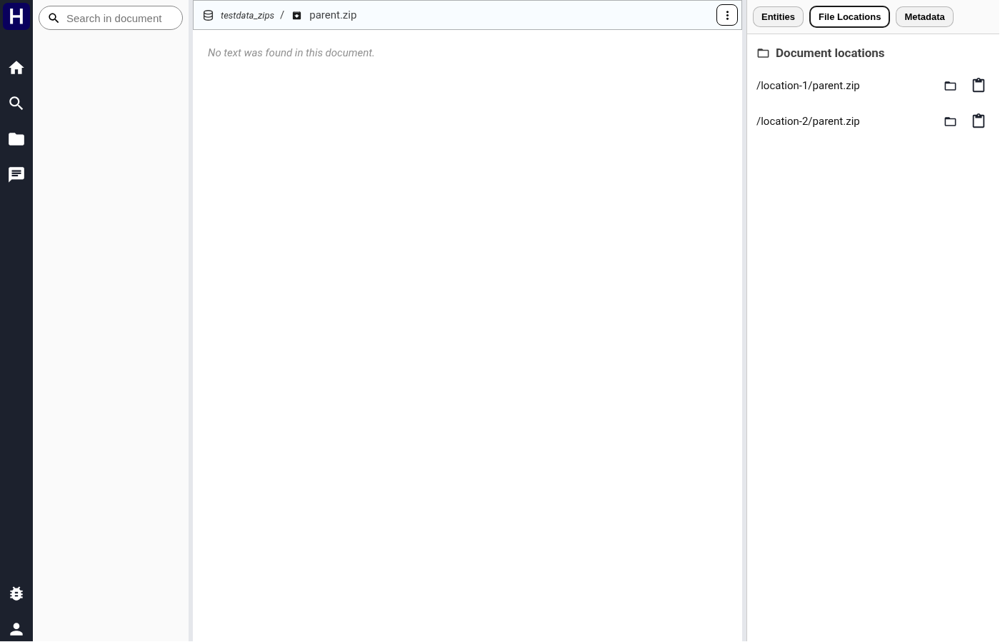</a>

### Searching inside a document

 

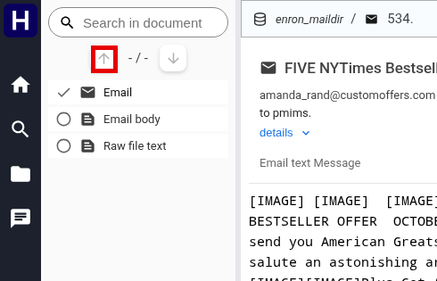

The box at the top left of the viewer searches the open document. Matches are highlighted and
the arrows beside the counter step between them.

### Entities

The right pane groups extracted names and structured values by category.
Model groups include **People**, **Organizations**, **Locations**, and **Misc**.
Structured categories include addresses, identifiers, amounts, and mentioned dates.
Counts include all sources. Use the box at the top to filter the list.

### Inspect an entity and its passages.

<a href="img/document-red-flags.png">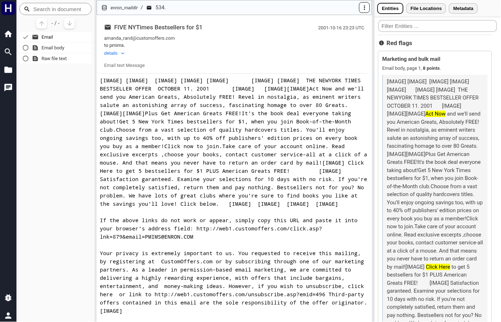</a>

The image shows scored red flag passages.

<a href="img/document-entity.png">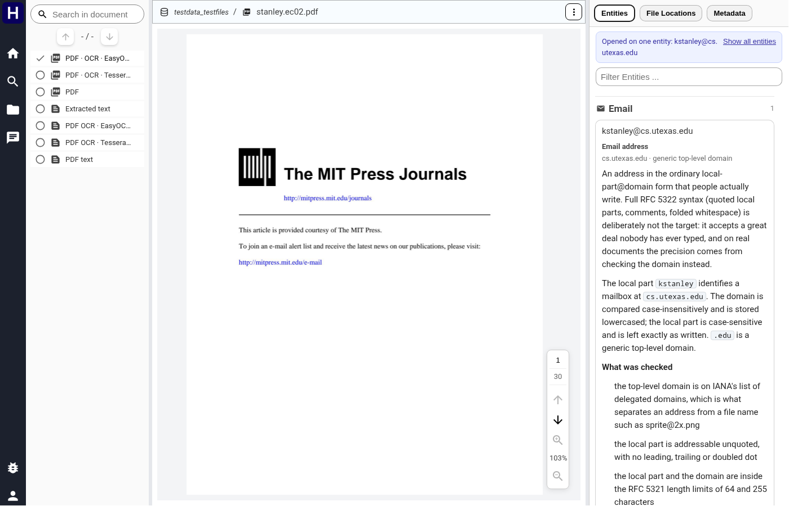</a>

The image shows the document entity controls.

<a href="img/red-flag-terms.png">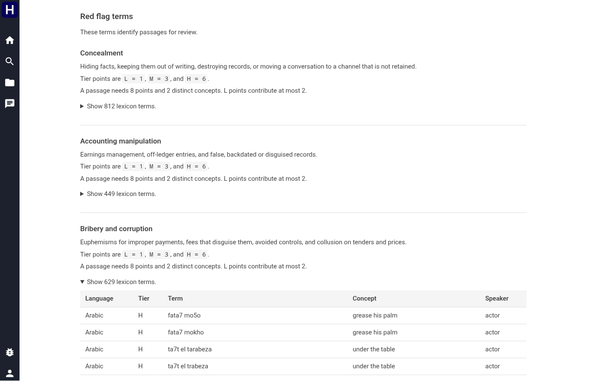</a>

 

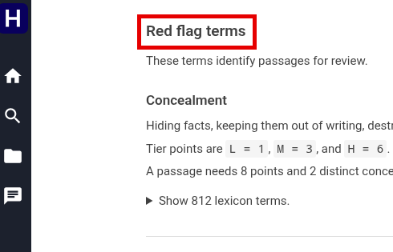

The image shows the red flag terms controls.

Select a structured entity value in the document pane to open its explainer.
Read the validated value, type, and detail rows.
Validation establishes the recorded property, such as a checksum, and does not establish ownership or authenticity.
Use source counts and matching passages to locate the extracted value.
Follow the available links to search that entity in permitted collections.

Open the red flag section to read the scored passages.
Expand a passage to inspect its supporting signals and source text.
Open **Red flag terms** to inspect the categories and terms used for scoring.

### Read a spreadsheet or table.

<a href="img/document-table.png">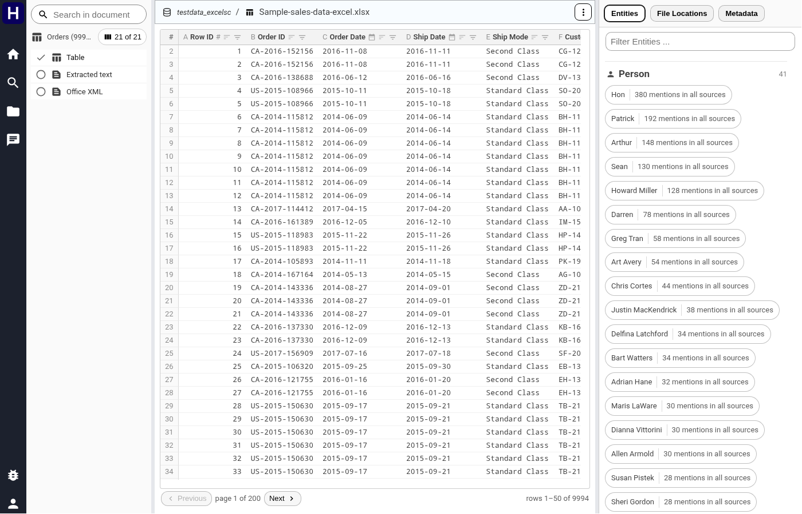</a>

The image shows the document table controls.

<a href="img/table-sheets.png">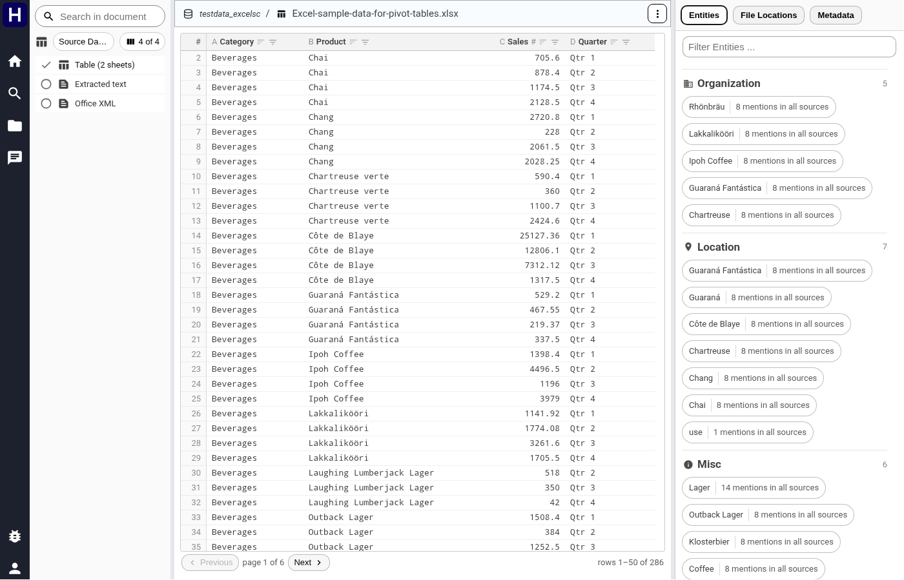</a>

The image shows the table sheets controls.

<a href="img/table-filter.png">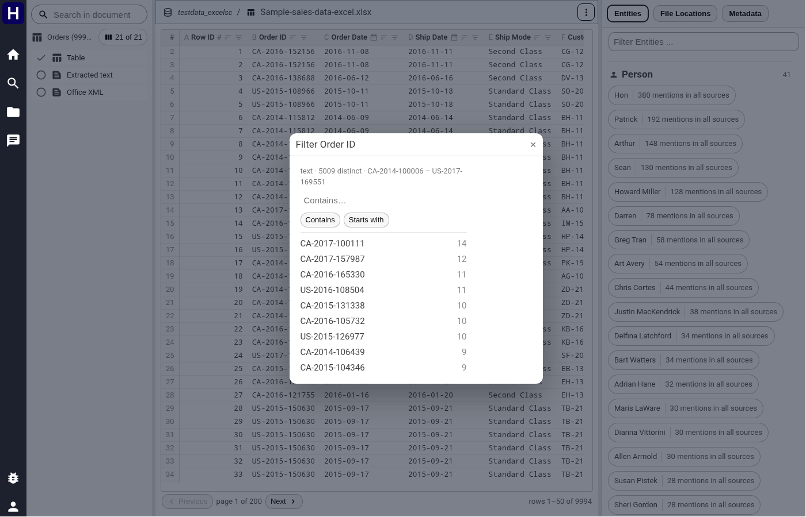</a>

 

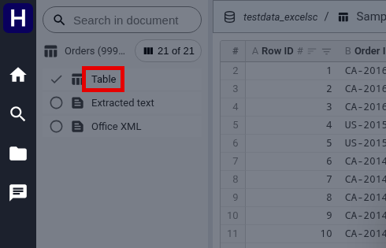

The image shows the table filter controls.

Select **Table** in the source list.
Choose a sheet from the sheet control.
Enter text in the cell search control to locate matching cells.
Cell search applies to the selected table and is separate from collection search.
Open a column control to inspect its values and apply a text, number, or date filter when available.
Select a column sort direction to order the matching rows.
Use the column controls to hide columns and restore them when needed.
Use the page controls to read additional rows.
Open a long cell value to read its complete stored text.
The server returns at most 200 rows and 60 visible columns per request.
A clamp or extraction notice describes a limit that affected the returned table.

### Read connected email.

<a href="img/connected-emails.png">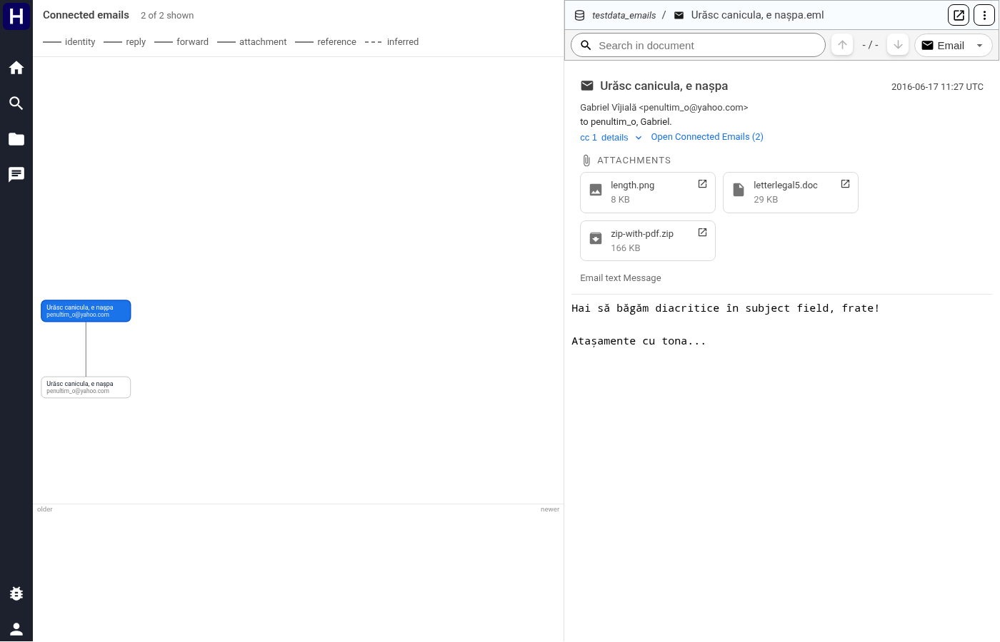</a>

 

The image shows connected email graph and selected message.

Select the **Email** source to read the subject, addresses, date, body, and attachments.
Expand header details when you need the complete stored headers.
Select an attachment to open its document.
Open the connected-email control to show the graph centered on this message.
Select a message node to read it in the preview.
Reply links show stored message relationships.
Time placement uses known message dates, while messages without known dates remain identified separately.
The graph contains at most 50 messages and traverses at most three relationship levels.
An absent message can be outside those limits. Search for it separately before concluding that it is absent from the collection.

### Metadata

 

The image shows the document metadata controls.

The **Metadata** tab holds everything the pipeline knows about the file: its dates and why they
are trusted, email headers, blob hashes and size, and the detected file types.

A PDF defect appears as `passworded` or `damaged` in its metadata.
The pipeline retains that metadata and skips later PDF processing.

### Downloading

**Download Document** in the ⋮ menu, or the same item in the viewer's own menu, saves the
original file under its real name.

 

---

## 8. Storage: browsing by folder

The folder icon in the rail opens **Storage**: the corpus as it is laid out on disk.

The landing page shows one card for each collection, with the same tree in the pane on the
left. A card shows the number of datasets and the summed documents, total size, indexed
documents and processing errors of those datasets. A card marked Processing belongs to a
collection whose data is changing.

Choosing a collection shows a card per dataset with its document count, total size, how many
are indexed, and how many hit processing errors. The pipeline counts these numbers during and
after processing. A dataset that it has not counted yet says so.

Choosing a dataset lists its contents, folders first, with **Files** and **Size** columns.
Files counts nested archive members and email attachments under each path.
Size counts bytes at the current container level, so archive members do not add their bytes to the archive size again.
Unavailable statistics remain unavailable until the pipeline computes them.
Select a file to open its preview beside the listing.

### The tree

 

In the left pane, the chevron opens a row and the label navigates to it, two separate
gestures, so you can look inside a folder without leaving the one you are in.

Large folders are summarised rather than dumped: a folder of 150 mailboxes shows the first
twenty and then `129 more below…`, which expands the rest on demand.

Deep paths are summarised the same way, in the other direction: the top of the path stays
put, the middle collapses into `35 more levels…` (click it to see them all), and the rows
around the folder you are in keep stepping in, so the chain reads as a chain however far
down it goes. Each of those rows also states its true depth in a `depth N` badge.

Drag the divider on the right edge of the pane to make it wider, and double-click the
divider to put it back. The width is remembered on this browser.

### Finding a file by name

The image shows folder scope opened in Search.

The box above the listing filters the **names** of files under the current folder. It does not
search their contents. `HOUSE` finds `HOUSE_OVERSIGHT_010560.txt`; searching for a word that
only appears *inside* the documents will find nothing.

 

For content, use **Open in Search**, which carries the current folder over as a *File location*
filter:

 

---

## 9. AI chat

Use AI chat to ask questions across the collections you can read.
The assistant can search documents, read their contents, and cite supporting passages.
When Internet tools are enabled, it can also search and read web pages.

Use these procedures to [start a conversation](#start-a-conversation), [inspect tool results](#inspect-tool-results),
[open citations](#open-document-and-web-citations), or [restore an earlier conversation](#earlier-conversations).

### Start a conversation.

1. Select the speech-bubble icon in the left rail.
2. Enter a question in **Ask the bot...**.
3. Set **Internet tools** before you send the first message.
4. Select the send arrow.

Name the collection, people, dates, and result you need.
For example, ask for dated Enron emails about California electricity prices and request source citations.
For a comparison, state which claims and sources the assistant must compare.

The Internet tools option stays fixed after the first message.
Start another conversation to change it.
Your deployment can hide this option when internet tools are unavailable.
The deployment selects the model. There is no model selector in the chat composer.

### While it works

The activity line shows when the assistant is working or waiting for capacity.
Tool groups appear as the assistant searches and reads sources.
Their summaries show completed work, elapsed time, and any failed tool calls.
A failed tool call does not necessarily mean that the whole turn failed.

Wait for a final answer before treating the result as complete.
Response time depends on the question, model, available sources, and service capacity.
You can draft another message while the current turn runs.

To stop the active turn, select the square stop control beside the composer.
Wait until the activity line and stop control disappear.
The partial answer is not saved as a completed answer.
The red message **This turn was stopped.** records the cancellation.
Earlier completed turns remain in the conversation.

### Inspect tool results.

 

Select **Show** on a tool-group summary to inspect its calls.
Select **Hide** to collapse the group again.
The expanded group can contain search, read, citation, web, question, and task-list cards.
An **Instruction to the agent** entry explains a system instruction that affected the work.
It is separate from an answer or an error.

Select **Expand** on an individual card to read its arguments and results.
Search cards show the query forms and returned documents.
**Search this** opens the corresponding search in the normal search interface.
When available, **Search every collection** removes that call's collection restriction.
Document rows open the document preview.

 

Read cards show returned text and page or source information.
Use **Show full text** when the card offers it.
Citation cards report whether the quoted wording was found, was not found, or was not checked.
Some cards also provide **Show raw JSON** for inspecting the complete displayed tool data.
When an entity card offers a validated value, select it to open its explainer in the document preview.

A task list records the assistant's goal and planned steps.
Completed steps can include the reason for completion.
The list helps you follow the investigation. Its completion does not verify the answer's claims.

### Reading the answer

Scroll through the answer and read its qualifications as well as its conclusions.
The answer can distinguish document evidence, external evidence, inference, and information that the search did not establish.
A missing match does not prove that an event did not occur.

Document references use labels such as **[D1]**. Web references use labels such as **[W1]**.
The corresponding source cards appear beside the passages that use them or below the answer.
Read the quoted passage and its document context before using the claim.
An unverified quote message means that the displayed wording was not verified against the source.

### Open document and web citations.

Select a document citation label or source card to open its preview beside the conversation.
The preview can select the cited source, page, and search phrase.
Use the document controls to inspect the surrounding text, attachments, metadata, and other available sources.
The open-document action opens the complete viewer when you need more space.

Select a web citation to open the captured page beside the conversation.
The preview shows the text the assistant read and can highlight the cited wording.
Use the page's original link when you need to compare the current website with the captured text.
A current website can differ from its earlier capture.

Close the preview to return the conversation to the available width.
Drag the pane divider to change the space assigned to the conversation and the source.

### Search in a conversation.

 

Enter a phrase in **Search in conversation** above the transcript.
The counter shows the current match and total matches.
Use the previous and next arrows to move between matches.
Clear the field to remove the conversation search.

 

Long user messages initially show three lines.
Select **Show** on the message to read all of it.
Select **Hide** to collapse it again.

### When it fails

A red error message states why a turn could not finish.
A deliberately stopped turn also uses a red message, with the wording **This turn was stopped.**
Read the message before deciding whether to retry.
A tool group's failure count describes its calls and does not itself establish that the answer failed.

When a failure lists attempts, expand that list to inspect their errors.
An answer that succeeded after retries can also show an attempts disclosure.
A service interruption can instead produce an interruption notice.
Ask again when you need a replacement for an unfinished answer.

### Continue a conversation.

Enter a follow-up in the same composer to continue with the conversation's earlier context.
Refer to a document or citation label when your question depends on that source.
If **Suggested next...** appears, select a suggestion to copy it into the composer.
Review or change the text before sending it.

When the assistant asks a question, select an offered response or enter your own answer.
Context notices describe summaries used for long conversations.
Expand a notice to inspect its details and displayed token counts.
A summary can omit earlier detail. Repeat a source or requirement when it remains necessary.

### Earlier conversations

Select **History**, or **View all conversations** on the chat home page, to open the conversation list.
Select a title to restore its transcript.
The list shows its summary, message count, and last update.
**Show board chats** includes the explore conversations created by your investigation boards.

 

Use the deletion control only for a conversation you no longer need.
Board explore chats have no separate deletion control. Their board manages them.
Chats remain stored until a person deletes them.

 

## 10. Investigation boards

Use a board for an investigation with one or more goals.
The board creates research directions, explores them in separate chats, and records findings with sources.
You review its proposed answers and decide whether they satisfy the goals.

Use these procedures to [create a board](#create-a-board), [read findings](#read-findings-and-ask-questions),
[accept an answer](#accept-an-answer), [complete the review](#complete-the-review), or [correct a result](#correct-a-result).

The right side of the AI chat home page lists your boards.
Each card shows a graph preview, summary, status, and last update.
Select a card to open the board.

### Create a board.

1. Select **New board** on the AI chat home page.
2. Enter a title and between one and six goals.
3. Enter background context that defines known facts, constraints, and the required result.
4. Select the collections to search.
5. Enter initial hints when you have useful leads.
6. Set **Internet tools** when the investigation must compare documents with online sources.
7. Select **Create board**.

The collections stay fixed after creation.
Write goals that you can review separately.
For example, separate a question about dates from a question about competing explanations.
A hint supplies a lead. A goal defines an answer that the board must provide.

### Read the graph.

The graph appears on the left, with the overview or selected card on the right.
It connects the background context, research directions, findings, and goals.
A complex graph can extend beyond the visible pane.

 

| Card | Meaning |
|---|---|
| background | The selected collections and background context. It has a black border. |
| goal-01, goal-02 | A goal. It is blue and shows whether its answer is proposed or accepted. |
| intent | A research direction. Its state can be open, running, concluded, failed, question, or cancelled. |
| finding | A sourced, inferred, or not-found result from an explore. |
| correction | Your recorded correction of a rejected answer or result. |

Drag the graph to move through it.
Use **-** and **+** to change its zoom between the available levels.
Select a card to read its complete text and controls in the right pane.
Selecting a distant card can move the graph to show it.

 

The page address records the selected card.
Copy the address to bookmark that finding or goal.
Opening the link still requires access to the owning account.
Select **Show the board overview** to return to the full goal and event list.
The graph and detail pane can scroll independently.

Select **AI Chat** to return to your board list.
Opening another board keeps each investigation's goals and findings separate.

### Read findings and ask questions.

Select a finding to read its statement and supporting source cards.
A **sourced** finding includes supporting source citations.
An **inferred** finding expresses an inference. A **not found** finding records an unsuccessful search.
Verify the cited passages before relying on the statement.

 

Scroll the detail pane to its **Open questions** section.
**Explore this question** starts an explore for a listed question.
A question already followed by the board links to the intent that explores it.

To ask your own question, enter it in **Ask about this finding** and select **Ask**.
For a question about the overall investigation, select the background card and use **Ask about the background context**.
The new explore records its result as another finding.

A question does not keep the whole board open.
On a completed board, the requested question can run as a separate explore.
Add a goal when the board must answer the question before the investigation is complete.

### Follow an explore into its chat.

Select an intent to read its objective, brief, state, attempt count, and creation time.
Select **Open the explore chat** to inspect its research conversation in a new tab.
A finding provides the same action for the explore that produced it.

 

A finding's source card opens that explore chat with the document preview selected.
Use the chat's tool groups and citation cards to inspect the searches and evidence.
The **Investigation Board** link returns to the board.
The coloured finding summary at the end of the explore chat opens its finding on the graph.

### Review answers and change settings.

The overview lists every goal and its current answer.
A dashed answer border and **Proposed answer** label identify an answer that still needs your review.
The **From the findings** links identify the results used to build that answer.
Open those findings and inspect their sources before deciding.

The board can propose answers for some goals while it continues work on others.
When every open goal has a proposed answer, the board waits for review.
The header then shows **Waits for review**.

### Accept an answer.

 

1. Select the goal, or find its proposed answer in the overview.
2. Read its qualifications and follow the supporting finding links.
3. Select **Accept answer** when the result satisfies the goal.
4. Wait for the accepted answer to replace the proposal.

The answer label changes to **Answer**, and its border becomes solid.
The accept and reject controls for that proposal disappear.
Other proposed answers still need a decision.

An accepted answer can state that the records did not establish the requested fact.
The interface identifies an answer supported only by not-found findings.
Accept it when that qualified result satisfies the goal.
Reject it when further investigation is needed.

### Complete the review.

Accept each remaining goal answer separately when you need individual decisions.
Alternatively, select **Close the board** in the review section to accept all proposed answers and stop the board.
Wait for the header to show **Completed**.
Accepted answers remain available with their supporting findings and explore chats.

A smaller completed board shows the same relationship between its graph, goal answer, and event record.

 

Adding a new goal reopens a completed board while preserving its accepted answers.
Use **Add goal** in the overview when another required question belongs to the same investigation.
A board has at most six goals.

### Correct a result.

 

To reject a proposed answer, enter why it is wrong or incomplete beside **Reject answer**.
Select **Reject answer** to continue investigation with that correction.
The other answers wait for your review.
Use **Continue with a correction** when you need to correct the overall review.

To reject a finding, enter its problem under **Reject this finding** and select **Reject finding**.
The board stops using that finding. The intent that produced it stays in the graph.
A correction can itself be rejected through **Reject correction**.

Use **Add hint** in the overview to supply a lead for the next assessment.
A hint can also answer an explore that asked you a question.
A pending action stays disabled until the board processes it.
If the action is refused, read the reason above the board before trying again.
A newer assessment can invalidate a decision on an older proposal.

### Change board settings.

Select **Settings** above the graph to open the board settings.
The dialog lists the fixed collections and available controls.
**Internet tools** changes access for later explores. Running explores keep their earlier setting.
Use **Pause the board** or **Resume the board** when the current state offers that action.

 

Pausing cancels running explores and prevents new work until the board resumes.
It differs from accepting answers and completing the review.
**Drop the board** requests deletion and requires the separate **Confirm drop** action.
Use **Close** to dismiss the settings dialog without dropping the board.

### Read the explore budget.

 

A board starts with 30 explores.
Each goal after the first adds 25. Each hint, question, or correction adds 4.
A board never receives more than 300 explores.
Near that limit, an action adds fewer explores, and its event records the actual increase.

When the board uses its budget, it makes a final assessment and waits for review.
**Reopen with 50 more explores** continues open goals while preserving findings and accepted answers.
Near the limit, the button states the smaller available increase.
At a budget of 300, it offers only the remaining unused budget.
A board that already used 300 explores starts no further work and links to a new board.

The reopen control can also appear on a completed board with a goal that lacks an accepted answer.
Review the existing evidence before starting more work.

### Read events and statistics.

Return to the board overview and scroll the right pane to **Events**.
The table records actions, status changes, explore attempts, assessments, and review decisions.
It lists the newest 200 events first. **Show all** expands an available longer history.
Your actions show your account name in bold.

An event can link to its card or explore chat.
Select **Show details** on an assessment to inspect its recorded prompt, response, and checks.
This helps explain why the board proposed an answer or changed direction.

**Statistics** below the events shows the explore budget, model steps per explore, assessments, intents, findings, collections, and creation time.
The counts distinguish sourced, inferred, not-found, and rejected results.
Use these counts and the event history when deciding whether to refine a goal or continue the investigation.

 

---

## 11. Sharing and bookmarking

Copy a view address to share its query or selected item:

* a search carries its query, filters, sort, page and selected document, so sending someone a
  search sends them the exact search;
* a document has a permanent link, from *Copy Document Link* in the ⋮ menu;
* a chat conversation has one too.

Recipients need permission to read the selected collections.
Chats belong to their owner, so copying a chat address does not grant another account access.
Board addresses also require the owning account.
Earlier Hoover4 search fields can take their current defaults when a bookmark omits them.
Legacy Hoover URLs do not automatically migrate to Hoover4.
A route that cannot be decoded shows **Page not found**.

---

## 12. Review search and processing limits.

These are properties of how search works here, not faults, and each has a visible sign on
the page.

**Only the first 1 000 documents of a match are reachable.** A corpus-wide query can report
tens of thousands of documents found over a pager that ends at 1 000: the count is the size
of the whole match, and the pager is what you can walk. The page states the difference beside
the count rather than implying the rest are reachable. Narrow the query (with words, a
filter, or a folder) to bring what you want inside the reachable range.

**Assistant tools can continue results.** When a collection tool returns a `more` handle, the assistant can call `read_more`.
The handle belongs to the same user, conversation, and run.
Continuation follows the original search window and does not remove the backend result limit.
Full-text document search can reach the first 1,000 matching documents.
Passage retrieval has a separate per-query limit, which defaults to 15 and follows deployment configuration.
Ask a narrower question when the available results do not cover the required material.

**A document with no confirmed date can never fall inside a date range.** It matches only
through the *no confirmed date* option, which is why that option exists alongside before,
after and between. A range that silently included undated documents would be a different
question from the one you asked.

**Filter counts are counts within the rest of the query**, not counts in the corpus. A chip
showing 12 means twelve documents among those that already match everything else you have
set.
